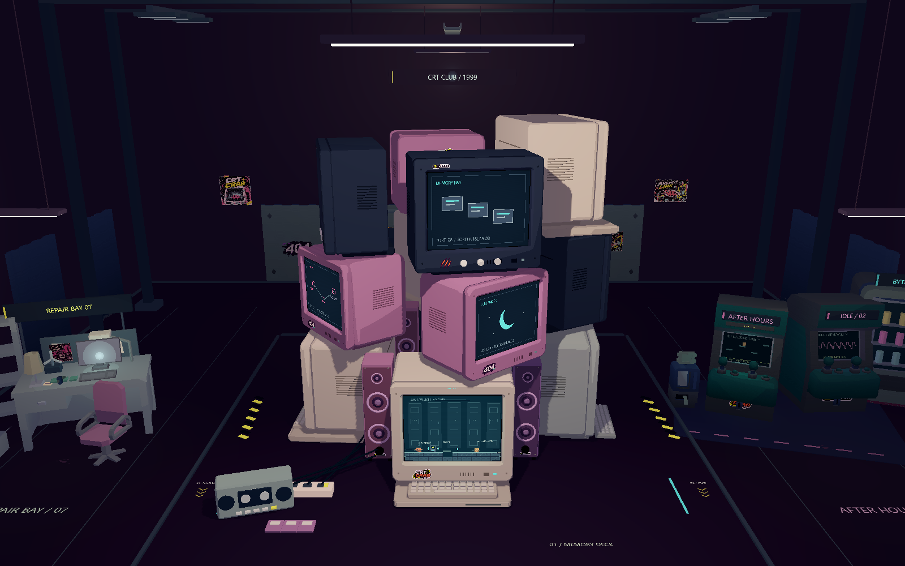
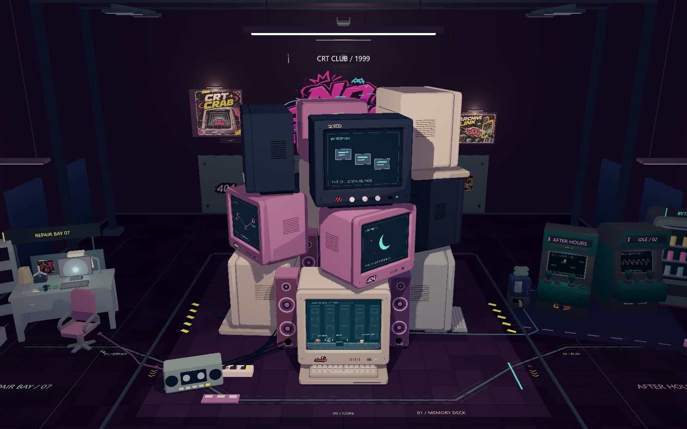
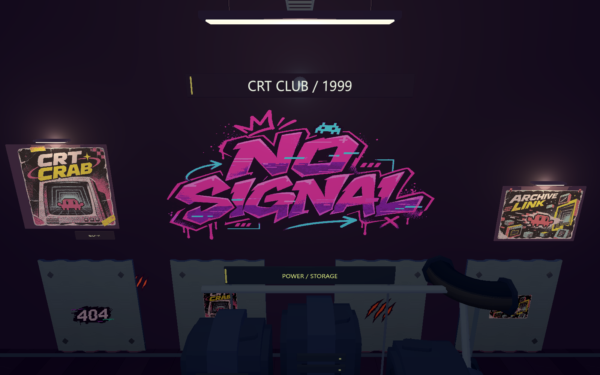
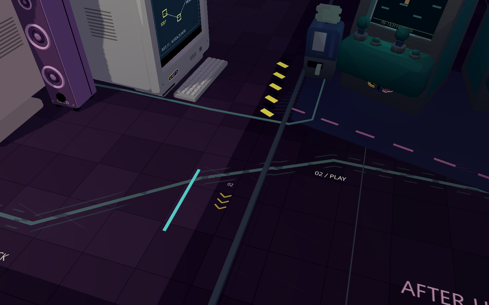
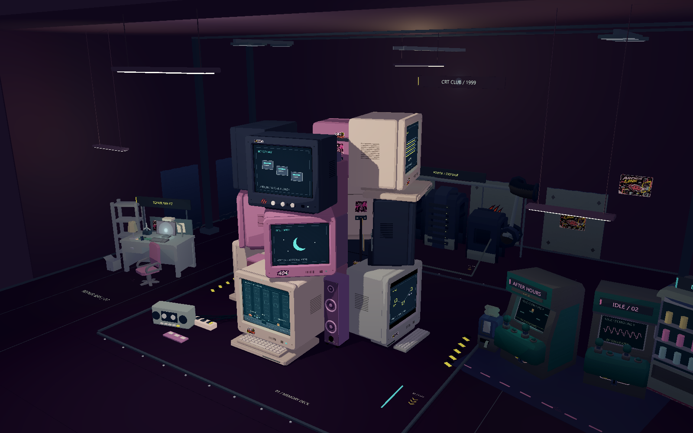
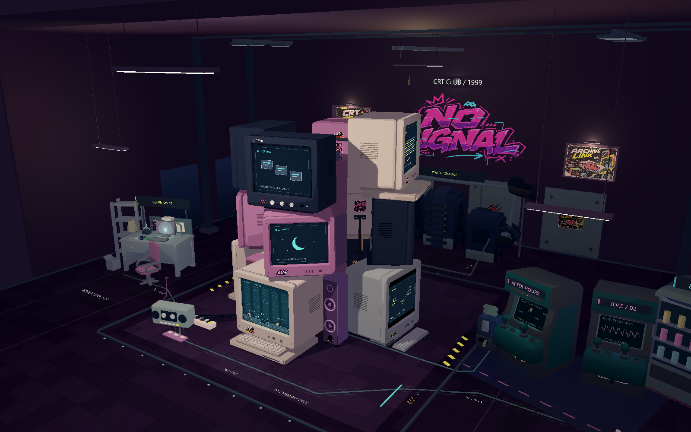
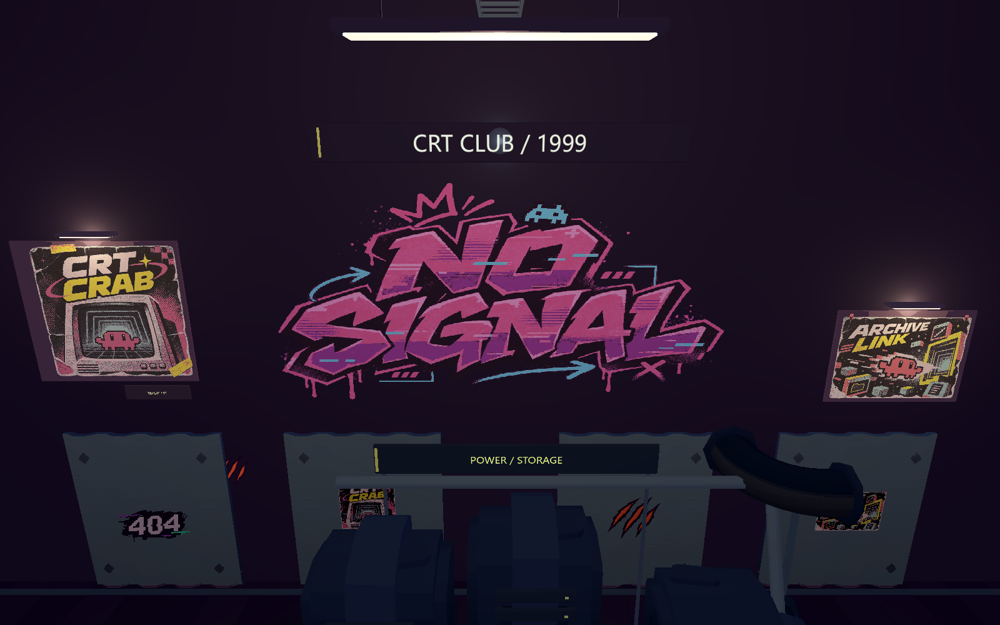

# 游戏厅氛围第二轮：后墙与地面联系

2026-11-06。在现有游戏厅上增量调整，保留电脑塔、街机、维修区和供电区布局。下方图片均为 Godot 4.7.2 / OpenGL Compatibility 的 1600×1000 实机渲染。

## 后墙与局部亮度

- 用户新提供的 **NO SIGNAL** 大贴纸放在后墙中央，位于 CRT CLUB / 1999 下方、POWER / STORAGE 上方，按标注红框调整至 16.5×8.8 场景单位，中心世界坐标为 (0,10.75,-24.745)。原 PNG 原样复制，使用已有透明裁切贴纸材质；随墙体一起显隐。
- 两侧海报扩大至宽 5.4 / 4.6，采用不同高度，补薄灯箱边框与有实体来源的暖色画灯。贴纸与海报使用低强度发光，保留暗环境中的辨识度。
- 顶部招牌稍加宽、文字更清楚，局部光范围略增。环境背景、全局环境光与主要日光灯亮度保持原值，新增的两盏画灯使氛围层局部点光源由 19 增至 21；无聚光灯、无 Bloom。

素材文件为 `assets/environment/decals/user/no_signal_wall.png`，来源和 SHA256 记录在同目录 `source_manifest.json` 的 `additional_images`。后续按用户提供的低饱和版本替换，保持场景位置与大小；使用保留调色板的最近邻缩至 720×540，PNG 为 39,136 字节，低于 40,000 字节，保留原颜色与透明背景。下方截图记录初版氛围，最新贴纸效果见文末。

## 地面与区域联系

- 在原地台和外围地面上复用同一个世界坐标地面 shader，以相近深紫色区分核心区与外围，细砖缝、少量深浅色块保持低模风格，没有新增高台或照片纹理。
- 褪色青绿导视线与虚线从核心区延伸到左右区域；保留黄色警示线与箭头，补 00 / CORE、01 / SERVICE、02 / PLAY 编号。
- 线缆沿地面边缘经过维修侧，另一条从现有 CRT 出线口绕向街机背面插头，避免横穿屏幕与街机机身。连接使用已有线缆和静态批处理工具。
- 通行路径增加轻微磨损，塔边增加三处拖动痕迹，墙角轻微变暗。粗糙度 0.68–0.80、低高光接住局部灯光，不使用镜面或屏幕空间反射。
- 边缘只增加一只带盖与拉环的双色饮料罐、两枚硬币和小插头，保持通道与电脑塔附近留白。

调整集中在 `scripts/arcade_ambience.gd` 与 `assets/shaders/arcade_floor.gdshader`。原游戏厅氛围开关仍可恢复旧环境；材质、局部灯强与装饰控制继续独立可调。

## 同机位正面对比

“调整前”取自上一版 `1c658e1` 的已应用游戏厅效果，不是关闭整个艺术层。两图相机同为 (0,17,34)，目标 (0,6.4,0)，FOV 43。

| 调整前 | 调整后 |
| --- | --- |
|  |  |

正面机位中电脑塔自然遮住部分墙画，以下后墙细节图展示完整位置。

## 后墙细节

## 地面细节

## 左右区域与核心区广角

| 调整前 | 调整后 |
| --- | --- |
|  |  |

## 验证

- [艺术层 37/37](arcade_round2_evidence/arcade-hall-qa.json)：全部十二屏聚焦、72 步环绕、房间剖视、外围机台可见性、独立开关与设置持久化；艺术层开关前后内部像素帧缓冲逐字节相同。
- [玩法回归 89/89](arcade_round2_evidence/sideview-qa-visual.json)：原 BOOT / ARCHIVE 动作解谜及相关流程通过。
- [几何检查 55/55](arcade_round2_evidence/geometry-checks.json)，[十二台承托检查通过](arcade_round2_evidence/crt-stack-check.json)：原 CRT、填充设备与既有大型装饰的检查未发现碰撞；全部十二台保留承托关系。该检查使用实际壳体平面与旋转包围盒，不是物理仿真。
- 三组本轮 Godot 运行错误日志均为空；布局、屏幕映射、主流程、CRT 设备与存档脚本无修改。

本机 RTX 5060 Ti、1600×1000 下，艺术层开启的正面/背面/聚焦强制渲染加 GPU 读回中位耗时分别为 24.04 / 23.94 / 24.00 ms，P95 为 26.85 / 26.37 / 27.10 ms（每机位预热 20 次、采样 60 次）。这是同一运行中艺术层开关的测试，不代表上一版本与本轮的耗时差，也不等同于正常游戏 FPS。

## 低饱和贴纸替换

