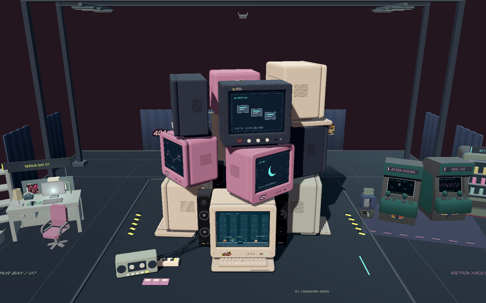
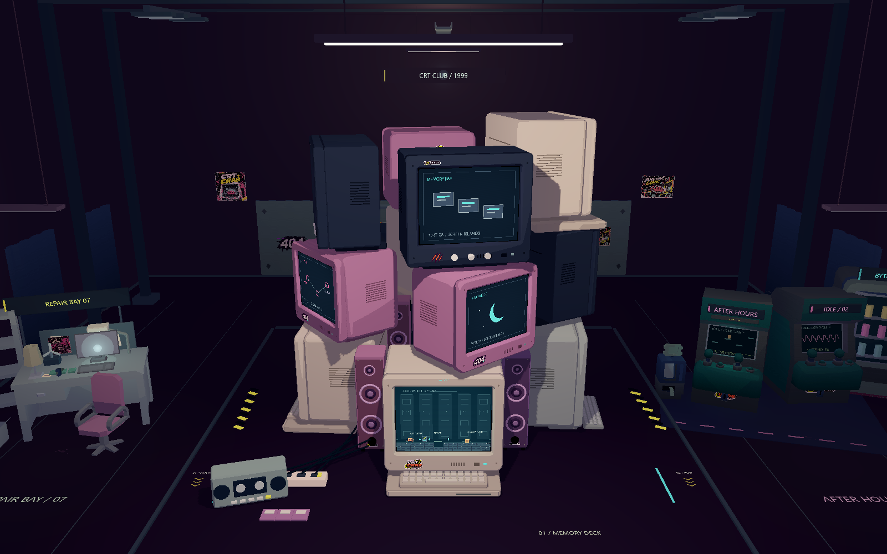
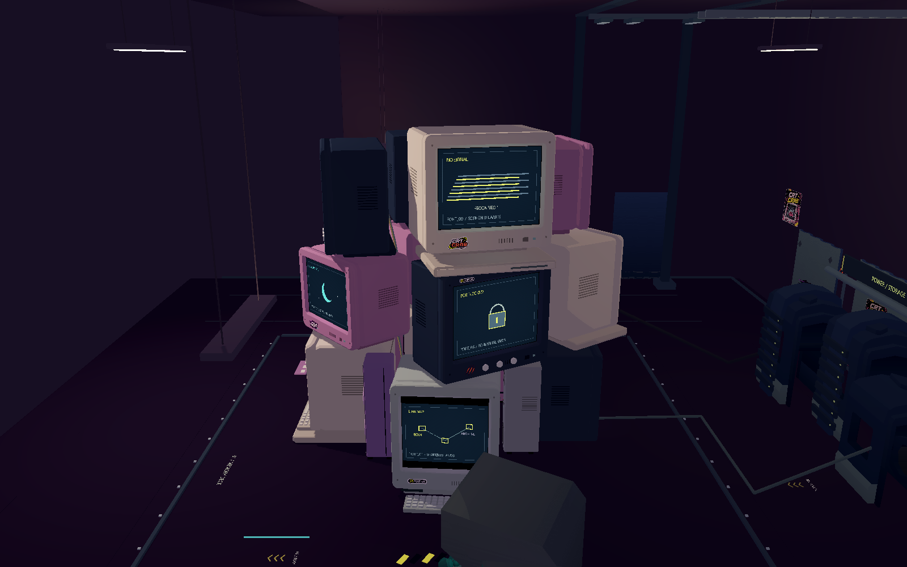
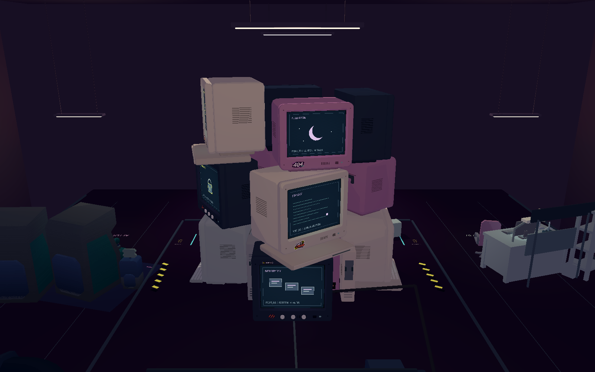
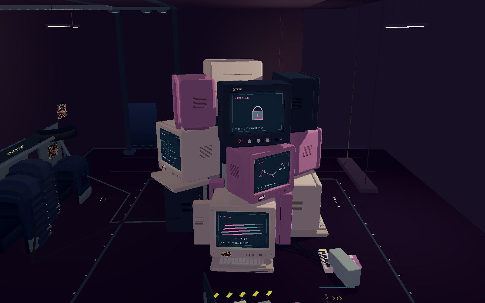
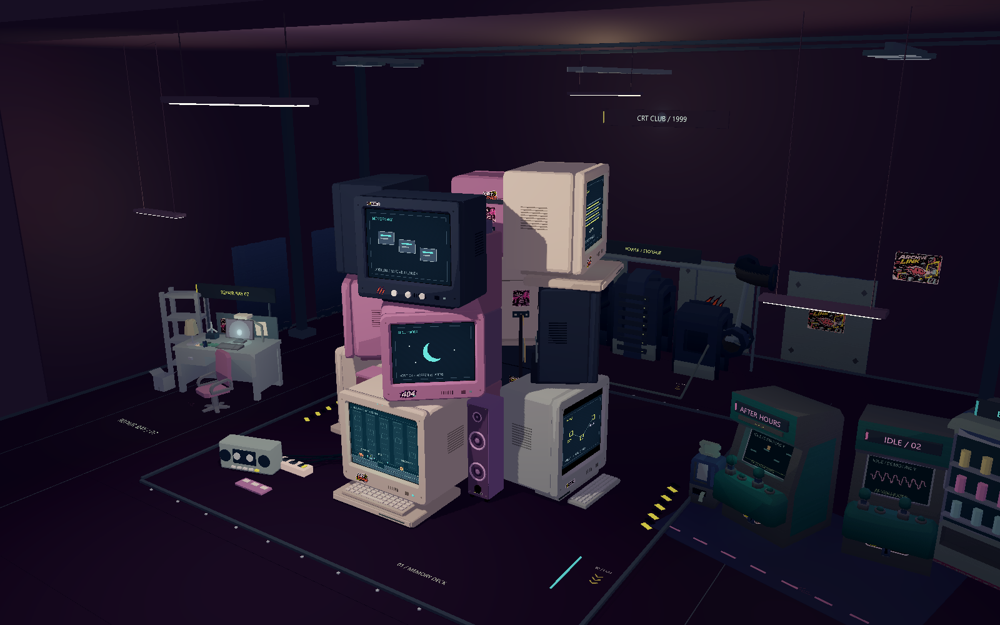
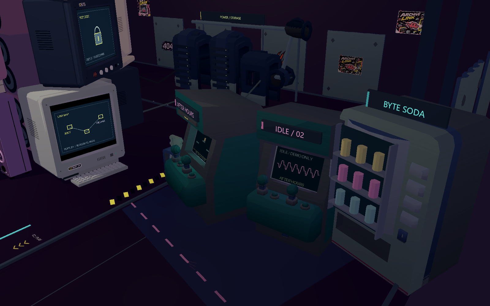
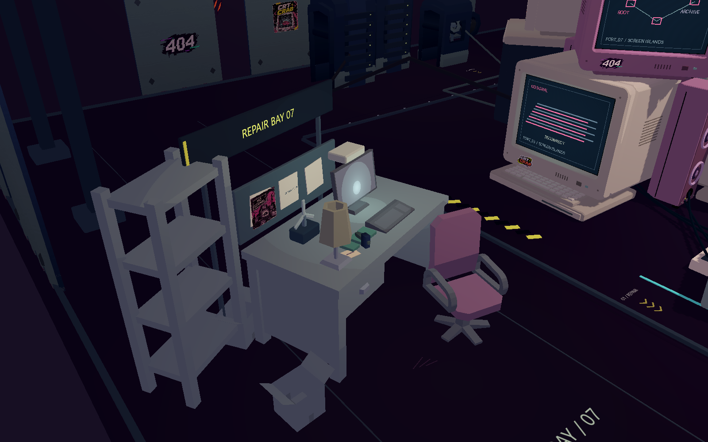
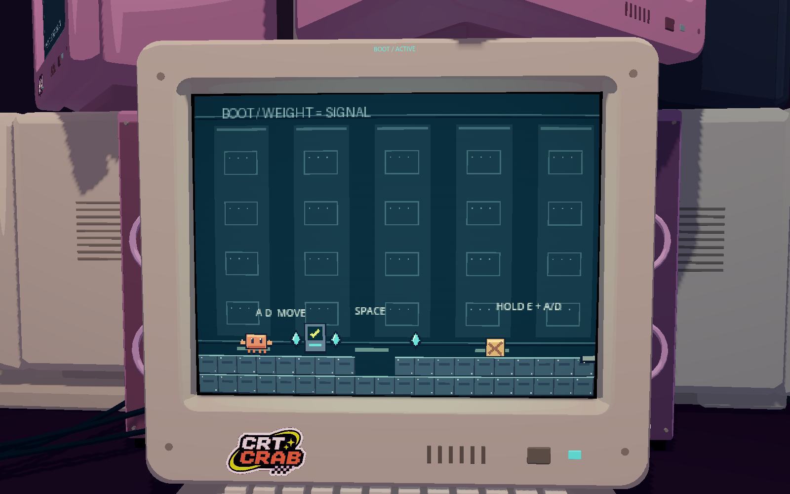
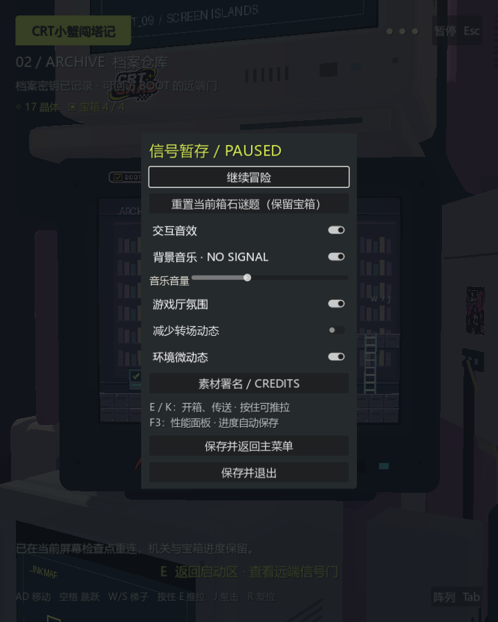

# 复古游戏厅全场应用与粉紫音响验收

2026-11-06。用户确认局部样板方向后，正式接入正常启动流程。BOOT / ARCHIVE、三段传送、存档和原十二台电脑布局保持原样。

## 实际完成范围

- 三只新增竖式音响由深灰改为与电脑呼应的粉、紫色，环形悬边、防尘帽与振膜也统一为低饱和粉紫。A 宽 1.25 → 1.44（+15.2%）；B/C 宽 1.15 → 1.32（+14.8%）。两侧各外移 0.12，后侧 C 横移 0.05、前移 0.2，确保加宽后仍不穿插。原中央音箱柜也改为偏粉紫的暗色。
- 全场普通不透明材质采用三档角度明暗，覆盖十二台 CRT 外壳、音响、主机、街机、维修和供电区。保留低模厚度与原贴图；不加轮廓黑线、不做写实金属或大面积 Bloom。
- 像素屏幕 shader、QuadMesh 大小和内容比例、关卡映射均保留；透明贴纸、发光指示与街机显示内容不被普通材质替换。
- 四组有可见灯管、外壳和吊线的日光灯，分别服务前区、后区、街机区和维修区；十二块 CRT 有短距离青绿/粉紫局部光，两台街机屏幕和后墙灯箱另有低强度局部光。新层共 19 个局部点光源，只有主灯投射阴影，避免灯光成本无节制增长；原无可见来源的两盏方向光在新层启用时关闭。
- 现有地台与外围地面统一为深紫黑、高粗糙度材质，仅保留少量柔和高光。没有镜面反射或全屏泛光。
- 增加三面墙和顶面，把原机器群纳入房间。未再堆放电脑或大型设备；全部原 CRT、街机、维修工位、供电储存区和外围模型保留。
- 复用用户海报，在后墙两处补招贴、一处小涂鸦；加入 CRT CLUB / 1999 灯箱、街机价格小标、三组地面区域编号与箭头、维修桌边便签及两处极少量地面擦痕。近塔区留白，远区照度和对比度低于近景。
- 自动剖视墙面和顶面，保护屏幕聚焦、塔的 360° 观察以及街机/维修近景。墙上贴纸与墙体共用显隐，避免留在空中。

## 正式使用与单独关闭

主菜单“游戏设置”和暂停菜单均有 **游戏厅氛围** 开关，随视觉设置独立持久保存，不改冒险存档。关闭后恢复原材质、环境、方向光并隐藏本次围合/灯具/装饰；粉紫加宽音响作为模型更新仍保留。

开发调整集中在 `scripts/arcade_ambience.gd`：`cel_shading_enabled`、`source_light_scale`、`decorations_enabled` 分别控制材质、局部灯强度和围合装饰，修改后调用 `set_enabled(enabled)` 生效。原样板脚本仅作为兼容入口复用此实现。

## 同机位正面对比

旧整体截图为 42b46d1 的真实游戏场景（黑音响、未默认应用样板）；新图为当前默认启用效果。相机同为 (0,17,34)，目标 (0,6.4,0)，1600×1000，未修图。

| 原整体 | 当前整体 |
| --- | --- |
|  |  |

## 当前游戏厅四向实机

| 正面 | 右侧 |
| --- | --- |
|  |  |

| 背面 | 左侧 |
| --- | --- |
|  |  |

### 房间与分区



| 街机 | 维修 |
| --- | --- |
|  |  |

### 像素游戏与暂停开关

| 聚焦屏幕 | 720×900 暂停 |
| --- | --- |
|  |  |

## 验证结果

- 全场艺术层：33/33，包括默认接入、十二台材质、三只音响宽度和颜色、灯源/无 Bloom、原方向光关闭、开关前后像素帧缓冲逐字节一致、72 角度环绕、十二台聚焦、外围机位剖视、主开关和各独立参数、设置持久化。
- 网格与承托：55/55，十二台直接承托 12/12；电脑、五件填充物和既有塔内大件之间未检测到组件包围盒穿插或意外承托。
- 实际显卡玩法/环境回归：89/89，含 BOOT → ARCHIVE → BOOT → ARCHIVE、失败回滚、机关、存档、720×900 与暂停。
- 无窗口玩法/环境回归：87/87；主菜单/换装/购买/设置/返回流程：无窗口与显卡各 49/49。新开关通过真实键盘激活路径验证。
- 最终上述运行及性能探针的错误日志为空；正式冒险数据未被 QA 读写。原 `monitor_layout.json`、屏幕 shader/映射、存档事务与传送导演代码未改动。

## 性能与边界

在同一份当前模型上切换艺术层，独占显卡运行，1600×1000；每机位预热 20 帧、采样 60 帧强制渲染＋GPU 图像读回。不是游玩 FPS，数值包含读回开销，小幅差异可能含测量波动。

| 机位 | 关闭氛围中位 | 开启氛围中位 | 变化 | 开启 P95 |
| --- | ---: | ---: | ---: | ---: |
| 正面 | 20.917 ms | 21.835 ms | +4.4% | 24.559 ms |
| 背面 | 21.151 ms | 21.816 ms | +3.1% | 24.304 ms |
| BOOT 聚焦 | 21.613 ms | 21.415 ms | -0.9% | 24.012 ms |

另在 1280×800 运行既有整场与三段传送性能探针，转场渲染读回 P95：EXIT 21.031 ms、LINK 24.141 ms、ENTER 23.837 ms。原始数据、引擎/GPU 信息和方法见 [performance.json](arcade_hall_evidence/performance.json) 与 [arcade-hall-qa.json](arcade_hall_evidence/arcade-hall-qa.json)。未做移动设备 GPU 或导出包的性能承诺。

墙体剖视是观察/运镜的显示策略，不是可碰撞房间玩法；不会引入屏幕外操控。此轮没有新增关卡或改变已有谜题规则。

## 复现

```powershell
.\.tools\godot\Godot_v4.7.2-stable_win64_console.exe --path . --script res://tests/arcade_hall_qa.gd -- --qa
.\.tools\godot\Godot_v4.7.2-stable_win64_console.exe --path . --script res://tests/crt_geometry_qa.gd -- --qa
python tools/check_crt_stack.py
.\.tools\godot\Godot_v4.7.2-stable_win64_console.exe --path . -- --qa --environment-qa
.\.tools\godot\Godot_v4.7.2-stable_win64_console.exe --path . -- --qa --menu-qa
.\.tools\godot\Godot_v4.7.2-stable_win64_console.exe --path . -- --perf --transfer-perf
```

新增造型、灯具和图形均为 Godot 原生代码；海报继续使用已有用户素材，没有引入外部美术资源。研究来源保留在 [历史样板记录](ARCADE_STYLE_SAMPLE.md) 的官方参考链接中。
