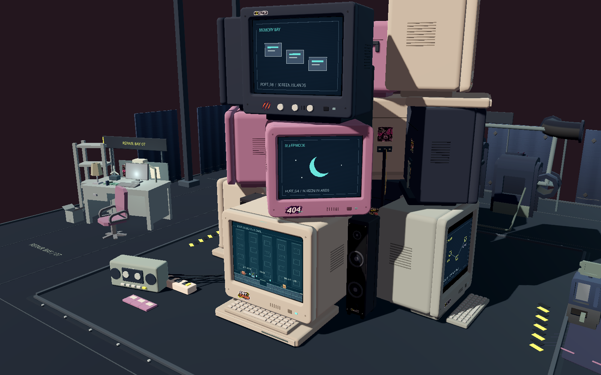
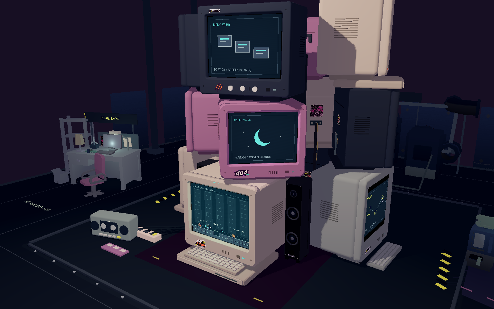
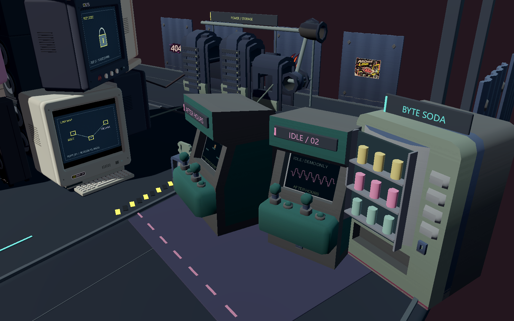
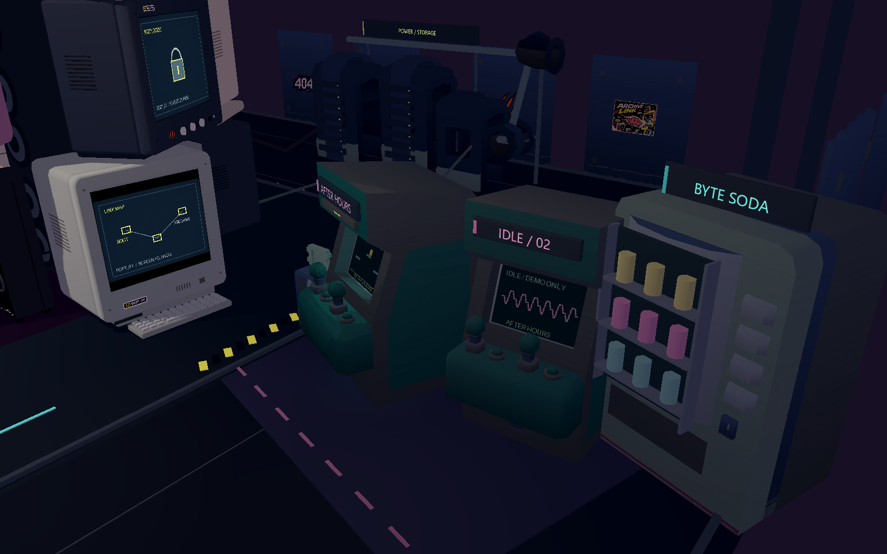
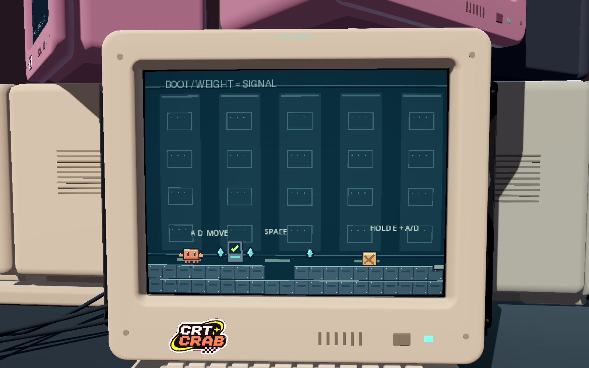
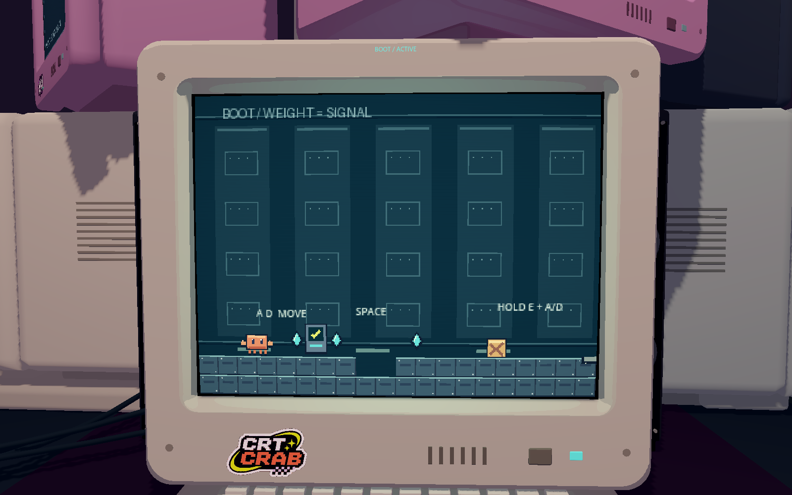
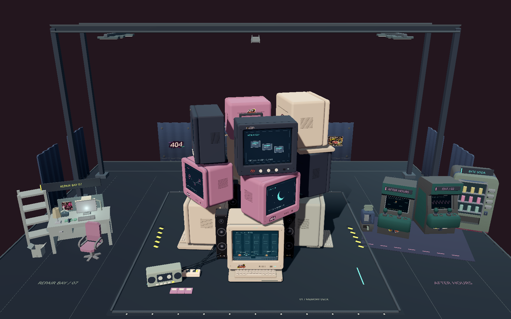
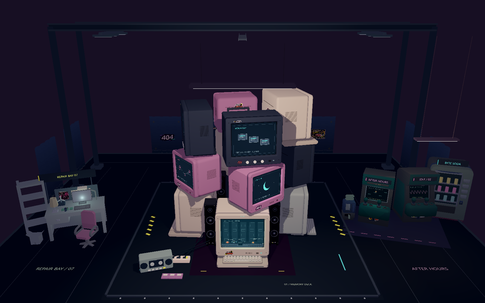

# 复古游戏厅材质与灯光样板 · 历史对比（已确认）

> 样板方向已获确认并应用全场，当前效果与验收见 [ARCADE_HALL_UPDATE.md](ARCADE_HALL_UPDATE.md)。本页保留当时样板的数据。

2026-11-06。基于 42b46d1，在现有真实场景中制作局部样板。按本次要求先对比确认，再推广全场。当前正常启动的主场景没有接入样板；所有原有排列、堆叠与模型保持原样。

## 样板覆盖与来源

- 两台 CRT：BOOT 米白机与其上方粉紫机；两只前侧竖式音响；一台现有街机机壳，试用三档明暗材质。其他机型和周边仍保留原材质，不能把远景截图当成全场三渲二改造完成版。
- 三档角度明暗，无写实金属、无轮廓黑线、无泛光；保留几何圆角和真实厚度。
- 一盏暖色吊式日光灯照亮机器群，一盏街机区日光灯提供局部亮度；灯管、壳体、吊线可见。
- 两块 CRT 和一块街机屏幕前各一盏低强度、短距离局部光。总计五个有对应可见来源的点光源，不使用聚光灯；原版两盏无可见来源的方向光在样板开启时关闭。
- 深紫黑环境与小块高粗糙度地面，局部两条酸黄图形；街机增加一小块投币价格标识，不覆盖原机器标题、贴纸和屏幕。
- 本阶段地面只试颜色和粗糙度，没有宣称已经完成游戏厅全场的柔和反射、房间包围感和生活化装饰。

## 同机位原版 / 样板

真实 Godot 4.7.2、Windows OpenGL Compatibility 渲染，1600×1000，无修图。每组相机完全一致，像素世界固定在同一帧，防止游戏进度影响对比。

| 原版 | 局部样板 |
| --- | --- |
|  |  |
|  |  |
|  |  |
|  |  |

## 校验与性能

样板自身 8/8 检查通过，最终错误日志为空。检查包括：样板确实生效、像素屏幕 shader 与 320×240 视口保持不变、内部像素帧缓冲逐字节一致、非样板机壳保留原材质、无 Bloom / 聚光灯、五个局部光源、正式存档禁用，以及开关能恢复原材质和 Environment。

同机同景、相同分辨率，各预热 20 帧后采样 60 帧强制渲染＋GPU 图像读回：

| 状态 | 中位耗时 | P95 |
| --- | ---: | ---: |
| 原版 | 20.136 ms | 21.275 ms |
| 局部样板 | 21.282 ms | 22.625 ms |

中位差异 +5.7%。这是带 GPU 读回开销的局部静态比较，不是实际游玩 FPS，也不代表全部材质铺开后的性能。原始结果见 [checks-and-performance.json](arcade_style_sample_evidence/checks-and-performance.json)。

## 代码与复现

- `assets/shaders/light_cel.gdshader`：三档光照材质，保留原贴图和色块。
- `scripts/arcade_style_sample.gd`：局部材质替换、实体灯具、屏幕局部光、装饰及 `set_enabled()` 恢复开关。
- `tests/arcade_style_preview.gd`：载入现有真实主场景、隔离正式存档，固定机位拍摄并校验。只替换已完成静态批处理后的网格，不引用批处理前待释放的节点。

```powershell
.\.tools\godot\Godot_v4.7.2-stable_win64_console.exe --path . --script res://tests/arcade_style_preview.gd -- --qa
```

此命令展示并拍摄前后对比后退出，正式 `PLAY.cmd` 继续启动原场景。样板阶段没有改动存档、传送、关卡、电脑布局或主场景代码。

## 参考与后续确认

阅读了 [Godot 官方 Toon 材质示例](https://github.com/godotengine/godot-demo-projects/blob/master/3d/material_testers/test_materials/toon.tres)、[官方 TPS Demo](https://github.com/godotengine/tps-demo) 和 [Spatial shader 文档](https://docs.godotengine.org/en/stable/tutorials/shaders/shader_reference/spatial_shader.html)。参考材质分档和场景内灯光分区的方向，没有复制这些项目的美术资源。

这一版方向已确认。全场应用、粉紫音响和最终验收见页首链接；本页图片与性能数据仅代表当时局部样板。
