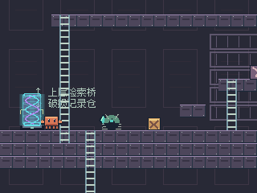
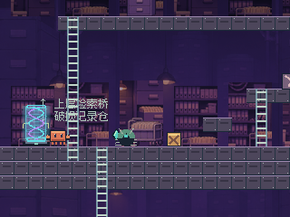
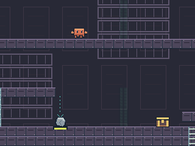
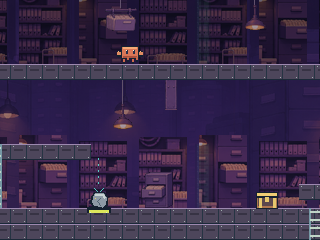
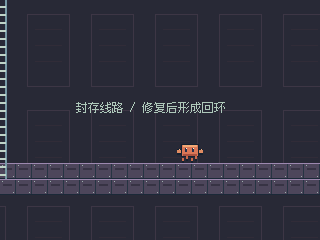
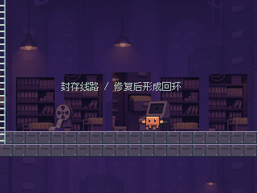
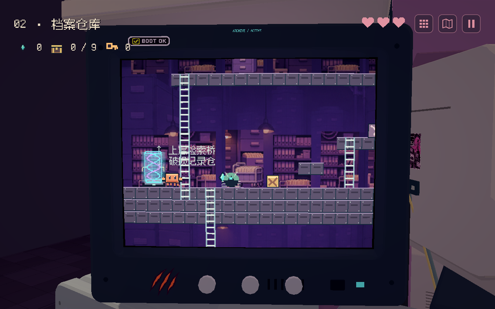

# ARCHIVE 素材接入与原生验证

2026-11-08，按用户确认“直接接入并运行验证”实施。素材包的 Markdown 作为设计资料读取，没有运行包内执行指令。

## 接入内容

ARCHIVE 专属远景、三组中景柜墙与 12 类道具已经接入。18 处固定摆放覆盖检索桥、归档大厅和破损记录仓；全部无碰撞并位于真实地形、机关及角色之后。灯与文件挂组用细线接现有顶梁；装饰梯横放收纳，桥柱截取竖向受力段，避免画出假可走横面。

原图、图集、概念参考和说明保存在 `assets/pixel/archive/source/`，逐项 SHA-256 与原 ZIP 一致；`.gdignore` 排除源大图的运行时导入。完整概念图没有作为场景使用。实际读取 `game/` 下的 512×128 道具图集、三张 48px 宽立面和 768×512 远景。道具按类别统一为 12–40px 宽，以整数区域和 1:1 Sprite 显示；透明轮廓清理为 0/255 alpha。

远景通过内置 imagegen 编辑移除桥、梯和地面线，独立保存 `far-clean.png`，原图未覆盖；[最终提示词](../assets/pixel/archive/source/FAR_EDIT_PROMPT.md)。中景从原长图截取三块柜墙，避开桥梯与地面，保持宽高比编译。远景按镜头 0.15 倍移动，始终采样单张图，不循环铺设。原远景左右边缘 RGB 平均差 0.004418（0–1）；这个数值不能证明结构无缝，因此没有宣称源图可以无缝重复。四角实际渲染与完整采样范围均已检查，没有背景空洞。

## 验证与画面

| 检查 | 本轮结果 |
|---|---|
| 原图完整性、图集、透明度、12 类身份、三层分布、落地锚点与背景覆盖 | 9 项通过 |
| Godot 专项：无碰撞、单视口、真实推石接通 A、实际攀梯进入上下层、边缘覆盖 | headless / RTX 3050 Compatibility 各 7 项通过 |
| 完整六关、九箱、核心 A→B→C、结局与磁盘恢复 | headless 118 项通过 |
| 横屏触摸的推拉、攀梯、攻击、持续压力、BOOT—ARCHIVE—BOOT 往返及 GUI 攻击隔离 | 原生 GPU 9 项通过 |

六份 `data/levels/` 和 `data/screen_links.json` 与接入前一致。没有修改角色、碰撞、重量、奖励、信号或存档版本；其他五关继续使用原背景分支。专项截图为真实 Godot 画面；镜头边缘扫描是单独渲染定位检查，不用它冒充通关。

[实际输入行走录像，33.8 秒](archive_art_evidence/archive-walk.mp4)：来自原生 320×240 视口，10fps 最近邻放大两倍，无音轨。静态前后对照期间暂停录制，移动、攻击、推石与攀梯段由真实输入完成。

中层同机位前后：

上层同机位前后：

下层同机位前后：

真实 CRT 机台：

## 性能与制作边界

同机位全场绘制调用：入口 487→422，重压谜题 473→411，上层 465→411，下层 457→396。20 次强制绘制加像素视口读回中位 6.96ms，含读回开销，不能当交互 FPS。前后对照共享同一进程已加载的纹理，不能用它证明独立旧版本的内存成本。新增纹理按 RGBA8 尺寸预算约 1.8MiB，源大图不在运行时加载。

源整图仍保留原有桥梯，只作制作资料；游戏使用清理远景与柜墙选段。柜墙由有限立面组合，未声称逐柜独立手绘或原长图已无缝。手机真机长时性能与首次玩家的主观可读性仍待人工测试。

## 安装与复现

默认用原 PLAY.cmd 启动，接入代码与运行资源已经包含，无需图像服务或 Python。素材重建：`powershell -NoProfile -ExecutionPolicy Bypass -File tools/install_archive_art.ps1`，可传 `-GodotPath`；脚本从已提交制作源编译、导入并检查日志。

专项：`--path . --fixed-fps 60 -- --qa --archive-art-qa`；加 `--headless` 跑逻辑检查。制作复核：`python tools/inspect_archive_art.py "素材包ZIP路径"`（Python / Pillow，只读取和核对文件）。

改动清单：`archive_dressing.gd`、摆件清单、制作源和运行图集、编译/安装/复核工具、专项检查与证据；`world_backdrop.gd` / `side_world.gd` 增加 ARCHIVE 专属视觉分支；`main.gd` / `verify.ps1` 注册 QA 入口。
