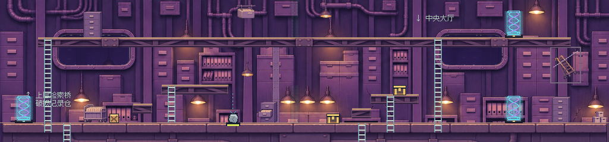
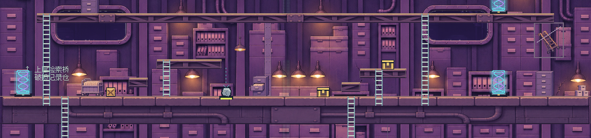
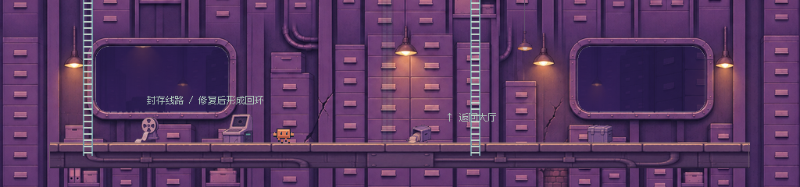

# ARCHIVE 连续环境 v2

2026-11-08。旧版三块 48px 柜墙每隔 60px 循环的方案已撤销，相关贴图与代码已删除。旧报告的“接入完成”不能代表视觉合格，本轮以实机画面重新检查。

现在中景是单幅 1024×640 建筑立面，以原始高清素材和真实地形示意为参考重绘，再去掉所有没有碰撞的长横梁、梯子和桥面。柜墙、竖向结构、弯管和灯具连续连接，真实的 64 / 208 / 448 高度平台组织三层空间。四个圆角观察窗为透明孔洞，透出保留的 0.15 倍远景视差。中景以完全不透明墙体绘制，没有用模糊或透明度掩盖贴片接缝。

ARCHIVE 不再绘制旧 16px 重复砖块；新建 1024px 宽的 16 / 32 / 48px 钢梁、紫灰基础材质，按世界 X 坐标采样并覆盖实际碰撞矩形。仅合并相邻矩形的视觉表面，原碰撞体、单向通行和梯子数据不变。12 类独立道具保留为 15 处固定摆放，柜、车、卷轴、终端与记录箱落在真实地面上；支撑柱连接真实桥底与大厅地面，装饰梯锁在墙面收纳框中。道具在角色与机关之后，无新增碰撞。

## 完整实机截图

下列全宽图由 Godot 的原生 320×240 视口在四个连续横向位置读取并无缩放拼接，覆盖世界 X=0…1024。它们是镜头检查夹具；游戏仍只有一个 320×240 视口，没有为截图增加可玩区域。原始分镜 `*-x0/320/640/704.png` 与四角采样同目录保留。

上层检索桥：



中层重压归档大厅：



下层破损记录仓：



人工逐图检查：没有原来的矩形裁剪边界或柜墙间背景空隙；不再周期复制三种柜体；管线沿墙面和真实平台连续；钢梁与基础材料配色一致；独立物件脚底贴合真实地面。画面中长横向站立面和可攀梯均来自原有地形、机关，柜体仅是后墙结构。

[上层完整机台截图](archive_art_v2_evidence/archive-v2-upper.png)、[中层完整机台截图](archive_art_v2_evidence/archive-v2-main-puzzle.png)、[下层完整机台截图](archive_art_v2_evidence/archive-v2-lower.png)保留角色实际输入到达后的画面。[34.6 秒实机行走录像](archive_art_v2_evidence/archive-v2-traversal.mp4)覆盖攻击、推石、攀梯和三层穿行，10fps、最近邻放大至 640×480、无音轨。录像起点为专用 ARCHIVE 入口加载，后续穿行使用实际动作输入；静态镜头夹具不混入录像。

## 验证与边界

| 项目 | 本轮结果 |
|---|---|
| Godot 4.7.2 / OpenGL Compatibility，RTX 3050，ARCHIVE 实机专项 | 9 / 9 |
| 六关流程、九个宝箱、核心 A→B→C、结局、磁盘恢复，headless | 118 / 118 |
| 桌面 ScreenTouch / ScreenDrag 输入回归，headless | 9 / 9 |
| 制作源、12 类身份、实际落地锚点、完整中景与透明窗洞、地形材质 | 12 / 12 |

报告 JSON 与截图保存在本页证据目录。实际 Godot 日志无 FAIL、SCRIPT ERROR 或 ERROR。全部 `data/levels/`、存档实现、传送连接、角色与机关逻辑保持本轮基线 a799fba 不变；其他五关仍进入原渲染分支。原始制作素材的已跟踪文件与基线无差异。Downloads 中原 ZIP 已不在原路径，本轮没有重新执行 ZIP 字节比对，没有据此声称重新验证压缩包。

20 次强制绘制与读回为约 5.3–9.8ms，含 GPU 读回，不作为游戏帧率结论；首次截图读到的引擎 FPS 也不作为稳定性能基准。本轮完成桌面实机视觉检查，手机真机、低端设备性能和用户主观验收尚未执行。

## 制作与复现

使用内置 image_gen 制作与编辑，没有调用外部 CLI 图像接口。[原始提示词、输入和输出路径](../assets/pixel/archive/source/CONTINUOUS_V2_PROMPTS.md)。选定制作源是 `source/mid-continuous-v2.png`、`source/terrain-material-v2.png`，旧清理远景 `source/far-clean.png` 保留。图像工具把窗洞画为棋盘格，编译器只对四个封闭的中性亮色窗洞执行明确的透明遮罩，其余墙面归一为全不透明。

运行资源是 `game/mid-continuous.png`、`walkway.png`、`foundation-32.png`、`foundation.png`、`column.png`，以及保留的 `far.png` 与 `props.png`。无需图像服务即可运行或重建。

```powershell
.\tools\install_archive_art.ps1
.\.tools\godot\Godot_v4.7.2-stable_win64_console.exe --path . --fixed-fps 60 -- --qa --archive-art-qa
python tools/inspect_archive_art.py
```

制作源保留原始高清图，`.gdignore` 阻止其运行时导入；游戏资源均使用最近邻采样。正常启动仍使用原 PLAY.cmd。
