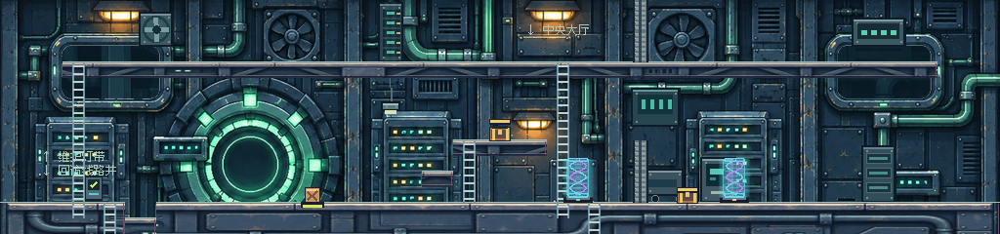
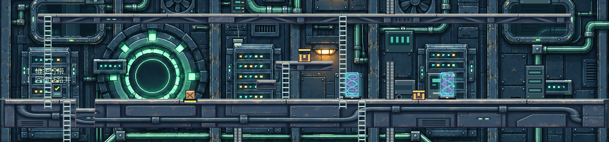
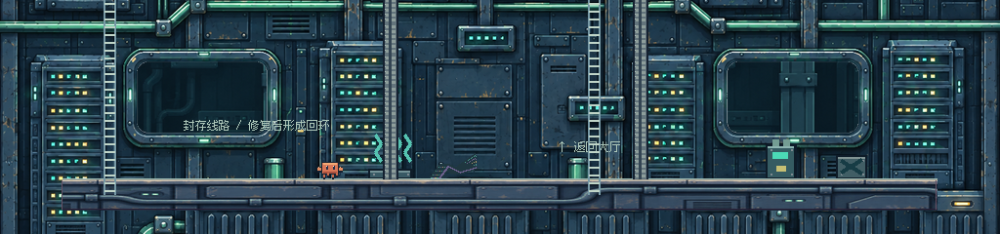

# BOOT 启动机房美术接入

2026-11-08，按用户“按照你的思路，继续”实施本次 BOOT 美术。素材包内说明作为资料核对，未执行包内脚本或把其文字当成独立授权。工作方法沿用 [ARCHIVE 背景制作思路](ARCHIVE_BACKGROUND_WORKFLOW.md)。

## 制作与接入

BOOT 原关卡为 1024×640，单活动游戏视口为 320×240。根据 `boot_01.json` 的实际三层结构，使用包内连续底稿和概念图作为构图、材质参考，用内置 image_gen 绘制一整幅深蓝灰机房立面。保留主电源环作为大厅地标，以薄荷绿管线、服务器、墙内风扇及暖维修灯组织空间。概念图里的角色、桥、梯、文字和虚构机关没有带入游戏。

第一轮生成仍出现长横梁，编辑后移除，补回竖柱和墙板；中景为单幅世界坐标图，无矩形柜墙循环。四个白色观察窗在编译时单独抠出连通的中性亮色窗内遮罩，其余建筑像素保持不透明。中景运行资源是 `assets/pixel/boot/game/mid-continuous.png`（1024×640）。

原远景底稿的大电源环在下层窗内重复出现，容易被误读为第二台核心设备，因此另绘无环的远处机柜与管线，运行时以镜头位置 0.15 倍采样同一张 `far.png`。完整贴图覆盖所有相机边界，无循环、无透明空洞。

专属地面采用窄钢梁与厚机房基础两种材质，编译为 1024×16、1024×32、1024×48；按真实平台世界 X 坐标连续采样，保持入口真实凹口和所有小平台轮廓。复用 `ArchiveTerrain` 的视觉合并方法，只新增可配置资源路径、顶边颜色；ARCHIVE 的默认值及素材不变。物理矩形、单向通行和梯子仍使用原数据。

包内 12 类独立道具各摆放一处，使用原像素图集，按 alpha 实际包围盒收紧取图区域以消除透明留白造成的离地缝隙。维护区放服务器、风扇与指示牌，大厅放维修灯、配电柜与工具车，下层放电池、线圈、电缆与零件箱。嵌墙面板有固定墙面锚点，吊灯连到真实桥底。道具全部无碰撞，位于角色及真实机关后方，没有增添假梯或假站立面。

原始 ZIP 所有文件（包括说明、概念图和底稿）原样保存在 `assets/pixel/boot/source/`，本轮逐一 SHA-256 比对通过；`.gdignore` 排除源图运行时导入。新增制作源是 `mid-authored.png`、`far-authored.png`、`terrain-material.png`。[完整生成与编辑提示词](../assets/pixel/boot/source/PRODUCTION_PROMPTS.md)、[远景提示词](../assets/pixel/boot/source/FAR_PROMPT.md)已保留。运行不需要图像服务或重新生成素材。

## 实机截图与检查

下面是实际 Godot 320×240 GPU 读回的无缩放拼接，覆盖各层全宽。镜头定位用于视觉检查，与实际输入穿行分开，不是扩大视口或伪装通关。

上层维护灯带：



中央电源大厅：



下层线路井：



[入口完整机台](boot_art_evidence/boot-art-entrance.png)、[推箱压板实机](boot_art_evidence/boot-art-power-hall.png)、[上层实机](boot_art_evidence/boot-art-upper.png)、[下层实机](boot_art_evidence/boot-art-lower.png)。逐图检查了连续墙面、管线连接、窗洞、平台断口及道具脚底；观察窗内没有重复的大电源环，画面没有机械裁片边界。独立道具保留原包较简洁的像素造型，未声称全部道具也重绘到了概念图细节程度。

[34.7 秒实际输入穿行录像](boot_art_evidence/boot-traversal.mp4)：从 BOOT 入口出发，攀上维护区、返回推拉箱体开门、爬梯取宝箱，再进入下层；没有用写入旗标或传送角色替代动作。视频来自原生视口，每六个物理帧采样一次，以 10fps 最近邻放大到 640×480，无音轨；静态镜头扫描不混入录像。

| 检查 | 本轮结果 |
|---|---|
| 原生 Godot 4.7.2 / OpenGL Compatibility / RTX 3050，BOOT 专项 | 6/6 |
| 制作源逐字节、12 类身份、落地锚点、图集区域、窗洞和采样覆盖 | 9/9 |
| 六关流程、九箱、A→B→C、结局与磁盘重载，headless | 118/118 |
| BOOT→ARCHIVE→BOOT 触摸操作、推箱推石、回访状态与 GUI 输入隔离，headless | 9/9 |
| ARCHIVE 实际推石与上下层路线回归，headless | 9/9 |

最终实机日志与以上回归日志无 FAIL / SCRIPT ERROR / ERROR。首次调试时出现导入未完成就启动导致的纹理缺失，已等待完整导入并重跑；早期专项路线误入下层导致的断言失败通过修正 QA 行走顺序解决，没有改地图来迎合测试。证据目录仅保留最终通过的截图和报告。

本轮全部 `data/levels/`、传送连接、剧情、教程、角色、机关和存档实现未改；ARCHIVE 素材、道具摆位及视觉默认参数不变，其余关卡仍走原来的背景与地形分支。测试模式禁止访问正式存档。回访与磁盘恢复由回归验证，未在用户正式存档上进行写入操作。手机真机、低端设备长时性能和用户主观验收尚未完成。

## 复现

正常运行继续使用原 PLAY.cmd。重新编译和导入：

```powershell
.\tools\install_boot_art.ps1
.\.tools\godot\Godot_v4.7.2-stable_win64_console.exe --path . --fixed-fps 60 -- --qa --boot-art-qa
python tools/inspect_boot_art.py "C:/Users/蒲帆/Downloads/BOOT_Asset_Pack_v1 (1).zip"
```

`tools/build_boot_art.gd` 负责整图缩放、窗洞遮罩、材质条编译和图集区域收紧；`data/boot_dressing.json` 是固定摆位清单；`tests/boot_art_qa.gd` 提供穿行与镜头扫描；`tools/verify.ps1` 已加入 BOOT 专项。更换源图时需重查窗洞种子、阈值、图集锚点并重新实机验收，不能直接沿用本轮截图。
