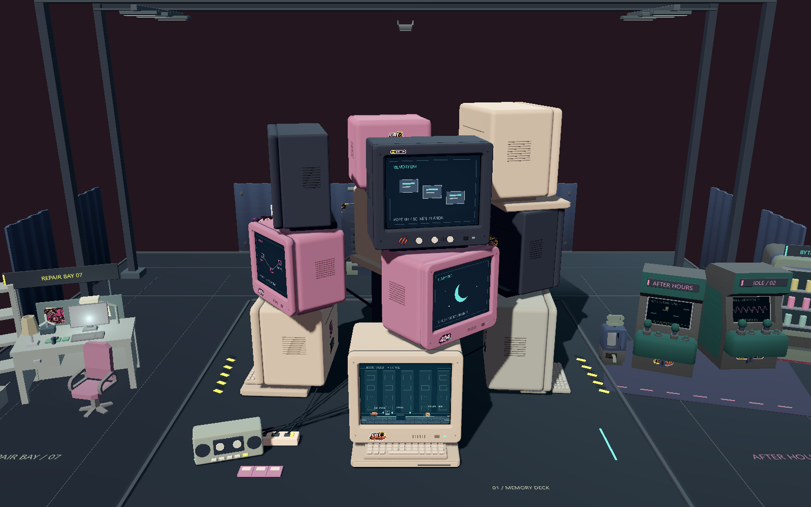
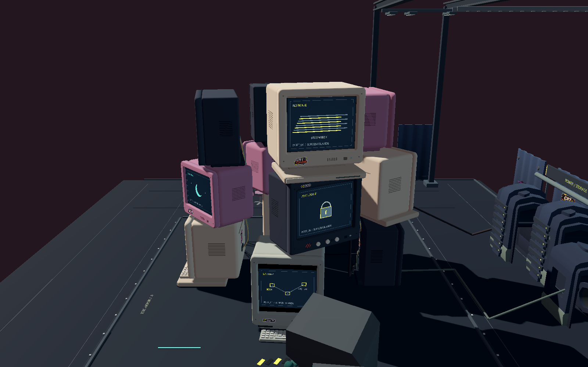
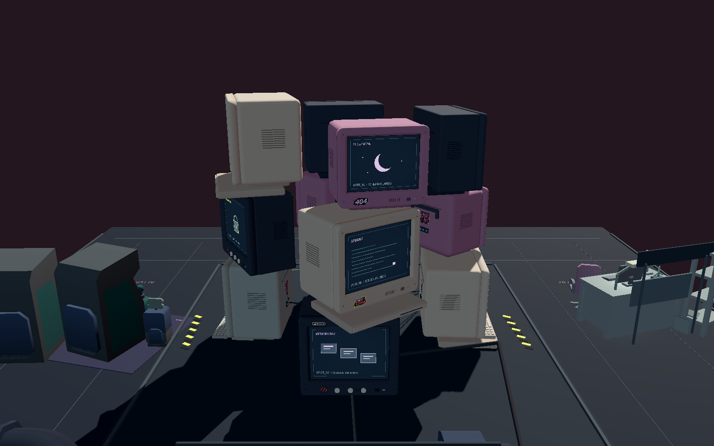
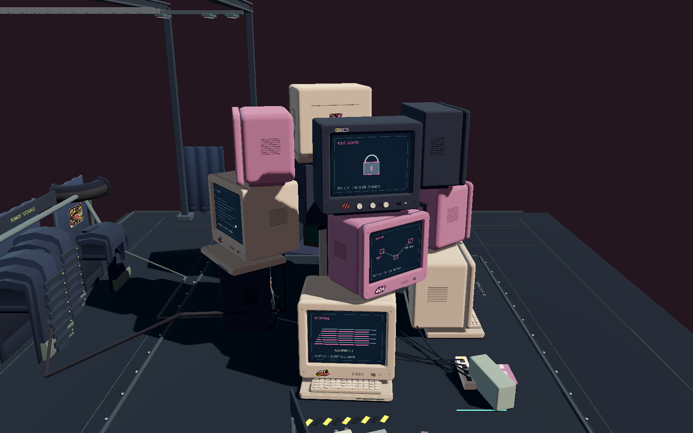
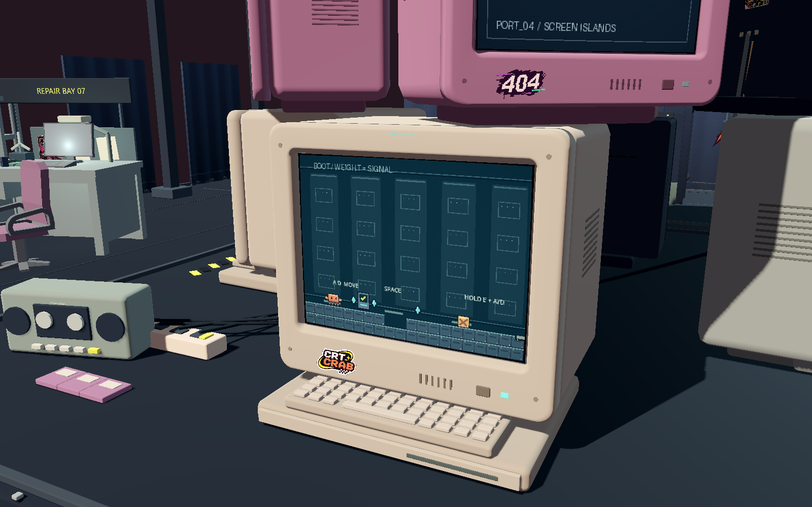
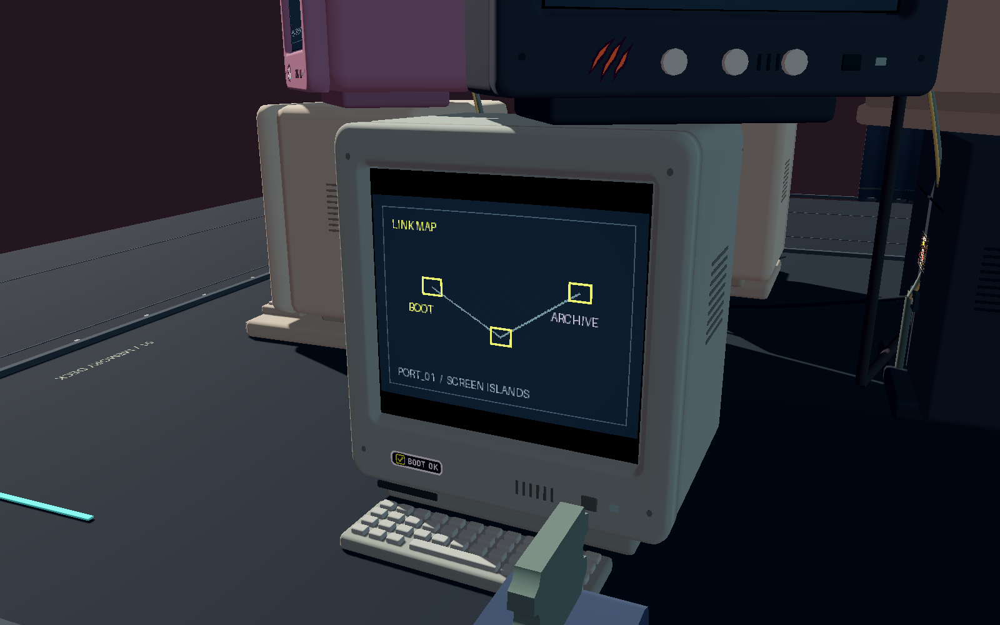
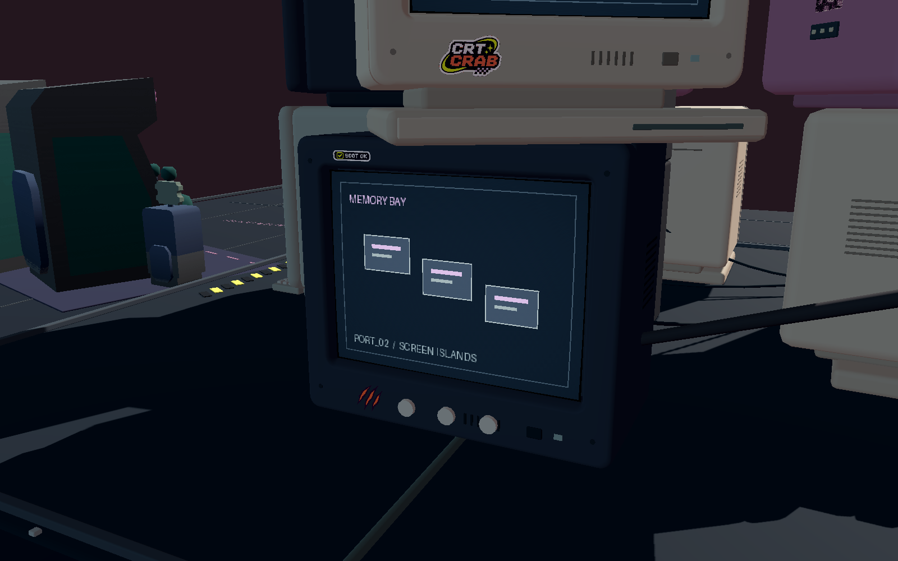
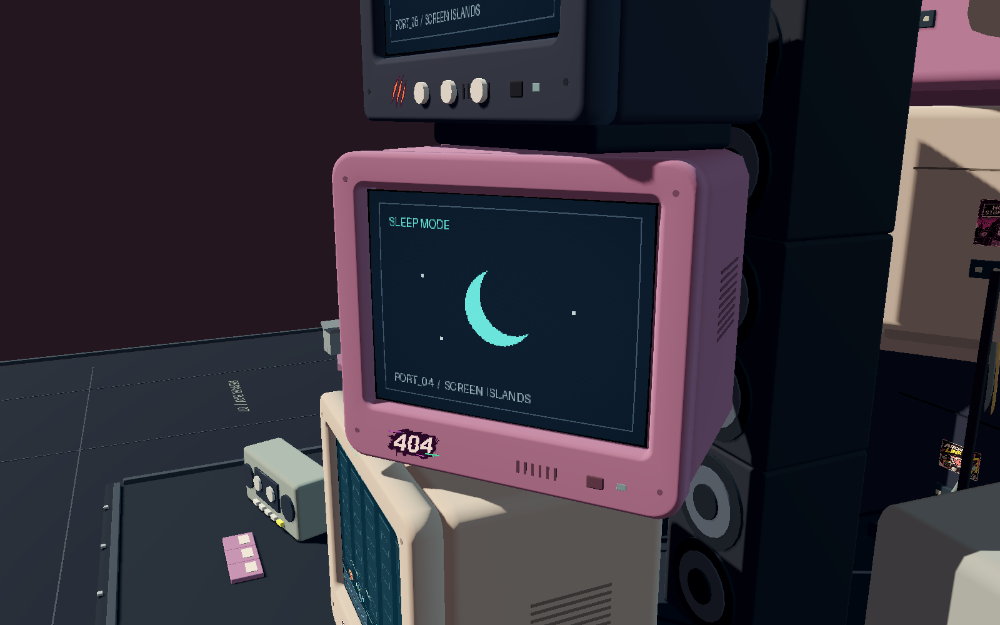

# CRT 外壳与实体堆叠修复验收

日期：2026-11-06。基于现有 clawd-crt-tower 场景修改，没有重新搭建阵列。

## 修改结果

- 正面由一张闭合的连续环形网格构成，包含外肩、圆润面沿、内侧凹槽和背面封口；不再用相交长方体拼四边。每个面框 720 三角形，四角无额外方块或胶带叠块。
- 屏幕仍为原始 4.16 × 3.12 QuadMesh、位置 (0, 0.2, 1.71)，前沿位于 z=1.88。原 CRT shader、320×240 SubViewport、content_scale 补偿及关卡映射均保留。灰绿高身型原来的 4:3 内容黑边仍保留。
- 米白一体底座、灰绿高身、深色短机身旋钮、粉紫便携四种机型保留尺寸比例、机身深度及特色。便携提手折到后壳，避免顶层压在提手上。
- 螺丝改成贴合面框的小圆形嵌件；按钮根部进入塑料面；装饰文字标签改用用户提供的 CRT CRAB、BOOT OK、爪痕、404、NO SIGNAL、ARCHIVE LINK 素材。运行状态文字仍可读，紧贴外壳。
- 主要通过 monitor_layout.json 调整十二台的位置。保留全部原有绕竖轴朝向，取消导致平面接触失效的小幅侧倾。维持三层、四周可见与不规则错位悬挑；上层没有键盘。
- 没有新增托架、横梁、支柱、连接托件或隐藏支撑。上层用电脑原有底脚或一体式底座接触下层机壳。底层落在原地台。
- 顺带修正底层键盘与一个饰件的位置、中央原有音箱之间的空隙，并将通信盒放回音箱顶面。音箱与所有 CRT 无碰撞、无承托接触；旧招牌支杆改为贴合机壳的素材贴纸。
- 修复周边背板隐藏后涂鸦留在空中的同类问题：四张后墙贴纸成为对应背板的子节点，共享显隐。

## 十二台承托关系

数值为场景单位。所有接触间隙绝对值 < 0.0001；表中四舍五入为 0。接触覆盖率按上层底脚或一体式底座的实际平面接触多边形计算，不要求所有悬挑边缘都有承托。

| 编号 / 屏幕 | 机型 | 直接承托物 | 间隙 | 底面有效接触覆盖率 | 累计上层载荷重心到承托边界最小距离 | 结果 |
| --- | --- | --- | ---: | ---: | ---: | --- |
| 00 / BOOT | 米白一体底座 | 原有地台 | -0.0000 | 100.0% | 0.3324 | 通过 |
| 01 / SLEEP_1 | 灰绿高身 | 原有地台 | 0.0000 | 100.0% | 0.4043 | 通过 |
| 02 / SLEEP_2 | 深色短机身旋钮 | 原有地台 | -0.0000 | 100.0% | 0.8395 | 通过 |
| 03 / SLEEP_3 | 米白一体底座 | 原有地台 | -0.0000 | 100.0% | 0.2968 | 通过 |
| 04 / SLEEP_4 | 粉紫便携折柄 | crt_boot_00 顶部机壳 | -0.0000 | 77.7% | 0.5872 | 通过 |
| 05 / ARCHIVE | 深色短机身旋钮 | crt_sleep_01 顶部机壳 | -0.0000 | 63.7% | 0.6348 | 通过 |
| 06 / SLEEP_6 | 米白一体底座 | crt_sleep_02 顶部机壳 | -0.0000 | 47.1% | 0.2204 | 通过 |
| 07 / SLEEP_7 | 粉紫便携折柄 | crt_sleep_03 顶部机壳 | -0.0000 | 77.0% | 0.5658 | 通过 |
| 08 / SLEEP_8 | 深色短机身旋钮 | crt_sleep_04 顶部机壳 | -0.0000 | 67.2% | 0.6539 | 通过 |
| 09 / SLEEP_9 | 米白一体底座 | crt_archive_05 顶部机壳 | -0.0000 | 59.6% | 0.5556 | 通过 |
| 10 / SLEEP_10 | 粉紫便携折柄 | crt_sleep_06 顶部机壳 | -0.0000 | 87.3% | 0.8413 | 通过 |
| 11 / SLEEP_11 | 深色短机身旋钮 | crt_sleep_07 顶部机壳 | -0.0000 | 63.6% | 0.6122 | 通过 |

检查读取 Godot 实际生成的 Case、Foot、IntegralBase 网格：从水平法线顶点提取真正平面区域，计入四种机型的缩放，再按实际 yaw 旋转，求交得到有效接触面；没有用整个世界 AABB 的重叠冒充接触。

逐组件旋转包围盒用分离轴法检查全部十二台之间的穿插，结果为 0；低于地台的组件为 0。另检查塔内既有大件装饰，CRT 与它们的穿插及意外承托均为 0。不会把下层玻璃、键盘、按钮或折柄当成承托面。

重心采用机壳、底脚、一体底座包围体均匀密度近似，并累计该列所有上层电脑的载荷；这是几何及视觉稳定性检查，不是实物材料强度或刚体仿真。各台自身重心和累计载荷重心均在有效接触多边形内。

## 四个方向的真实游戏截图

Godot 4.7.2，Windows / NVIDIA OpenGL Compatibility；1600×1000，原场景显卡渲染，未修图。检查脚本只隐藏 HUD、停止测试世界输入与环境微动态，并固定相机，不替换任何外壳或布景。

相机方位依次为 +Z、+X、-Z、-X，高度 17、水平距离 34，目标 (0, 6.4, 0)。另外渲染检查了 72 个整圈相机角度，未进入 CRT 内部。

### 正面



### 右侧



### 背面



### 左侧



## 四种机型近景

| 米白一体底座 | 灰绿高身 |
| --- | --- |
|  |  |

| 深色短机身旋钮 | 粉紫便携折柄 |
| --- | --- |
|  |  |

## 验证结果与复现

- 新增几何验证：37/37。包括十二个面框的闭合边、流形边、退化三角形、法线及绕序，十二块屏幕尺寸/深度/shader，状态文字贴合，以及 72 个 360° 视角。
- 实体承托：12/12；穿插、低于地台、意外装饰承托均为 0。
- 无窗口玩法与环境回归：87/87。
- 显卡渲染玩法与环境回归：89/89。覆盖 BOOT → ARCHIVE → BOOT → ARCHIVE 实际交互、坏出生点拒绝、转场失败回滚、输入锁定、重物压板、远端门、宝箱账本、存档、暂停、720×900 竖屏和贴纸随背板显隐。
- 主菜单流程回归：46/46。没有改动菜单、衣橱或存档事务代码。
- 上述最终运行的标准错误日志均为空。性能截图里的 FPS 是测试期间含强制读回的瞬时值，不作为稳定帧率基准。

在项目根目录执行（需要本机 Godot 和 Python，仅校验工具用 Python，游戏运行不依赖 Python）：

```powershell
.\.tools\godot\Godot_v4.7.2-stable_win64_console.exe --path . --script res://tests/crt_geometry_qa.gd -- --qa
python tools/check_crt_stack.py
.\.tools\godot\Godot_v4.7.2-stable_win64_console.exe --headless --path . -- --qa --environment-qa
.\.tools\godot\Godot_v4.7.2-stable_win64_console.exe --path . -- --qa --environment-qa
.\.tools\godot\Godot_v4.7.2-stable_win64_console.exe --headless --path . -- --qa --menu-qa
```

原始网格导出、逐台校验 JSON、完整玩法测试结果及竖屏/传送截图保存在 [crt_shell_stack_evidence](crt_shell_stack_evidence)。QA 禁用正式存档和设置读写，不覆盖玩家进度。
