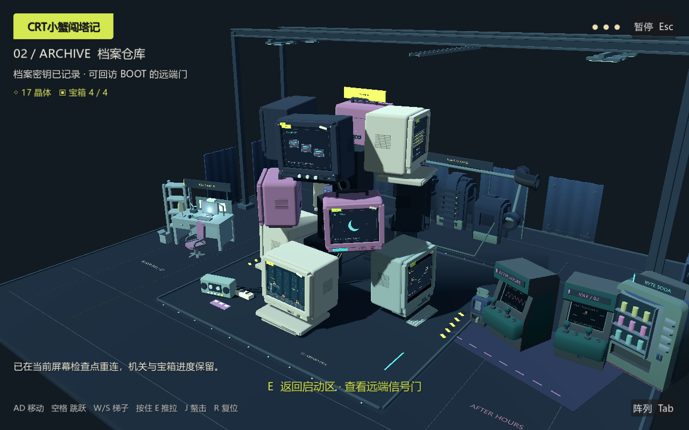

# 环境升级验收与实测

2026-11-05。E0 基线 main / `bcd0fe203fe1808684b8d572326a6ef91846e4eb`；开始前同步远端，建立 `codex/tower-surroundings` 分支。Godot 4.7.2 stable、Windows、OpenGL Compatibility、NVIDIA GeForce RTX 5060 Ti。

## 实测结果

- 新增四个独立分区、26 个真实 GLB 实例；导入网格 7,067 tris，全体新增几何 **23,343 tris**，包含梁架、小件与两根供电线，全部可见也低于 60k 预算。
- **80 项 headless / 82 项真实 GPU 流程检查通过，无失败**。保留原 69/70 项回归：12 CRT、键盘布局、唯一内屏玩家、320×240、走跳/推拉/攀梯/战斗/开箱/重压板、跨屏信号往返、R、暂停与观察输入冻结、目标失效回滚、磁盘读写和 v1 迁移备份。
- 环境追加模型/四区、无新增物理角色/碰撞体、无额外 SubViewport、几何预算、遮挡隐藏/恢复、72 方位观察、实际跨屏镜头、菜单微动态开关停止/恢复风扇、游戏内署名弹窗检查。
- 实走跨屏镜头采样 **320 帧**，相机位于可见外围道具包围盒内 **0 次**；72 方位采样同样为 0。离散采样和包围盒保护不等于穷举任意自由镜头。
- 横向 1280×800、竖窗口 720×900，包含暂停截图。未测手机硬件/触控、低配置 GPU、长时压力、平台导出；竖窗口检查不等于已有移动版。
- QA/性能模式禁用正式进度访问；磁盘用例使用进程号独立文件并清理，没有覆盖玩家存档。导入无脚本/资源错误，GPU 与性能 stderr 为空。

原始记录：[headless](environment_evidence/sideview-qa-headless.json)、[GPU](environment_evidence/sideview-qa-visual.json)、[几何/镜头](environment_evidence/environment-metrics-visual.json)、[导入输出](environment_evidence/environment-import.txt)、[渲染 stderr](environment_evidence/environment-visual-errors.txt)、[性能 stderr](environment_evidence/environment-performance-errors.txt)、[E0 QA](environment_evidence/baseline-qa.json)。完整本机日志另在 `artifacts/`；本页引用的必要证据随源码提交。

## 画面证据

全部为实际 Godot GPU 渲染；`-screen.png` 是同一时刻真实 320×240 内部画布，没有生成概念图冒充完成画面。

| 用途 | 图片 |
|---|---|
| E0 历史五视图 | [前](environment_evidence/baseline-front.png) / [后](environment_evidence/baseline-back.png) / [左](environment_evidence/baseline-left.png) / [右](environment_evidence/baseline-right.png) / [顶](environment_evidence/baseline-top.png) |
| 最终五视图 | [前](environment_evidence/environment-front.png) / [后](environment_evidence/environment-back.png) / [左](environment_evidence/environment-left.png) / [右](environment_evidence/environment-right.png) / [顶](environment_evidence/environment-top.png) |
| 同机位对照：关闭外围 | [前](environment_evidence/environment-compare-front-before.png) / [后](environment_evidence/environment-compare-back-before.png) / [左](environment_evidence/environment-compare-left-before.png) |
| 分区近景 | [维修](environment_evidence/environment-detail-repair.png) / [电玩](environment_evidence/environment-detail-arcade.png) / [供电](environment_evidence/environment-detail-power.png) |
| 旧玩法 | [BOOT](environment_evidence/m1-01-boot.png) / [像素画布](environment_evidence/m1-01-boot-screen.png) / [转场中段](environment_evidence/m2-04-transition.png) / [ARCHIVE](environment_evidence/m2-05-archive.png) / [像素画布](environment_evidence/m2-05-archive-screen.png) |
| 窗口与菜单 | [竖窗口](environment_evidence/m2-portrait.png) / [暂停](environment_evidence/m2-pause.png) / [署名](environment_evidence/environment-credits.png) |

三组同机位对照在最终 QA 同一进度/机位拍摄，仅临时隐藏新增外围；它们与 E0 独立历史图分开。分区近景为检查支撑，诊断时暂时关闭遮挡隐藏，拍完恢复；五视图和正常游戏启用遮挡保护。

[前后切换 GIF](environment_evidence/before-after.gif)：由 FFmpeg 编码实际两张渲染帧，先无外围、再有外围。这是对照动图，不是连续游玩录像。



## 同设备性能

复用原 `tests/performance_probe.gd`，同路径、每方向 2.5 秒、1280×800、单个 320×240 内屏，不使用固定时间步。为可重复性禁用关卡物理；隐藏窗口下强制 OpenGL 绘制并 GPU 读回。**包含读回开销，不是交互游戏 FPS、显存或完整 CPU/GPU 帧时间保证**。“静态内存”为引擎监视值。

[实施前原始数据](environment_evidence/baseline-performance.json) / [最终原始数据](environment_evidence/after-performance.json)。两次均为 30 个强制绘制读回循环/秒，受窗口调度影响，不能据此宣称游戏锁定 30 FPS。早期 M3 的 52～60 循环/秒不是本次基线。

| 视角 | 前中位数 / P95 ms | 后中位数 / P95 ms | 中位数变化 | draw calls 前→后 | 静态内存 MiB 前→后 |
|---|---:|---:|---:|---:|---:|
| active | 19.407 / 21.308 | 19.482 / 21.273 | +0.4% | 774 → 837 | 81.26 → 84.40 |
| front | 19.713 / 21.486 | 20.087 / 21.780 | +1.9% | 678 → 854 | 81.29 → 84.44 |
| back | 19.750 / 21.213 | 19.906 / 21.974 | +0.8% | 690 → 868 | 81.29 → 84.45 |

最终中位数最差约 +1.9%，低于约 10～15% 目标。不同轮次有时钟/调度波动，早期样本最差约 +10.3%，同样未超目标。新增调用约 63～178；继续扩展或移到低配设备时需重测，没有降低活动屏幕分辨率、更新频率或删关卡换数据。

## 复现

工程目录，Godot 控制台程序：

```text
--headless --editor --path . --quit
--headless --path . --fixed-fps 60 -- --qa --environment-qa
--path . --fixed-fps 60 -- --qa --environment-qa
--path . -- --perf
--path . -- --perf --no-surroundings
```

正常启动 `PLAY.cmd`。`--no-surroundings` 供隔离外围成本，旧核心仍可用 `--qa` 单独复测。回退可在独立分支检出 E0 commit，无须移动存档或重建项目。

## 明确未完成

原定 Sketchfab SF-01～04 官方下载返回 401，未导入；现用真实 Kenney CC0 模型。SF-05～08 仍为可选项。原定资源的人工下载入口、目标路径和许可见 [素材表](ASSET_CREDITS.md)；完整边界见 [改动记录](ENVIRONMENT_CHANGELOG.md)。当前是可运行环境样板，未宣称商业美术验收或新增四关/Boss。
