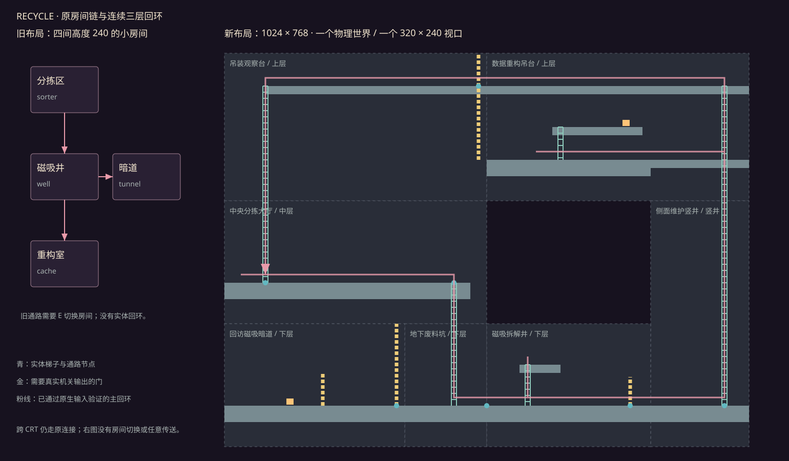
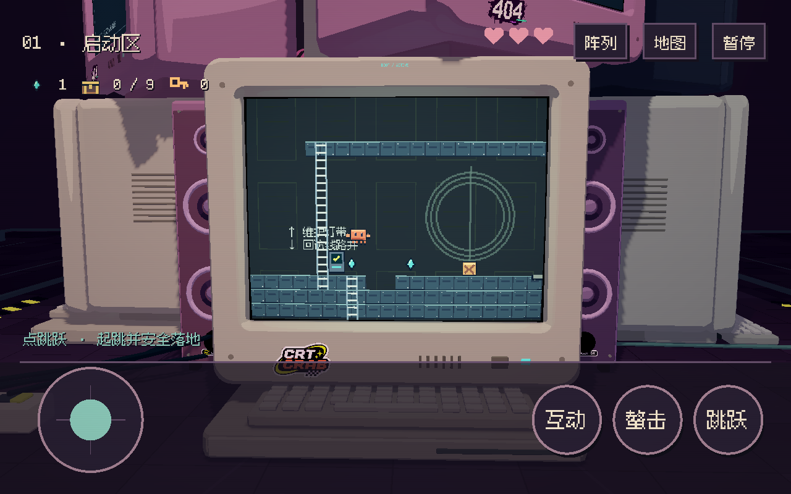
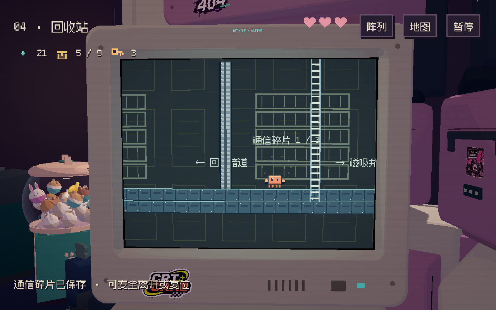
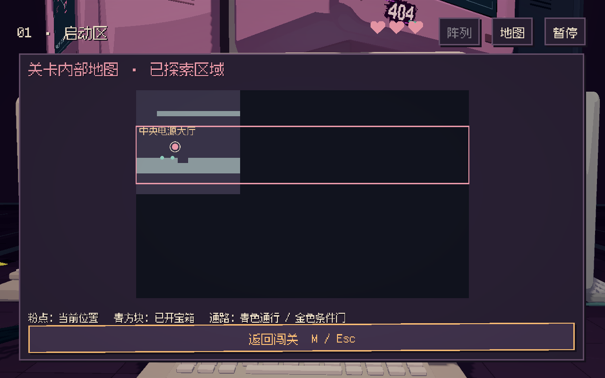
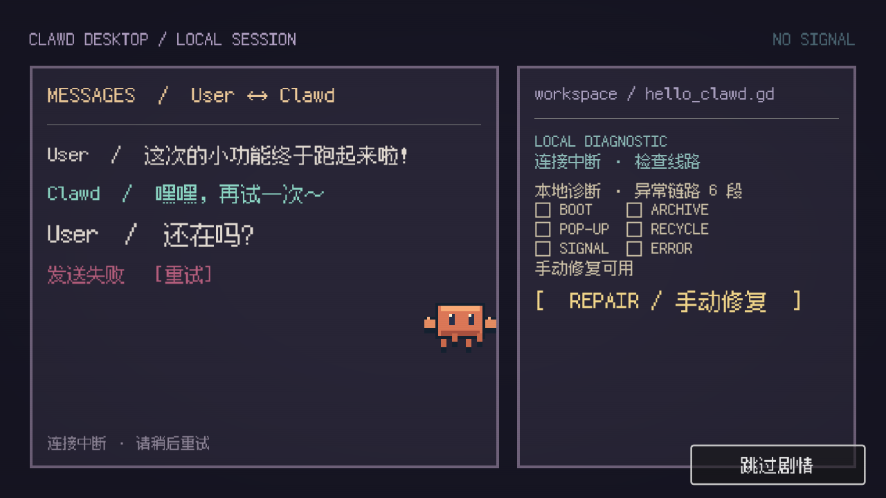

# 连续探索、横屏触控与 UI 重构交付

2026-11-08。按用户“手机横屏，其他去做”实施。三份原策划保存在 [design](design/)，冲突处理以 [统一执行规则](design/UNIFIED_EXECUTION.md) 为准。没有开发竖屏玩法。

## 已落地

- 首次开始或继续先选择键鼠 / 触屏；取消不创建或重置冒险。设置可以切换，操作偏好独立持久保存。触屏每根手指单独持有动作，支持移动加跳跃、按住互动推拉；抬一根手指不会释放另一根。GUI 点击经过界面处理后才可能进入攻击路由。
- 教程由真实移动、起跳落地、箱石移位、攀梯、开箱、攻击命中、跨 CRT 及阵列进出完成。教程随冒险保存；切模式不重做谜题，新游戏重新学习。可关闭提示、跳过或重新查看。
- 游戏 HUD 保留关名、生命、资源及阵列 / 地图 / 暂停入口；取消常驻按键长串和任务长句。上下文提示、教程及通知按优先级显示。暂停分操作、声音、画面等子页；内置指南、当前任务、地图与区域复位。地图与暂停不会互相盖住。
- 六关分别成为一个连续物理世界，全部删除关内房间传送链；跨 CRT 仍保留原三段连接。世界变大，活动像素视口仍只有一个 320×240。镜头同时跟随 X/Y，整数像素输出；修复长梯穿过厚地板时离梯卡住的问题。
- Tab 看外部阵列；M 看当前关已探索的内部地图。未知区域保持雾区，只标发现过的道路与已开宝箱。地图、路牌、条件门标识从同一份区域 / 通路数据生成，不提供随意传送。
- 手机采用横屏触控。六个 CRT 的完整屏面投影均验证位于顶部信息栏与底部按钮之间。竖屏时释放触点、暂停关卡和剧情，并把旋转提示放在剧情之上；横屏后恢复。开场双栏在横屏下重新排布。

## 六关结构

| 关卡 | 物理尺寸 | 分层、岔路与回环 |
|---|---|---|
| BOOT | 1024×640 | 保留推箱开门主路，上方维护灯带，下方先见后开的线路井；上层折返梯与 RECYCLE 修复后的地下回环 |
| ARCHIVE | 1024×640 | 保留真实重石持续源；上层检索桥、下层记录仓与两侧竖向返回路线 |
| POP-UP | 1024×768 | 大厅、缓存夹层、供电竖井与底层缓存道；两枚真实保险丝修复后开窗口回环 |
| RECYCLE | 1024×768 | 大厅三岔；废料坑 → 磁吸井 → 维护竖井 → 上层吊台 → 大厅；修复后开放地下暗道 |
| SIGNAL | 1024×768 | 中央诊断台，A 实时源、B 继电蜂、C 数据光纤三支路；保存旁路与顶部返回桥 |
| ERROR | 1024×768 | 前厅、活塞线、观察环、诊断站与下层核心；节点修复开放返回维护道。核心保留 A→B→C 顺序 |

[六关通路图](design/TOPOLOGY.md)。RECYCLE 的重构前后对照由实际关卡数据导出：

R 只复位当前区域的箱石、临时机关与谜题动物；其他区域、宝箱、永久捷径和故事保留。真实持续压板照常重算。SIGNAL 新增的是本地校准，没有撤销 POP-UP 的供电或 RECYCLE 的已修复数据包。

## 存档兼容

存档 v5 与地图 layout_version=2 分开管理。v1–v4 先自动备份；同名旧备份内容不同会保留原备份，再另存当前源文件。v5 的旧布局也有独立布局备份。备份或写入失败会停止覆盖。

旧房间按明确偏移合并，保留九箱 ID、箱石、破墙、敌人、机关、核心节点、衣橱、故事与解锁状态；重复读取不二次平移。无效或被阻挡的位置回安全区域检查点，不伪造机关完成。ARCHIVE 的离屏 A 输入仍从实际保存的源石重建。宠物收藏和音画设置继续独立保存。

## 原生运行验证

Godot 4.7.2 / Windows / Compatibility / RTX 3050 Laptop GPU。以下均为本轮运行结果；原始 JSON 位于 [证据目录](exploration_evidence/manifest.json)，不相加计算覆盖率。

| 检查 | 运行方式 | 结果 |
|---|---|---|
| 原版本迁移、源信号及事务 | headless | 17 / 17 |
| 六关边界、每个旧房间偏移、幂等、备份与安全回退 | headless | 51 / 51 |
| 原 BOOT / ARCHIVE 流程 + 新四关、九箱、结局与磁盘恢复 | headless / 真实 GPU | 117 / 117；118 / 118 |
| 操作选择、双指归属、横屏屏面边界、竖屏剧情暂停、地图与暂停互斥 | headless / 真实 GPU | 各 20 / 20 |
| 原生触摸完成推箱、攀梯、攻击、实时压力与 BOOT—ARCHIVE—BOOT 往返；GUI 不误触攻击 | headless / 真实 GPU | 各 9 / 9 |
| 主菜单、衣橱、消费、失败回滚、三段传送 | headless / 真实 GPU | 各 49 / 49 |
| 剧情、跳过、失焦、失败重试与结束后交回控制 | headless / 真实 GPU | 各 15 / 15；GPU 另用横屏触屏配置 |
| 机械动物与软锁恢复 | headless / 真实 GPU | 各 21 / 21 |
| 六种屏面解锁主题、减动、暂停与重复跳过 | 真实 GPU | 38 / 38 |
| 宠物扭蛋、独立存档、保底、机台与菜单返回 | 真实 GPU | 47 / 47 |
| 原两关及外围环境、音频、遮挡、环绕与微动态 | headless | 93 / 93 |

新四关的通关段没有直接设置旗标、移动角色或搬动物件来冒充推进；RECYCLE 主回环保持同一个世界实例。原 BOOT / ARCHIVE 继承的战斗与重量阈值检查含独立定位场景，与正常通关段分开。触摸路线完全使用桌面 Godot 原生 ScreenTouch / ScreenDrag。

## 录像与画面

录像是实际 320×240 视口每六个固定 60 步采一帧，10 fps、最近邻放大两倍、无音轨，保留整段操作及跨 CRT 前后衔接。没有通过剪接掩盖关内传送。编码后核对了帧数，元数据与 SHA-256 见 [manifest](exploration_evidence/manifest.json)。

- [POP-UP 连续探索](exploration_evidence/popup-v2.mp4)
- [RECYCLE 完整地下—上层—大厅回环与隐藏暗道](exploration_evidence/recycle-v2.mp4)
- [SIGNAL 三支路与返回诊断台](exploration_evidence/signal-v2.mp4)
- [ERROR 外环、核心 A→B→C 与送达](exploration_evidence/error-v2.mp4)

## 性能记录及边界

同机 1280×800、非固定 FPS、每机位 2.5 秒的强制 OpenGL 绘制加 GPU 图像读回：活动 CRT 中位 6.13 ms / P95 9.22 ms；正面阵列 11.70 / 15.43 ms；背面 11.33 / 15.68 ms。此测量含读回成本，不能当作交互 FPS 或手机性能。记录见 [performance.json](exploration_evidence/performance.json)。

Android/iOS 安装包、真机同时双指、系统切后台与长时性能尚未验收；实体手柄和首次玩家的难度、时长也没有冒称通过。平台准备状态见 [横屏移动端说明](MOBILE_LANDSCAPE.md)。本轮没有使用正式冒险或收藏存档做测试。

## 复现

Windows 使用原 PLAY.cmd。`tools/verify.ps1` 跑 headless 回归，`tools/verify.ps1 -Visual` 跑真实 GPU 对应流程。单独触摸路线为 `--path . --fixed-fps 60 -- --qa --touch-route-qa`；横屏剧情为 `--path . --fixed-fps 60 -- --qa --menu-qa --story-qa --landscape-story-qa`。

`tools/rebuild_exploration.py` 从不可覆盖的 `data/legacy_v4` 基线生成六关与通路图；`tools/draw_exploration_map.py` 导出结构对照；`tools/collect_exploration_evidence.py` 只收集通过的报告并核对录像。旧 v1 地图生成器已加保护，避免误覆盖新布局。
