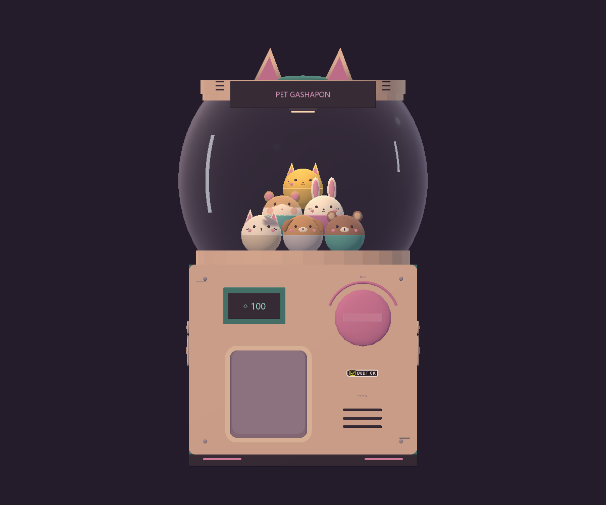
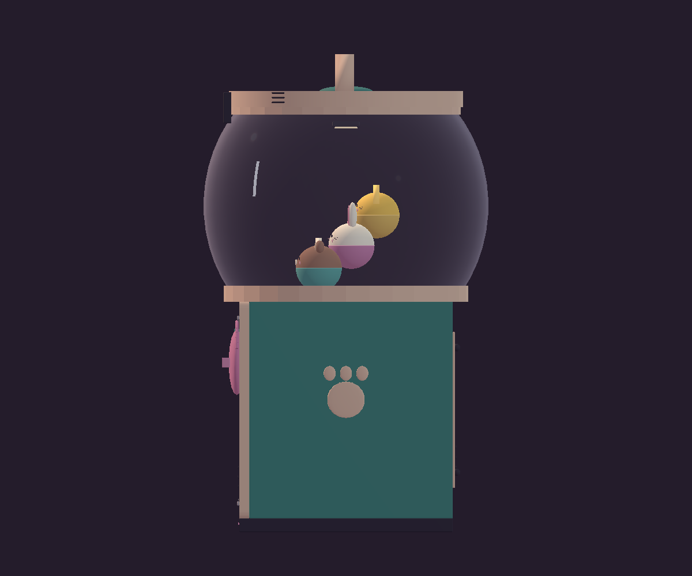
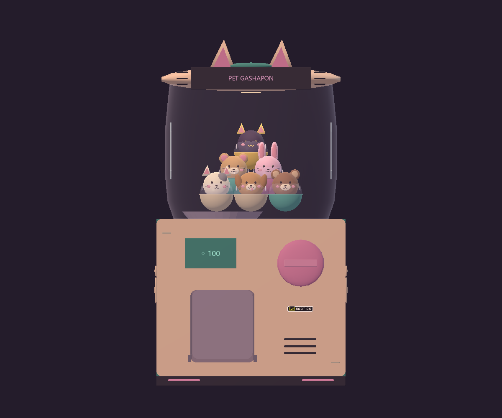
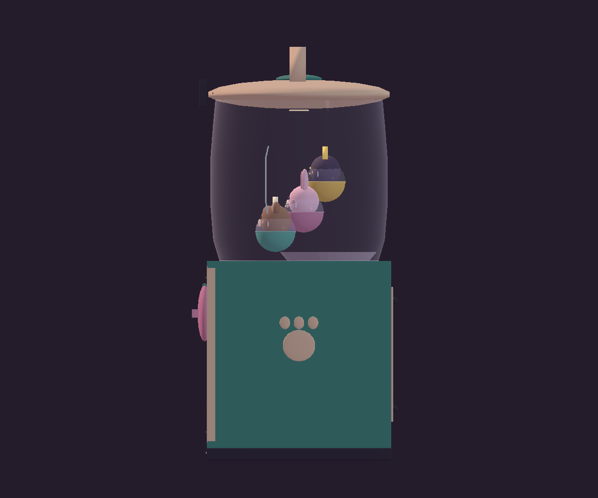
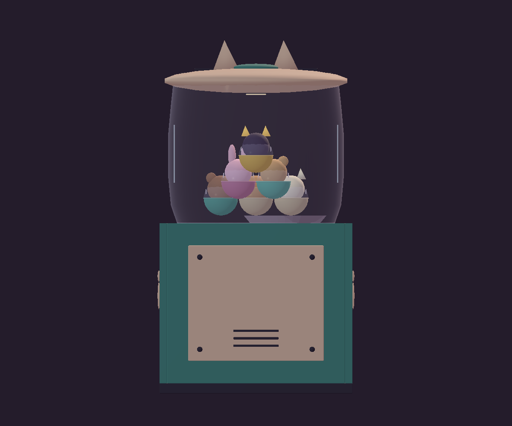
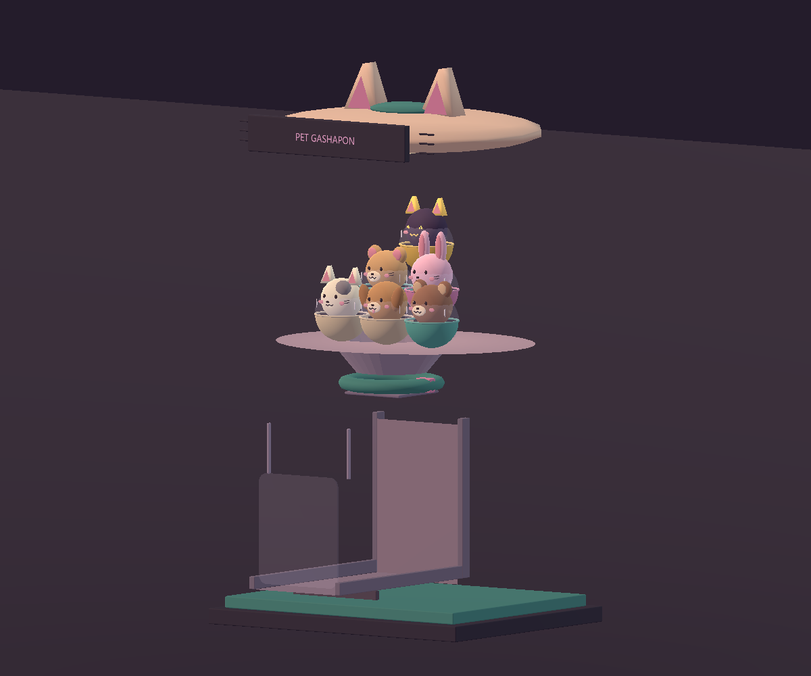
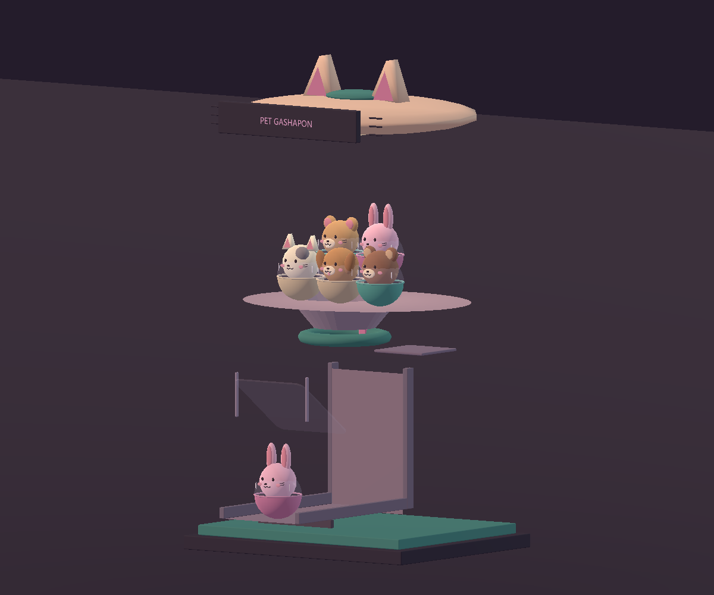
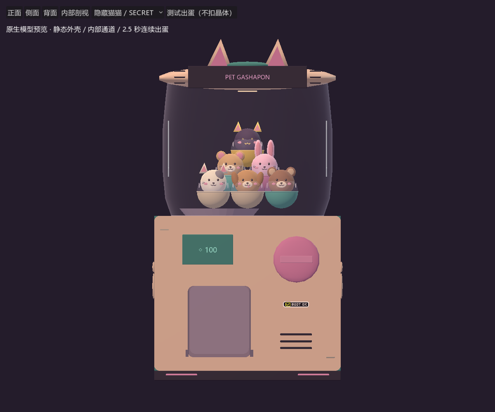
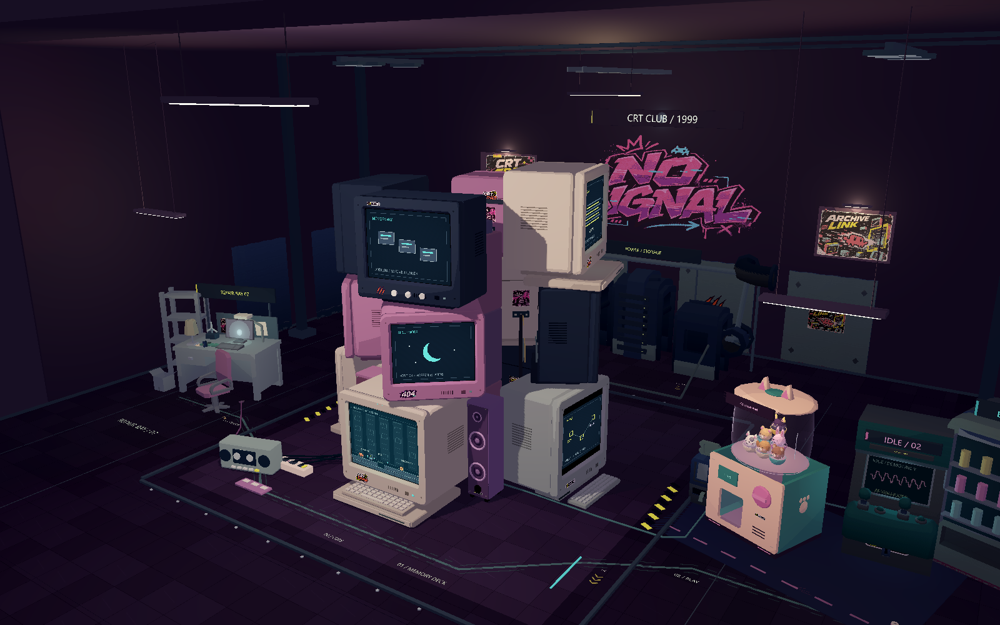

# 扭蛋机 v3 实机验收

最新抽取系统已替换早期演示：[18 颗自然滚动、免费抽取、保底与收藏验收](PET_GACHA_V1.md)。当前使用 1.5 秒出口出货，旧 `ROUTE` / `TIMES` 动画已移除；本页保留机身建模及早期机构记录。

## 最新：球形玻璃罩与扣环

将原来近直筒的玻璃改为同一椭球面，两端仅为安装开口而截断。最大直径 4.20，球心 Y=4.82，半径 (2.10,2.20,2.10)；下口 Y=3.55、半径 1.714758，上口 Y=6.24、半径 1.603977。上下圆形 U 槽直接由这些截面半径生成，槽宽 0.04；底座下表面 Y=3.40 贴合原机身顶部，玻璃边缘嵌入槽内，顶部由匹配圆环与猫耳扁盖扣住。

修正球面法线、增强 Fresnel 边缘反光，增加两条贴合球面的高光，同时保持仓内可见。下半机身仅补旋钮弧标、价格牌内衬、固定螺钉、取物口薄边框和系列标识；机身尺寸、内部机构、宠物模型和摆放、出蛋路径及交互代码均保留。

| 正面实机 | 侧面实机 |
| --- | --- |
|  |  |

正侧面检查未见外露缝隙或玻璃穿入机身。[机台 31 项](spherical_hopper_evidence/gashapon-v3-qa.json)、[全场 44 项](spherical_hopper_evidence/arcade-hall-qa.json)、[玩法与环境 90 项](spherical_hopper_evidence/sideview-qa-visual.json)通过；新增检查覆盖椭球面方程、上下口与扣环半径、底座落点和取物口净空。六款共 906 个出蛋姿态样本通过受检通道检查。[游戏厅效果](spherical_hopper_evidence/hall.png)，[环境几何统计](spherical_hopper_evidence/environment-metrics-visual.json)为 56,790 三角面。

以下为原 v3 初验记录，参数与配图保留历史版本。

后续宠物外观按草稿修正为不透明的“动物上半球 + 稀有度下半球”，透明仅保留在机台大玻璃仓。最新并排图和复查结果见 [六款扭蛋说明](PET_CAPSULES.md)；本文图片与视频保留 v3 初验记录。

按 [用户调整单](GASHAPON_V3_SPEC.md) 在原扭蛋机脚本内完成外壳、玻璃与出蛋机构修改。游戏厅位置、六款独立模型、电脑塔、屏幕玩法、关卡映射和存档脚本保留。

双击 **GASHAPON_PREVIEW.cmd**：可选正面、侧面、背面、内部剖视；选择测试款式后点“测试出蛋（不扣晶体）”。按钮在播放期间禁用，结束后恢复，再点可重置演示。正常游戏厅只陈列机台，不加入扣费、概率或收藏系统。

## 比例与玻璃

| 项目 | 实现 |
| --- | --- |
| 主体外壳 | 宽 3.85、高 3.20、深 3.15，中心 Y=1.80，壁厚 0.15 |
| 球罩 | 宽 3.50、高 2.84、深 3.02，中心 Y=4.82；底边 Y=3.40 与机身衔接 |
| 顶盖 | 中心 Y=6.24，半径 (1.85,0.25,1.57)，猫耳顶 Y=7.05 |
| 宽度比 | 3.50 / 3.85 = 90.9%，小于 110% |
| 玻璃 | 专用 Spatial Shader，颜色 #E3DCEB，基础 Alpha 0.10、Fresnel 边缘最高 0.42、粗糙度 0.08 |

球罩为开口曲面，轮廓在上下口略收拢，保持目标包围尺寸并给底部堆积留空间；不是封闭的磨砂白球。两条直径 0.025 的弧形高光贴合曲面，上下薄边圈表现约 0.035 的视觉壁厚。采用当前 Compatibility 渲染器可用的透明与 Fresnel，不使用折射采样。

## 实际开孔与通道

- 主体由侧板、背板、底板和连续的开孔前面板组成，内部没有完整实心盒体。前面板有正背面及孔壁，开口范围为 X=-1.23…0.07、Y=0.48…1.95，前表面 Z=1.575，圆角 0.12。
- 薄圆角挡板嵌在开孔内，闭合时留出边缘间隙。播放时先内翻 55°，再沿内侧导轨退后 0.10、抬高 0.52；这一步给兔耳腾出净空，避免翻起后的挡板横在落蛋路径中。
- 储蛋底面围绕真实进料孔建造，接通上口直径 1.65、下口 0.90、高 0.45 的漏斗。下接直径 1.35、厚 0.18 的单槽选球盘与退让闸片，没有实心底板封死球路。
- 选球盘出口接开放式下降滑道及取物仓地面；滑道净宽 1.25，侧壁厚 0.08、高 0.16。下降段调整到机身后部，扭蛋先在后方落下，再沿下部地面前滚进入出蛋口，避开挡板和前面板。
- 取物区前后深度约 0.85，入口与滑道连通；末端根部 Y=0.48，正好落在仓底。没有在出口另生成模型。

内部六款缩放均为 0.34，按前排 3、中排 2、后上方 1 交错堆放，底排由开孔底面承托，其余靠下层头部/球壳接触。独立六款场景文件与宠物建模脚本未改。预览下拉框只替换最上方测试样品，方便逐款验证通道；正常游戏厅默认仍是六款各一颗。

## 动画与声音

使用一个持续 2.5 秒的 Tween：0–0.35 秒旋钮转 90°，0.35–0.70 秒选球盘转动并退开闸片；样品从球堆最上方连续移到进料孔，经漏斗与滑道下降，2.18 秒到取物仓，最后小幅弹跳停止。样品自始至终为同一 Node3D；路径点在机台脚本 `ROUTE`，时间点在 `TIMES`。

机械咔嗒、滚动和落蛋声音由原生 PCM 合成，分别在起动、0.70 秒和2.18 秒触发。下面视频记录真实 Tween 的 80 帧（固定 30 fps），前 20 帧显示旋钮，随后切到剖视镜头；音轨使用相同 PCM 与时刻合成。

## 实机截图

| 正面 | 侧面 |
| --- | --- |
|  |  |

| 背面 | 内部剖视 |
| --- | --- |
|  |  |

## 检查与复现

- [机台检查](gashapon_v3_evidence/gashapon-v3-qa.json)：27 项通过。射线验证前面板真正开孔、周围面板存在、储蛋底面进料孔畅通；六款包含耳朵的尺寸均通过滑道净空检查。
- 每款以 60 Hz 采样 151 个动画姿态，总计 906 个。使用实际模型顶点检查漏斗、选球环、下降滑道及机壳边界，用三角形边与平面求交检查开孔面板和活动挡板；本轮未发现这些受检边界的碰撞。
- 实际按钮启动 Tween，完整播放后校验样品末位置、播放锁定与按钮恢复。几何采样是通道检查，不是刚体物理仿真，也不是全场任意三角形对的碰撞求解。
- [全场艺术检查](gashapon_v3_evidence/arcade-hall-qa.json)：43 项，含十二屏聚焦、72 步环绕、机台与邻机间距及像素帧缓冲一致性。修复了整机大包围盒把猫耳旁空白也算作遮挡的问题：先用总包围盒筛选，再按部件包围盒确认；侧面游戏厅机位保留机器可见，聚焦保护仍有效。
- [玩法与环境回归](gashapon_v3_evidence/sideview-qa-visual.json)：90 项；[环境采样](gashapon_v3_evidence/environment-metrics-visual.json)记录几何预算与实际传送镜头检查。

复现：`godot --path . --fixed-fps 30 res://scenes/pets/gashapon_preview.tscn -- --gashapon-qa`。自动保存截图、实际动画帧、PCM 音效及 JSON 至 `artifacts`，平时运行预览无需测试参数。

机械分区参考：[Bottle-cap-GACHA](https://github.com/lodgefab/Bottle-cap-GACHA)。本次使用项目原生网格与代码实现，没有导入该仓库模型。
