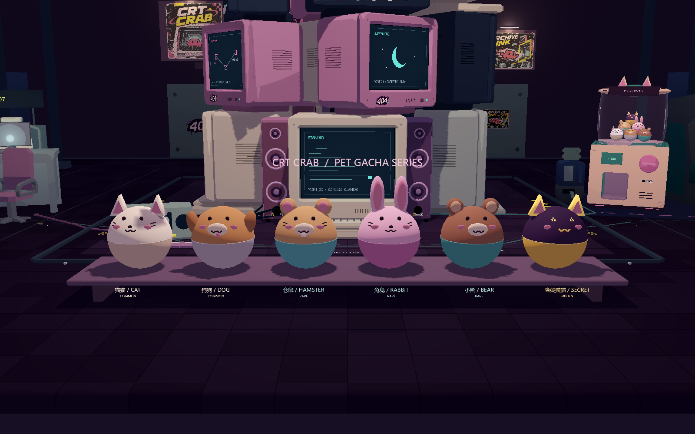
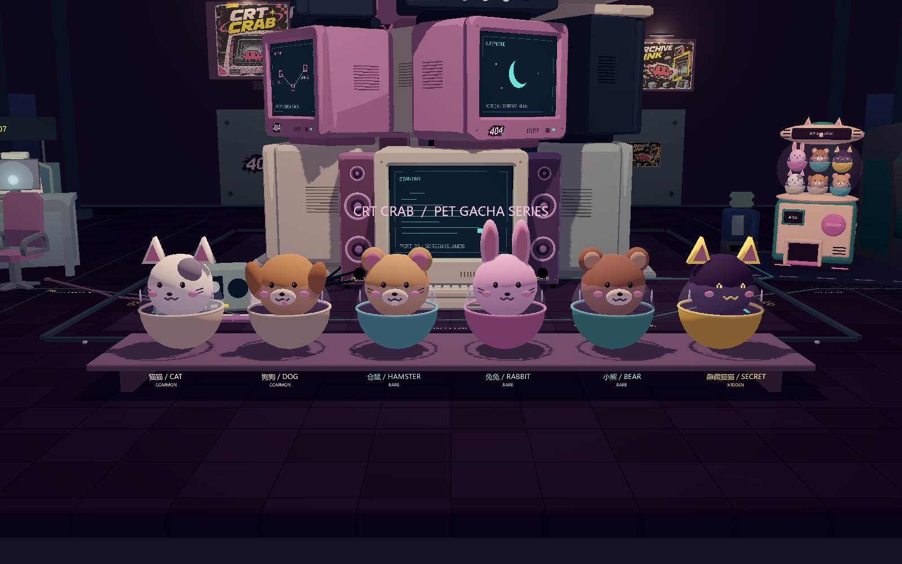
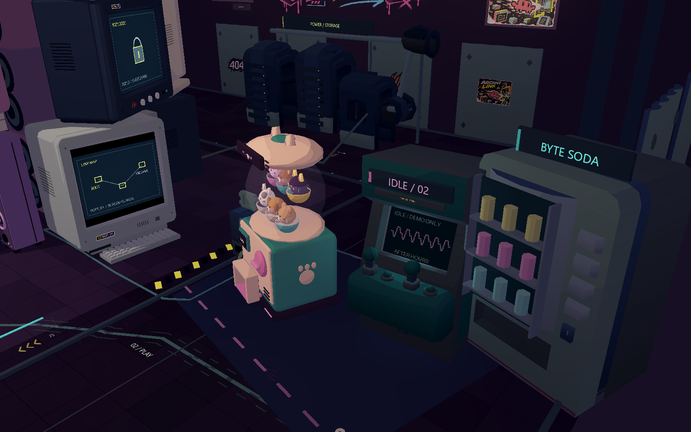
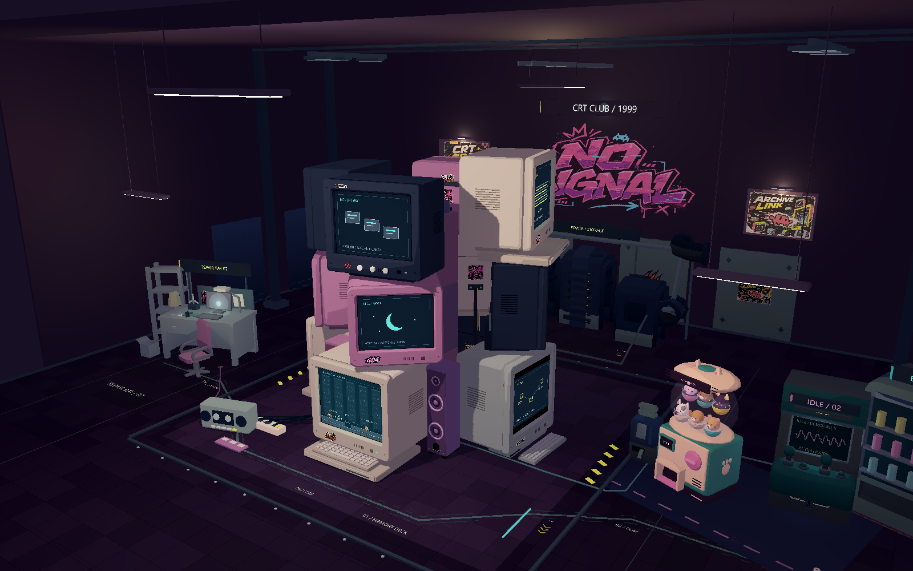
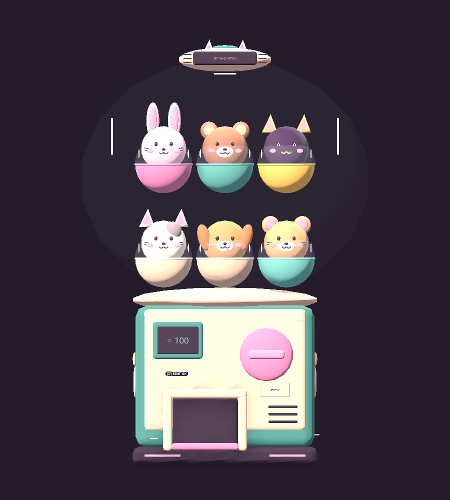

# 六款宠物扭蛋与扭蛋机

最新机台：[v3 比例、真实开孔、内部机构与连续出蛋动画](GASHAPON_V3.md)，双击 `GASHAPON_PREVIEW.cmd` 测试。本文下方机台图保留早期版本记录。

六款均为 Godot 原生 Mesh / SurfaceTool 构造，没有第三方模型或抽奖逻辑。按用户最新草稿改为一个完整球体的上下两半：**上半球就是动物本身，不透明；下半球才是稀有度胶囊壳**。两半共用相同球心与半径，耳朵和表情附着于上半球，接缝圈收窄。移除透明小罩、内部独立圆头和玻璃高光，扭蛋机的大玻璃仓保留。模型原点位于底端，正面朝 +Z，基础球壳直径 2 单位。

最新模型实机预览：

[侧面](pet_halves_evidence/side.png) · [背面](pet_halves_evidence/back.png) · [模型检查](pet_halves_evidence/pet-capsules-qa.json) · [六款出蛋通道检查](pet_halves_evidence/dispense-qa.json)

独立模型的 12 项结构/不透明材质检查与机台 27 项检查通过；六款共 906 个动画姿态样本未发现受检通道边界的碰撞。机内实例继续复用同一模型，并微调顶部一颗的位置，使新球形轮廓与下层接触。后文早期配图保留历史记录。

[全场 44 项检查](pet_halves_evidence/hall-qa.json)通过，含聚焦、环绕与像素帧缓冲一致性；同时让三渲二材质保留猫猫的顶点花斑颜色，避免正常游戏厅与独立预览出现色差。[机内实机效果](pet_halves_evidence/machine.png)。

| 独立场景（`scenes/pets/`） | 外观与稀有度 |
| --- | --- |
| `cat.tscn` | 米白上半球、灰色花斑、尖耳，米色下壳；普通 |
| `dog.tscn` | 棕色上半球、垂耳、奶白口鼻、吐舌，灰色下壳；普通 |
| `hamster.tscn` | 浅棕、圆耳、胡须、门牙、青绿下壳；稀有 |
| `rabbit.tscn` | 粉色长耳、粉色下壳；稀有 |
| `bear.tscn` | 棕色圆耳、奶白口鼻、青绿下壳；稀有 |
| `hidden_cat.tscn` | 深紫、柔金发光尖耳、像素眼、金色下壳；隐藏 |

调用方式：`load("res://scenes/pets/cat.tscn").instantiate()`，加入任意 Node3D 后调整位置与缩放。共享脚本为 `scripts/pet_capsule.gd`，没有碰撞体、奖励、随机概率、存档写入或额外灯光。

双击 **PET_PREVIEW.cmd** 可在现有游戏厅内查看六款并排模型；按住鼠标左键拖动统一旋转，Esc 退出。也可直接运行 `scenes/pets/preview.tscn`。桌子仅用于预览，不加入正常游戏厅。

## 场景放置

根据用户标注，用原生扭蛋机替换电玩区靠电脑塔、位于右前方的那台街机。电玩区局部位置 (-2,0,0.7)，朝向 -8°；另一台街机、贩卖机、票机、电脑塔和其他区域保留。

`scripts/pet_gashapon_machine.gd` 制作米白/奶茶与青绿机身、猫耳、透明仓、粉色旋钮、价格牌、实体出蛋凹槽、侧面爪印、背面检修盖与通风槽。仓内展示六款缩小模型，当前是静态陈列，旋钮不可抽奖。前面板使用与 HUD 相同的晶体符号“◇ 100”，数字仅作模型展示，不设定实际抽取费用。

机台整组注册到已有观察遮挡系统，屏幕聚焦与传送时整体显隐，避免单独隐藏部分零件。局部光和原街机屏幕引用自动指向保留下来的街机。

## 实机图

[侧面](pet_capsule_evidence/side.png) · [背面](pet_capsule_evidence/back.png)

## 可复现检查

使用本机 Godot 4.7.2 OpenGL Compatibility 渲染。运行 `godot --path . res://scenes/pets/preview.tscn -- --pet-check`，自动检查六款实例及半球、透明材质结构，保存正侧背截图和 JSON 至 `artifacts/pet-capsules-*`。正常流程回归使用既有 `--qa --environment-qa`；全场聚焦与环绕使用 `tests/arcade_hall_qa.gd`。

验收 JSON 见本目录 `pet_capsule_evidence`。原屏幕玩法、传送、关卡映射、存档代码均未修改。

- 六款结构检查 12/12 通过，保存正侧背真实渲染截图。
- 玩法与环境回归 90/90 通过；359 左右的实际传送镜头采样无环境穿模（具体采样数见 JSON）。
- 环境几何总量 56,819 三角面，低于原 60,000 预算；移除一台 GLB 街机后仍有 25 个原素材实例。
- 全场艺术检查 37/37，包含十二屏聚焦与 72 步环绕。

## 机台第二次调整

顶牌整体移到弧形盖子外，清除压字的壳体凸块。玻璃罩三个轴放大至原来的 1.5 倍（半径 2.55/2.13/2.01），顶盖连同耳朵、招牌缩至 0.5 倍并移至罩顶。透明度 Alpha 从 0.12 降至 0.035，使用近无色材质与两道细高光；仓内六款展示随罩体重新排布。

盖内增加有实体灯具的暖色向下灯，随机台整组显隐，不增加全局补光。外壳复用 BOOT OK 贴纸，添加小维修便签与三处克制的掉漆痕迹。最新全场检查扩展为 42 项，增加晶体标价、玻璃/顶盖比例、招牌表面间距、灯光方向及放大后与保留街机的间距检查。

以下为新模型的 Godot 正交预览灯光截图；上方并排扭蛋图和初版性能数据保留为初版记录，游戏厅机台图已更新。

[新侧面](pet_capsule_evidence/machine-side-v2.png) · [新背面](pet_capsule_evidence/machine-back-v2.png)
