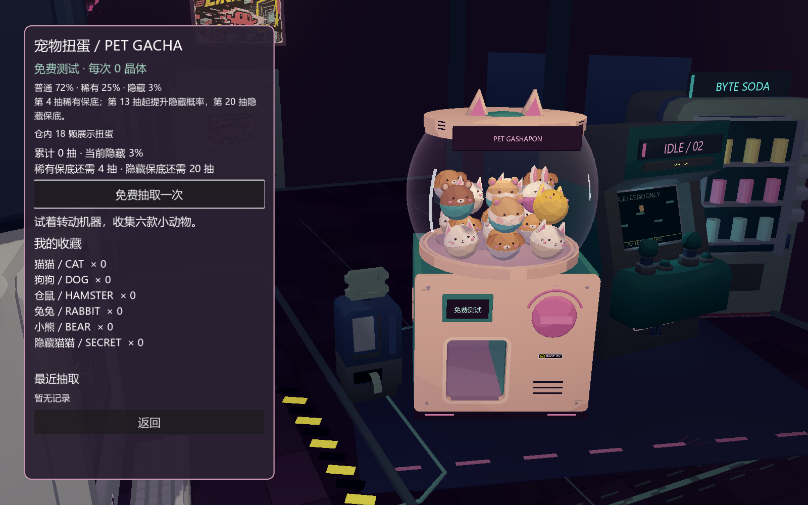
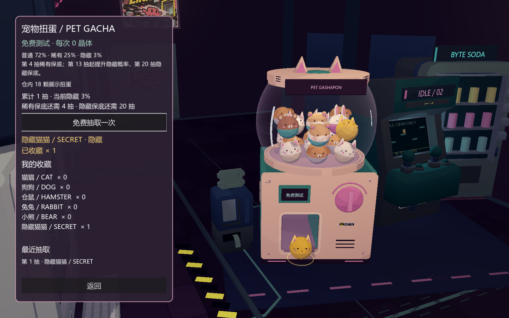

# 宠物扭蛋：18 颗储蛋与免费抽取

按[机制原文](PET_GACHA_V1_SPEC.md)开发，以用户后续确认的“约 18 颗、稍大、按稀有度配置、自然滚动后静止”覆盖原文的六颗固定陈列。保留球形玻璃、机身、出货口、六款外观与屏幕冒险。

主菜单 **宠物扭蛋** 或暂停菜单 **宠物扭蛋 · 免费测试** 进入；`GASHAPON_PREVIEW.cmd` 也直接打开同一正式界面。每次费用 **0 晶体**，机身价格牌同步为“免费测试”。界面显示拥有数量、累计抽数、保底进度、当前隐藏概率和最近记录，支持键盘焦点与窄屏滚动布局。返回后恢复原菜单/暂停状态，继续冒险可正常操作。

## 仓内自然陈列

- 共 18 颗：普通 13（猫 7、狗 6），稀有 4（仓鼠 2、兔 1、熊 1），隐藏 1。整数陈列比例只控制视觉，**不作为抽取权重**。
- 机内缩放从 0.34 增至 0.38，约大 12%。不再用 3+2+1 固定悬空排列。
- 使用六款模型的凸包碰撞体，18 颗球在真实玻璃边界和底板内滚动、接触后休眠；隔离在专用 3D 碰撞层，不参与屏幕内 2D 玩法。回归测试中 18 颗全部自然休眠，凸包顶点未越过受检仓壁与地面。
- 抽取时三次衰减轻晃，持续 0.55 秒；位移最大 0.025、旋转最大 4°，结束后恢复局部原位。仓内数量始终保持 18。
- 仓内小模型复用缓存网格与材质，并使用较低细分；独立预览、出货展示仍使用原细分，六款配色与脸部规则保留。

## 概率与保底

| 规则 | 实现 |
| --- | --- |
| 基础池 | 普通 72%、稀有 25%、隐藏 3% |
| 池内分配 | 猫/狗各 1/2；仓鼠/兔/熊各 1/3；隐藏为金猫 |
| 稀有保底 | 连续 3 次普通后，第 4 次必为稀有或隐藏 |
| 隐藏软保底 | 第 13–19 次分别 8%、13%、18%、23%、28%、33%、38% |
| 隐藏硬保底 | 第 20 次强制隐藏 |
| 判定顺序 | 隐藏 → 稀有保底 → 稀有/普通；隐藏提升从普通池扣除 |
| 计数重置 | 隐藏清零两个计数；稀有只清零稀有计数 |

实际抽取使用独立 `RandomNumberGenerator.randomize()`，无固定种子。自动测试中的种子和示例筛选只用于复现验收，不出现在正常界面。保底生效后的长期占比会不同于基础概率。

无保底的 100,000 次采样结果：普通 **72.123%**、稀有 **24.921%**、隐藏 **2.956%**；六款次数为 36,099 / 36,024 / 8,311 / 8,291 / 8,319 / 2,956。另连续模拟 10,000 次带保底抽取，最多连续普通 3 次、连续未出隐藏 19 次。

## 出货与收藏

结果先确定并原子写入独立 `user://pet_gacha.json`，成功后才播放 1.5 秒动画。存档包括六款数量、总抽数、两个未出计数与最近 20 条记录；重复宠物累加。沿用冒险存档的临时文件、flush、rename 写入方式，不改冒险存档格式，也不在新游戏时清空收藏。

写入失败时不增加收藏、不播放出货，显示可重试提示；损坏/不支持的收藏文件停止覆盖。中途返回或退出后，已写入的宠物仍在收藏中，重新打开显示最近获得记录。抽取按钮与机台播放状态双重防重入。

仓内宠物不再走旧滑道路径；0–0.25 秒旋钮转 90°，0.15–0.70 秒仓内轻晃，0.70–0.95 秒挡板打开，0.95–1.25 秒独立奖励模型由出口内部弹出，1.25–1.50 秒挡板复位并显示结果。按实际模型将出货根部 Y 调为 0.48，保证兔耳也可通过；最终 Z=1.93，模型在挡板前方展示，关闭时不夹住奖励。

普通用白色提示，稀有有短暂粉/青绿光圈，隐藏有金色光圈、12 个短寿命电子粒子及专属音效；不启用 Bloom。演示视频附机械声，结尾额外停留 0.8 秒以便阅读结果。

| 普通 | 稀有 | 隐藏 |
| --- | --- | --- |
|  |  |  |

[普通截图](pet_gacha_evidence/common.png) · [稀有截图](pet_gacha_evidence/rare.png) · [720×1280 窄屏窗口](pet_gacha_evidence/mobile.png)

## 验证

- [抽取系统 37 项](pet_gacha_evidence/pet-gacha-qa.json)：概率、保底、25 次实际磁盘写入及重载、写入失败、损坏文件保护、18 颗碰撞/休眠、三档出货、防连点、中途关闭恢复、主菜单与暂停入口、返回继续、窄屏与键盘滚动。
- [全场 44 项](pet_gacha_evidence/arcade-hall-qa.json)、[玩法与环境 90 项](pet_gacha_evidence/sideview-qa-visual.json)、[菜单与存档原功能 49 项](pet_gacha_evidence/stage2-qa-visual.json)、[六款独立模型 15 项](pet_gacha_evidence/pet-capsules-qa.json)均通过。
- [环境几何](pet_gacha_evidence/environment-metrics-visual.json)为 58,767 三角面，保持原 60,000 预算。全场性能 JSON 包含强制渲染/读回采样，不将该时间直接当成游戏帧率。
- 存档、概率和测试在项目原生 Godot/GDScript 内完成，无新增第三方依赖；正式收费、图鉴兑换与宠物能力系统未加入。

复现：`godot --path . --fixed-fps 60 --script res://tests/gacha_qa.gd -- --qa --menu-qa --gacha-qa`。测试使用内存收藏与独立临时文件，不覆盖玩家收藏或冒险进度。
