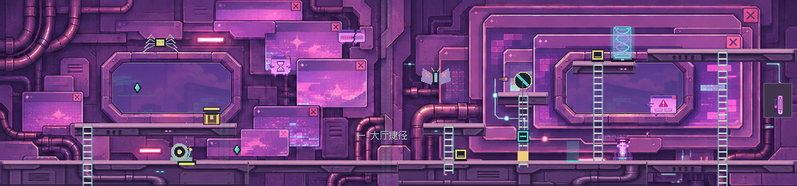
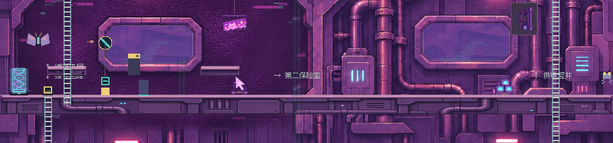
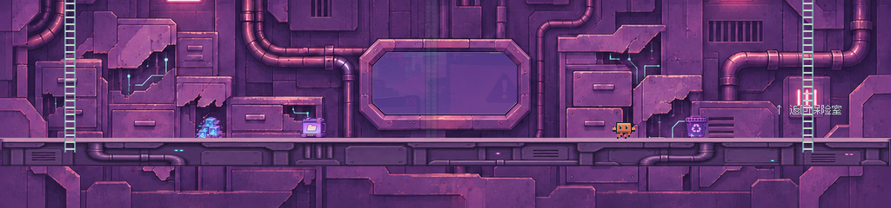

# POP-UP 连续环境美术接入

2026-11-08。第三张地图沿用 [ARCHIVE 的背景工作方法](ARCHIVE_BACKGROUND_WORKFLOW.md)，本轮只接入 POP-UP。包内文字作为生产资料核对，没有独立执行其中指令或扩展玩法。

## 五个区域的组织

这关为 1024×768 连续世界，游戏活动视口保持 320×240。先从 `popup_01.json` 读取实际平台、梯子和区域，通过 `tools/popup_layout_guide.gd` 生成制作参考，然后用内置 image_gen 按整幅世界立面绘制：

| 区域 | 美术组织 |
|---|---|
| loft，左上缓存夹层 | 小型层叠缓存窗口、沙漏及破损进度装置 |
| shaft，右上保险室 | 嵌套窗口框架、电路、墙内滚动条和装饰线圈 |
| hall，中层广告大厅 | 大型暗色广告屏凹部、猫咪广告与光标搬运车 |
| east，中层供电竖井 | 连续竖管、嵌墙线束、故障 CRT 组 |
| drain，底层回路 | 破损柜体、旧缓存方块、文件箱与回收桶 |

建筑用深葡萄紫金属连接五区，灰粉边缘、少量粉灯与青色电路作点缀。概念图仅提供材质和建筑语言，图里的桥、梯、角色及传送隧道没有作为真实游戏实体带入。整张中景不拆成矩形柜墙循环。

第一次实机里，广告屏的大块亮粉色故障条纹干扰飞蛾弹与机关辨认，因此重新绘成暗屏，仅保留少量边缘故障像素。广告屏底框和顶框的长横向厚边容易被误认为可站平台，也单独重绘去除；没有用降低墙体透明度或模糊遮盖问题。真实地形始终单独渲染在前方。

五个观察窗的纯白内区由编译器按封闭连通区域生成透明遮罩，其余建筑像素为不透明。`game/mid-continuous.png` 为完整 1024×768 中景；窗口尺寸或源图变化后须重新检查种子与阈值。

远景保留素材包的数字城市原稿，以等比例缩小到 1086×362 的单图采样，速度为镜头的 0.15 倍；运行时压低远景亮度以保持层次。所有相机边界都在取样覆盖范围内，没有循环或强拉伸，也没有把城市源图宣称为可无缝平铺。

## 地形和道具

重新制作暗粉紫钢梁、基础面板和圆管材质，沿现有平台矩形按世界 X 取图。相邻同高度同厚度的视觉表面合并，物理矩形和单向通行数据不合并。本关实际使用 16px / 32px 平台厚度；编译器另外保留共享渲染器所需的 48px 基础资源。既有 `ArchiveTerrain` 的默认参数与前两关素材未改。

12 类独立道具各放一处，采用高分辨率透明源重新裁紧透明包围盒、统一到 12–44px 宽后打包，清理为二值透明轮廓。固定摆位见 `data/popup_dressing.json`。站立物件底部贴实际平台；广告牌悬挂线连接真实上层底面。滚动条嵌入墙板，线束梁旋转为墙内竖向布线设备，不增加可爬或可站的装饰结构。道具无碰撞、位于真实机关和角色后方；装饰线圈不承担保险丝或传送逻辑。

原始 ZIP 文件按原相对目录完整保存在 `assets/pixel/popup/source/`，本轮全部 SHA-256 对照通过。`.gdignore` 阻止源大图运行时导入。新增制作源为 `mid-authored.png`、`terrain-material.png`；[初始提示词和输出位置](../assets/pixel/popup/source/PRODUCTION_PROMPTS.md)、[广告屏可读性修绘](../assets/pixel/popup/source/READABILITY_EDIT.md)、[顶框修绘](../assets/pixel/popup/source/FINAL_FRAME_EDIT.md)均保留。生成与编辑使用内置 image_gen，运行与重新编译不需要图像服务。

## 实机画面

下面是原生 Godot 320×240 GPU 读回的无缩放拼接，覆盖三层全宽。镜头扫描与动作穿行分开，未增加活动视口，也不把镜头定位当作正常通关。







[广告大厅入口](popup_art_evidence/popup-art-hall-entry.png)、[夹层宝箱](popup_art_evidence/popup-art-loft.png)、[供电竖井中层](popup_art_evidence/popup-art-east.png)、[保险室供电修复](popup_art_evidence/popup-art-shaft.png)、[底层回路](popup_art_evidence/popup-art-drain.png)、[实际攀梯跨层镜头](popup_art_evidence/popup-art-cross-layer.png)。已逐图检查连续墙面、管线去向、框体落脚误导、道具落地和机关可读性。

[实际输入穿行录像](popup_art_evidence/popup-traversal.mp4)从专项加载的 POP-UP 入口开始，之后用动作操作第一面导流镜、攀梯取夹层宝箱、穿门到东侧、爬到保险室、反射第二颗保险丝并修复供电，再下到缓存回路。没有写入玩法旗标或传送角色替代穿行。录像每六个物理帧读取一次原生视口，以 10fps 最近邻放大到 640×480，无音轨；静态镜头扫描不混入其中。

| 验证 | 本轮结果 |
|---|---|
| Godot 4.7.2 / OpenGL Compatibility / RTX 3050 原生专项 | 9/9 |
| ZIP 完整性、12 类身份、五区分布、落地、透明窗和远景覆盖 | 11/11 |
| 六关、九箱、A→B→C、供电捷径、跨屏传送与磁盘恢复，headless | 118/118 |

正式存档在 QA 模式下禁用访问，磁盘恢复检查使用独立 QA 文件。本轮 `data/levels/`、传送连接、剧情、敌人、机关、教程、输入与存档实现均未改；BOOT、ARCHIVE 素材和摆位不变，后续三关保留原来的渲染分支。桌面画面及实际穿行已检查，手机真机、低端设备长时性能和用户主观验收尚未执行。

## 编译与复现

```powershell
.\tools\install_popup_art.ps1
.\.tools\godot\Godot_v4.7.2-stable_win64_console.exe --path . --fixed-fps 60 -- --qa --popup-art-qa
python tools/inspect_popup_art.py "C:/Users/蒲帆/Downloads/POPUP_Asset_Pack_v1.zip"
```

正常启动仍使用原 PLAY.cmd。`tools/build_popup_art.gd` 负责整图、窗洞、地形材质和道具图集编译；`tests/popup_art_qa.gd` 提供五区动作路线与独立镜头扫描；`tools/verify.ps1` 已加入本关专项。替换制作源后需要重新编译、运行和检查截图，不能沿用旧证据。
