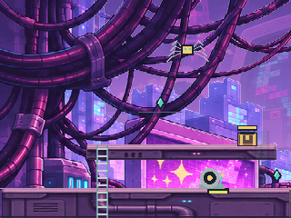
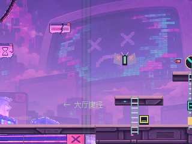
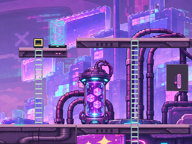
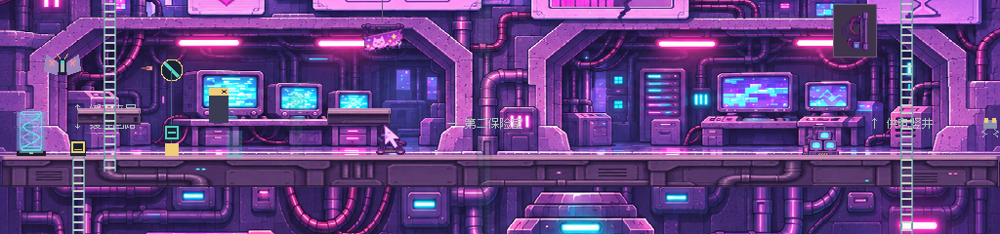
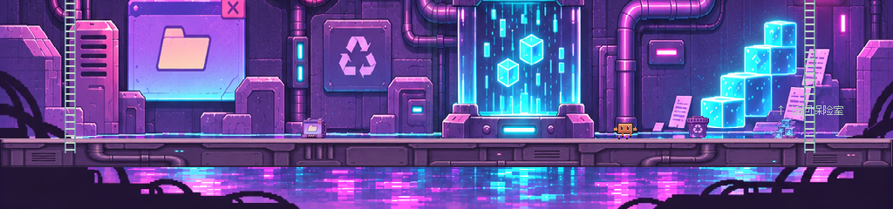

# POP-UP 开放场景还原 v2

2026-11-08。用户指出首版“很多元素没还原，全都是墙”。首版把档案库的连续柜墙方法过度套用到开放弹窗城市，虽然接缝和碰撞检查通过，却丢失了参考图的空间与主要设备。本次以用户圈选的场景元素为修复目标；旧版截图与报告只作历史，不代表当前结果。

## 按圈选元素还原

| 参考中的元素 | 本次实现与实机证据 |
|---|---|
| 左上大量悬垂线缆 | 重绘有弧度、层叠和遮挡的粗线缆束，保留建筑之间的天空空隙，见左上独立镜头 |
| 右上封闭能量舱 | 单独制作玻璃圆筒、青色顶灯、悬浮方块、顶盖与小底座；保留道具第11类身份，底部对齐真实 Y=208，见能量舱镜头 |
| 左侧维修间 | 深凹入式房间、顶部灯管、三台旧 CRT 工作台、线缆与落地设备，底部对应大厅真实 Y=448 |
| 右侧维修间 | 与左间不同的中继机柜、双显示器控制台、侧设备与顶部灯管，底部同样对应真实 Y=448 |
| 底部缓存、水面与倒影 | 独立可见的数据缓存发生器、落地底座、右侧缓存方块、废弃文件、青粉色水面和反射；真实道路保持 Y=688，水面位于道路后方及下方 |
| 城市与巨型 CRT 的开放纵深 | 撤掉五个小观察窗，把上部改为建筑之间的大范围开放天空；修正远景取样，使原稿中央的巨型 CRT 能进入镜头 |

中景不是把原概念图直接铺进游戏：用内置 image_gen 参照场景身份与真实关卡示意重绘，再做维修间地面位置和能量舱拆分的修绘。生成结果的维修间脚底仍未精确达到提示位置，因此编译器对单幅场景做连续纵向坐标映射，将上层安装位、维修间脚底、缓存底座分别对齐世界 Y=208/448/688。没有把房间裁成矩形拼片循环，也没有降低墙体透明度掩盖接缝。

原有平台碰撞及其专属材质继续单独绘制在场景前方。背景房间内的工作台、设备顶盖和框体属于后景设备，不增加可走路线。能量舱是封闭的装饰设备，没有增加传送触发器。既有12类道具继续保留，缓存方块移到右侧实际地面，配合参考的缓存堆；正式机关、传送柱与角色在它们前方。

天空按明确白色键生成透明遮罩。首轮只从一个天空种子清理，漏掉被线缆和塔楼分隔开的白色空隙；已改为从上部多个白色连通域清理，重新运行验证。远景单图不循环；横向取样使用 `160 + view_x × 0.5`，纵向保持 `view_y × 0.15` 并限制在纹理范围内。首版远景取样只覆盖偏左部分，导致中央 CRT 几乎不出现，本次改变了构图取样而非仅提高亮度。

## 最终实机截图

中层、下层全宽图由实际 Godot 320×240 GPU 读回无缩放拼接，属于独立镜头检查。活动视口仍只有一个320×240，没有扩大地图或用镜头定位冒充实际通行。上层开放远景有视差，多个镜头直接拼接会多次显现同一远处CRT，不能当成静态全景；所以上层用独立镜头展示。原始分镜及上层拼接检查图仍在证据目录保留，不将它当成多台CRT的场景设计。











[城市中央 CRT 镜头](popup_scene_v2_evidence/popup-art-landmark-skyline.png)、[封闭能量舱镜头](popup_scene_v2_evidence/popup-art-landmark-capsule.png)、[缓存水面镜头](popup_scene_v2_evidence/popup-art-landmark-cache-water.png)是原生视口定位检查。[大厅完整机台](popup_scene_v2_evidence/popup-art-hall-entry.png)、[实际跨层攀梯](popup_scene_v2_evidence/popup-art-cross-layer.png)、[供电修复机台](popup_scene_v2_evidence/popup-art-shaft.png)、[底层实际行走](popup_scene_v2_evidence/popup-art-drain.png)来自动作输入到达后的实机截图。

[本次实际穿行录像](popup_scene_v2_evidence/popup-traversal.mp4)包括两面导流镜与保险丝、夹层宝箱、供电修复、攀梯进入底层。起点是专项加载的 POP-UP 入口，后续没有直接改位置或写入旗标；镜头夹具不混入录像。原生320×240每六个物理帧采样一次，10fps最近邻放大至640×480，无音轨。

已逐图检查圈选元素是否实际出现，以及天空残留、CRT 构图、维修间地面、能量舱底部、缓存底座、水面与道路的关系。这个场景的“连续”来自城市结构和管线连接，不再用一整幅平墙替代空间。

## 验证与边界

| 项目 | 本轮结果 |
|---|---|
| Godot4.7.2 / RTX3050 / OpenGL Compatibility，原生专项 | 9/9 |
| 道具身份与五区分布、实际落地、天空透明、独立能量舱、远景范围、材质资源 | 11/11 |
| 六关流程、九箱、保险丝与供电、核心A→B→C、结局及磁盘恢复，headless | 118/118 |

本轮关卡数据、碰撞、输入、敌人、剧情、机关、传送和存档实现未改。其余五关素材与摆位不变。QA禁止访问正式存档，磁盘恢复使用独立QA文件。原始素材在仓库中保持原字节；Downloads中的原POPUP ZIP已不在原路径，本轮未重新对ZIP比对，资源检查不将其计入已通过项目。

本轮完成桌面视觉检查与流程验证；手机真机、低端设备长时性能和用户主观验收仍未完成。按用户最新指示，RECYCLE素材暂未处理。

## 制作源与复现

新增源：`assets/pixel/popup/source/mid-scene-v2.png`、`capsule-v2.png`；完整内置 image_gen 提示词、输入、选定输出和技术坐标映射见 [SCENE_V2_PROMPTS.md](../assets/pixel/popup/source/SCENE_V2_PROMPTS.md)。原先封闭墙面制作源保留为历史，编译器已切换到新场景。运行资源保存在 `assets/pixel/popup/game/`，新增 `capsule.png`，游戏运行与重建无需图像服务。

```powershell
.\tools\install_popup_art.ps1
.\.tools\godot\Godot_v4.7.2-stable_win64_console.exe --path . --fixed-fps 60 -- --qa --popup-art-qa
python tools/inspect_popup_art.py
```

正常运行仍使用原PLAY.cmd。重新绘图后须复核地面锚点、天空遮罩和远景构图，再重跑实机截图；源图或程序测试本身不能替代场景还原检查。
