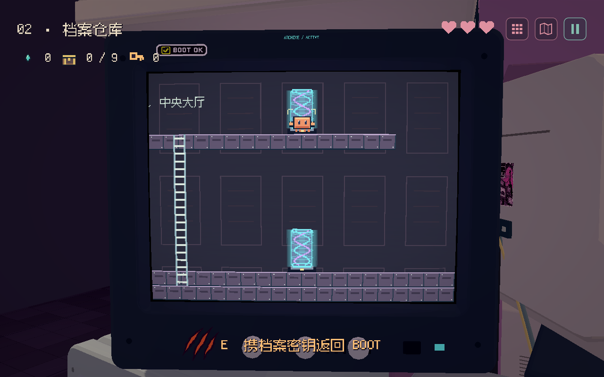
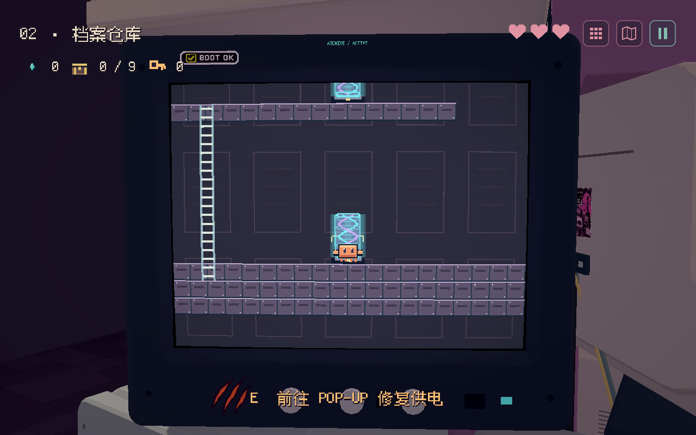
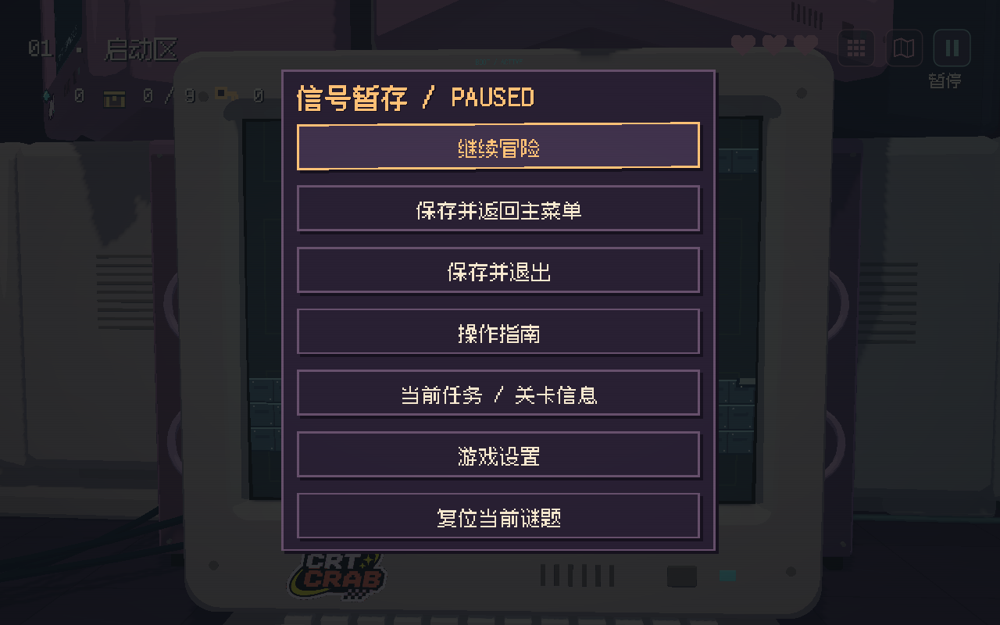

# 传送光柱与 HUD 细化

2026-11-08，按本轮四项截图反馈修改。

- ARCHIVE 右侧去 POP-UP 的端口移到大厅右侧 `(864,208)`；返回 BOOT 的端口移到上层检索桥 `(864,64)`。都远离梯子，上层可沿原有折返梯到达。左侧回 BOOT 的入口保留。
- 全部跨 CRT 端口改为原生像素能量光柱：小底座、青色发光边缘、紫青双螺旋、流动能量环。底座灯区分条件是否满足；原目的地、钥匙要求及传送流程保留。减动模式冻结旋涡。
- 删除暂停菜单的“关卡内部地图”重复入口；右上角地图按钮和 M 快捷键保留。
- 顶部按钮改为 36×36 半透明圆角方块：九宫格阵列、折叠地图、两竖线暂停；粉色 / 青色细边与生命颜色协调。默认无文字，鼠标悬停或触屏按住 500ms 显示名称。长按只看说明，短按执行动作。

验证：专项 headless 14 项、真实 GPU 15 项通过；额外 GPU 检查悬停显示。包含原生触摸短时隐藏 / 长按提示 / 不误触菜单、短按暂停、端口唯一目标与梯子间距、减动。新位置的完整六关、九箱、结局与存档恢复 headless 118 项通过；触摸往返与 GUI 攻击隔离 GPU 9 项通过。截图中的定点画面为独立视觉检查，不代替通关路线。

原始报告保存在同目录下。复现专项：`--path . --fixed-fps 60 -- --qa --portal-hud-qa`；加 `--headless` 可运行逻辑检查。手机硬件仍未作真机验收。
