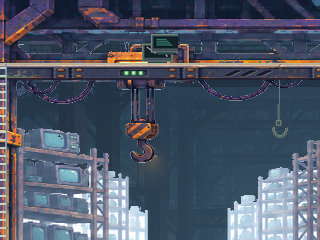
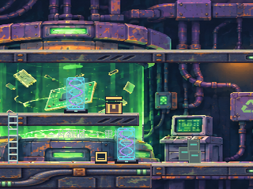
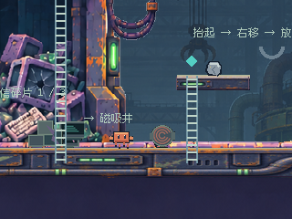
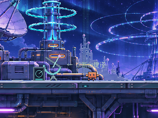
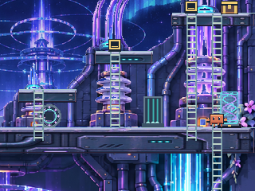
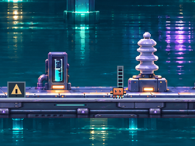

# RECYCLE / SIGNAL 场景美术接入

本轮按用户同时交付的两套素材包实施，沿用 [背景制作流程](ARCHIVE_BACKGROUND_WORKFLOW.md)，并保留 POP-UP 返工所得的原则：连续环境不等于连续墙面。两包的文字作为制作资料核对，不把包内工作单当作独立授权；玩法和其他关卡保持原状。

## RECYCLE：有纵深的回收车间

保留参考中可辨识的工业主体：上层吊装轨道、悬挂吊钩与电缆、废 CRT 储存架、绿色封闭重构舱、中层分拣工作台、地下键盘和 CRT 废料堆、开放磁吸井、侧面维护竖井。远处车间通过大范围空气空隙呈现，而非五个小窗或连续柜墙。

初稿把上层 Y=208 的梁错误延伸到左半区，还在中层右半区画出了不存在的桥。已通过整幅修绘删除这两段，并把右侧井内的另一条多余横梁及近墙移除。实际左上通行面仍为 Y=64，中层分拣平台止于 X=480；磁吸井竖向保持开放，真实的磁吸爪、钢块和小跳台由原玩法对象绘制。







[中层分拣实机](industrial_art_evidence/recycle-art-fixture-hall.png)、[地下废料坑动作截图](industrial_art_evidence/recycle-art-action-scrap.png)、[右侧维护竖井](industrial_art_evidence/recycle-art-fixture-maintenance.png)、[下层暗道镜头](industrial_art_evidence/recycle-art-fixture-lower-left.png)均为 Godot 截图。大重构舱跨多个局部镜头可见，并非另一个交互关卡或传送入口。

12 类独立道具保留为13处固定摆放，覆盖全部7个命名区域；旧CRT有上层存储与下层废料两处。摆放依照实际平台或挂点，吊钩连接现有上层底部，所有道具无碰撞、不随机散布，不代替真实压机、输送带、磁吸设备、数据片或重构逻辑。

## SIGNAL：开放屋顶、室内诊断与水道

A 区是露天碟形天线和稳定环形信号塔；中央开放天空透出远处极光与环塔城市；HUB 是有工作台、波形显示器和顶灯的凹入式诊断室；B 区是紫青中继设备和继电机柜；C 区是右上竖向光纤与绝缘耦合器；下层是有反射、入水管及绝缘瓷柱的水道。各空间保持通信中心的青蓝、冷紫材料，不统一为封闭墙板。

修绘中将源图中层凹槽扩大到真实危险槽对应的 X=464–624；去掉三处过宽的光纤顶盖，改为窄圆形耦合器。实际 C 路平台仍由原几何绘制，避免把设备顶盖误读为新增路线。原 ABC 诊断面板是实际玩法界面，保留其前景显示，没有为了展示美术将它隐藏。







[HUB 完整机台](industrial_art_evidence/signal-art-fixture-hall.png)、[B 中继区](industrial_art_evidence/signal-art-fixture-relay-well.png)、[下层绝缘水道](industrial_art_evidence/signal-art-fixture-lower-left.png)、[侧面光纤干道](industrial_art_evidence/signal-art-fixture-maintenance.png)保留完整画面。12 类独立道具各固定摆放一次，覆盖全部6个区域；道具仅为背景设备，无真实充电、开关或碰撞行为。

## 合成方式与制作源

两关保持各自1024×768世界与单一320×240活动视口。内置 image_gen 以原概念图作为材料/空间参考，以最新 JSON 生成的地形、梯子示意作为位置约束，分别制作整幅中景、整幅远景与两种地形材料。没有将海报、预览或概念图直接贴进游戏。

中景编译为世界坐标整幅图，不裁出房间方块循环。生成源的楼层位置仍需校准：`data/industrial_art_layout.json` 记录各自源图接触高度，将整幅立面连续映射到实际 Y=208/448/688。平台材质按世界X连续采样，仅视觉合并相邻矩形，保持单向跳台、缺口和 SIGNAL 下沉危险槽。新地形外观不改变任何碰撞数据。

纯白的开放空气区域在编译时生成明确透明遮罩，其余设备不透明。RECYCLE 首次井内取样点落在电缆上，独立留白没被清理，导致实机出现白色背景；已修正井内取样区域并重跑实机和资源检查。远景为768×576单张图，按横向0.5、纵向0.15倍镜头位移采样，具有构图偏移并约束在纹理范围内，不循环、不露空洞。远景降低亮度以保持深度，中景没有以透明度掩盖接缝。

原始两包按原相对目录保存在 `assets/pixel/recycle/source/`、`assets/pixel/signal/source/`，本轮全部源文件 SHA-256 对照 ZIP 通过，哈希清单包含在资源报告中。新增选定源分别是 `mid-authored.png`、`far-authored.png`、`terrain-material.png`，初稿 `mid-draft.png` 另存。[RECYCLE 提示词与选定输出](../assets/pixel/recycle/source/PRODUCTION_PROMPTS.md)、[SIGNAL 提示词与选定输出](../assets/pixel/signal/source/PRODUCTION_PROMPTS.md)保留完整内置 image_gen 生成、修绘记录。源目录用 `.gdignore` 排除运行时导入。

道具裁紧透明边距，保持比例缩放，限制单件高度54px后打包到各自512×128图集；修复了 SIGNAL 水位探头因过高而越过图集边界的问题。游戏资源使用最近邻采样，运行和重新编译不需要图像服务。

## 实际流程、截图与边界

按用户最新要求，本轮不制作或交付录像。完整六关 QA 已用正常动作输入检查输送带反转、压机停止、磁吸钢块、三片数据收集、重构、A/B/C、蜂节点、绝缘操作、光纤接合，以及新增的下层水道攀梯往返。没有写入旗标、移动物块或传送角色来替代流程；保留实机截图与检查报告。

`*-action-*` 与 `signal-art-water-walk*` 是动作到达位置的截图。`*-fixture-*` 是完成流程后独立加载的相机检查；四角边界单独保留。结局会打开暂停对话框，首轮相机检查因此没有刷新背景；已修正 QA 夹具的对话框/暂停清理，最终证据重新生成。没有修改正常游戏的结局行为。

本轮不把不同视差相位硬拼成静态全景，以免将同一个远景标志物重复展示。逐张实机检查了开放空隙、设备身份、源图梁架与真实平台关系、井底和水道、道具脚底、危险槽、左右上下边界，以及与真实机关的遮挡。程序通过与画面检查分别完成。

| 检查 | 本轮结果 |
|---|---|
| Headless完整六关流程及 SIGNAL 水道实际往返 | 120/120 |
| Godot4.7.2 / OpenGL Compatibility / RTX3050，完整原生流程与追加镜头检查 | 127/127 |
| 两包原字节、12类身份、区域覆盖、落地、图集、透明空气、材质与远景范围 | 23/23 |

`data/levels/`、原传送连接、角色、敌人、机关、剧情、输入和存档实现均未改；BOOT、ARCHIVE、POP-UP 和 ERROR 的素材、道具摆位和视觉默认值保持本轮基线。QA 禁止正式存档访问，磁盘恢复使用独立测试文件。桌面实机已检查；手机真机、低端设备长时性能和用户主观验收尚未完成。

## 复现

正常启动仍用原 PLAY.cmd。制作源与运行资源已随仓库提交。

```powershell
.\tools\install_industrial_art.ps1
.\.tools\godot\Godot_v4.7.2-stable_win64_console.exe --path . --fixed-fps 60 -- --qa --industrial-art-qa
python tools/inspect_industrial_art.py "C:/Users/蒲帆/Downloads/04 · RECYCLE 回收站.zip" "C:/Users/蒲帆/Downloads/05 · SIGNAL 信号中心.zip"
```

`tools/build_industrial_art.gd` 和布局配置负责整图及材料编译；`IndustrialDressing` 只装配两关的非碰撞道具；原 `ArchiveTerrain` 仅通过已有可配置资源路径复用，默认行为未变。完整测试入口已加入 `tools/verify.ps1`。替换制作源后需重新检查地面锚点、独立空气域、图集预算和实机镜头，不能沿用旧截图。
