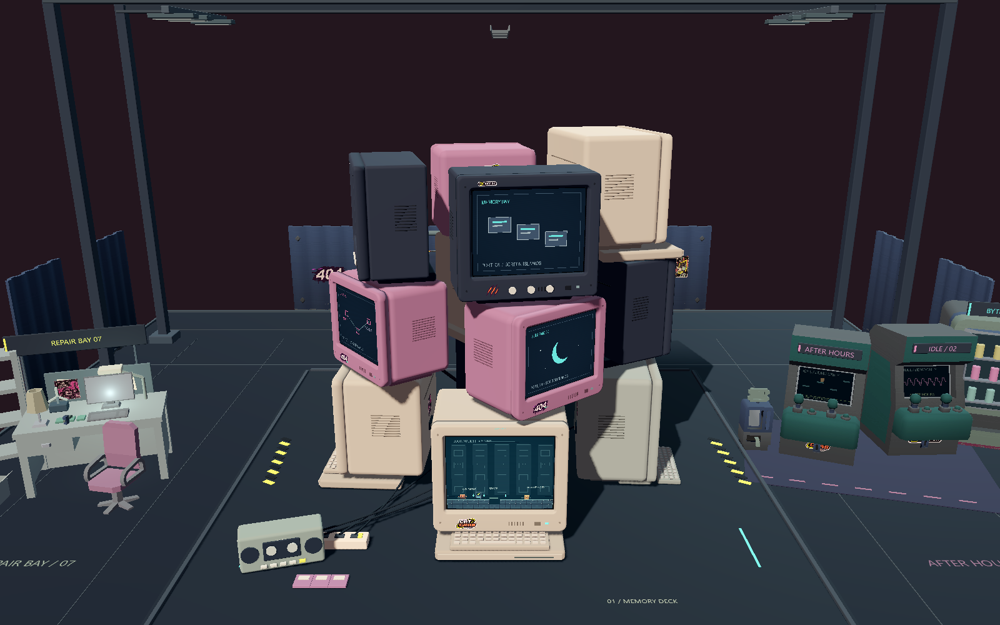
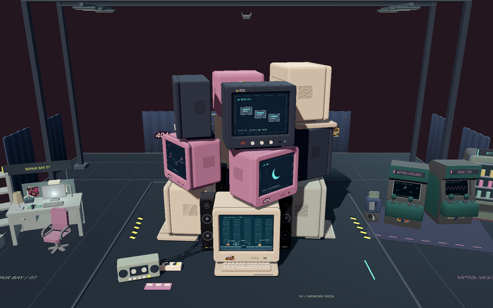
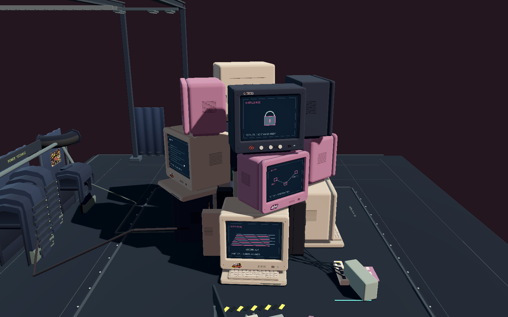
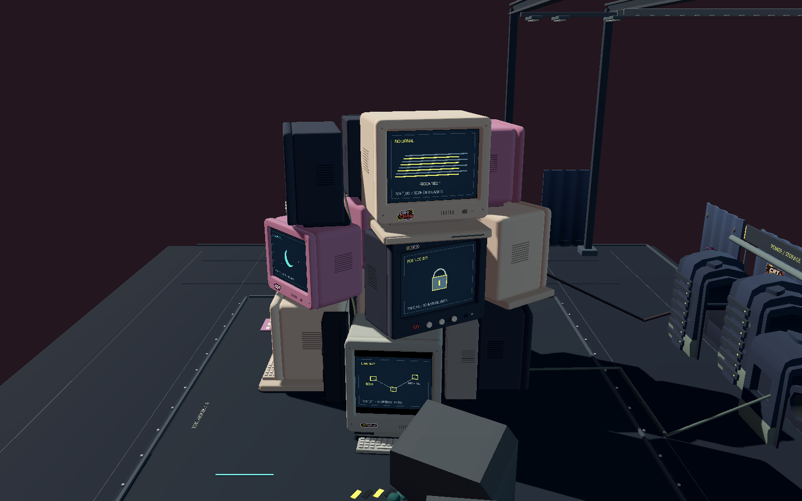
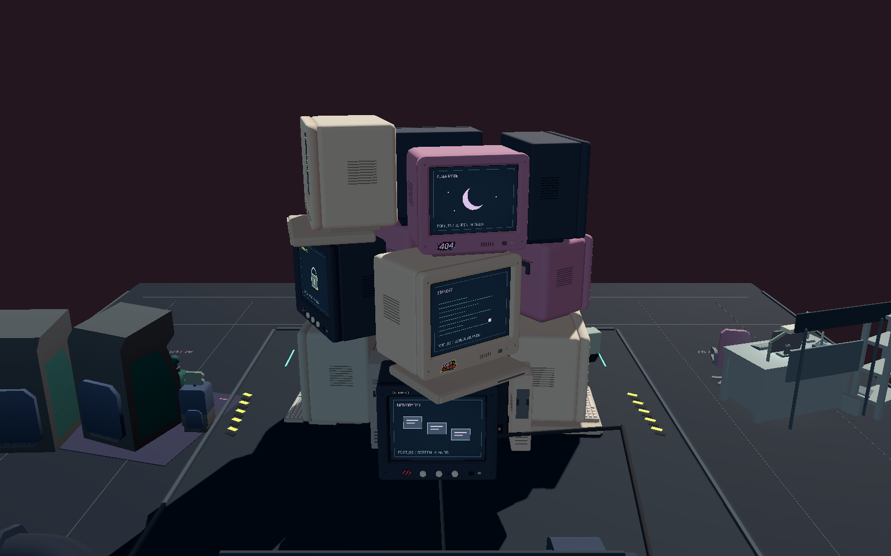
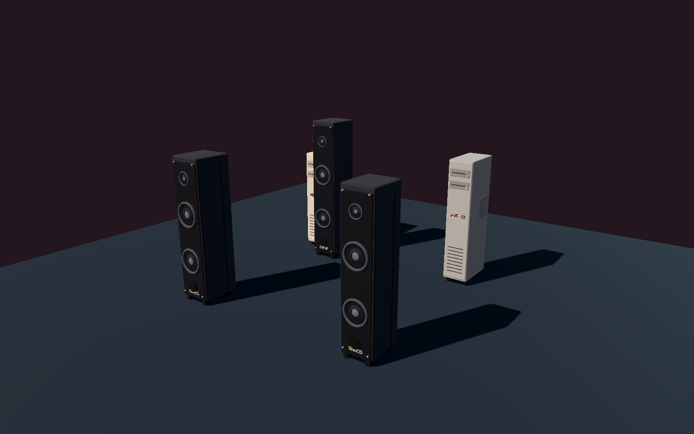
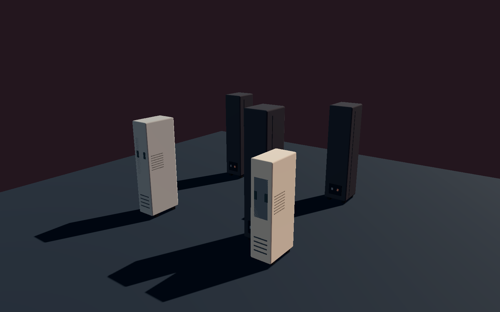

# 复古竖式音响与窄主机

2026-11-06。基于聚拢完成版 25ebf56，仅增加装饰设备，未改十二台 CRT 布局、外壳、承托对象、屏幕映射和游戏规则。

## 已加入场景

全部由 Godot GDScript 原生几何生成，复用 Craft 的圆角网格、材质和静态批次；不是平面贴图或长方体占位。贴纸继续使用用户素材。

| 新增设备 | 位置 X / Z | 宽 / 深 / 高（场景单位） | 细节 |
| --- | --- | --- | --- |
| 深灰音响 A | -3.3 / 3.6 | 1.25 / 1.55 / 5.0 | 三个立体单元、环形悬边、锥形振膜、防尘帽、低音口饰圈、螺丝、箱体接缝、后接线端子 |
| 黑色音响 B | 3.3 / 3.5 | 1.15 / 1.50 / 5.0 | 同上，窄箱体 |
| 深灰音响 C | -2.5 / -2.4 | 1.15 / 1.50 / 5.6 | 同上，后方高箱体 |
| 米白主机 A | -3.6 / -3.4 | 0.95 / 1.75 / 4.1 | 驱动器托盘、插槽、弹出键、电源键、指示灯、散热槽、侧板、后接口和扩展槽 |
| 灰色主机 B | 3.1 / -3.2 | 0.95 / 1.75 / 4.6 | 同上，高机箱 |

尺寸为包络设计范围，主体稍小以容纳脚垫和面板细节。每件有四个实体橡胶脚，底面直接接触原地台 y=-1.1；不会成为 CRT 的支撑。前两只音响露出喇叭和侧面，后方三件部分藏在电脑之间，保持电脑为主视觉。

## 正面前后对比

同机位、相同渲染设置的原生游戏截图，1600×1000，未修图。

| 增加前 | 增加后 |
| --- | --- |
|  |  |

## 左右与背面实机

| 左侧 | 右侧 |
| --- | --- |
|  |  |



## 模型独立检视

以下两张是验证用的 Godot 原生渲染：临时隐藏 CRT 和其他布景，保留五件新增设备及地台，以展示完整厚度和前后细节。实际游戏保持上方截图的全部 CRT 和布景。





## 验证

- 几何、落地、屏幕映射、十二台聚焦视线、72 个整圈视角：55/55 通过。
- 新设备之间、与 CRT、与塔内既有大件装饰的组件旋转包围盒穿插：0；新增五件均有完整实体组件与地台接触，没有物理玩法节点。
- 十二台 CRT 承托：12/12，通过，无新增装饰承托。
- 真实显卡玩法与环境回归：89/89，通过，包含跨屏传送往返与失败恢复、关卡机关、存档及 720×900 竖屏。
- 最终两组运行的错误日志均为空。

代码入口是 `scripts/exterior_dressing.gd` 的 `build_fillers()`；`scripts/main.gd` 在既有装饰批处理后调用一次。验证复用 `tests/crt_geometry_qa.gd` 和 `tools/check_crt_stack.py`：

```powershell
.\.tools\godot\Godot_v4.7.2-stable_win64_console.exe --path . --script res://tests/crt_geometry_qa.gd -- --qa
python tools/check_crt_stack.py
.\.tools\godot\Godot_v4.7.2-stable_win64_console.exe --path . -- --qa --environment-qa
```

QA 不访问正式玩家存档；独立检视仅发生在 QA 拍摄末尾，不进入正常游戏。
