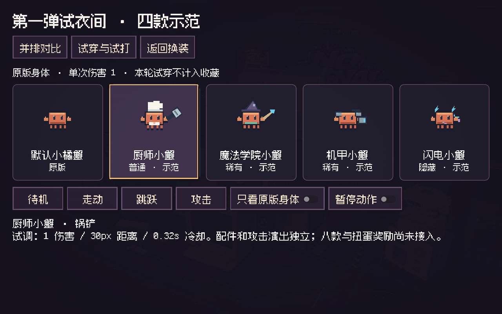
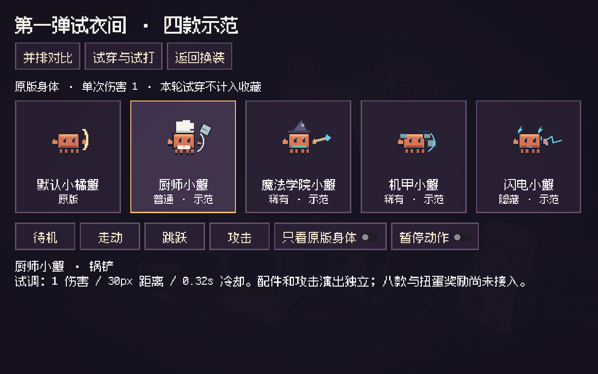
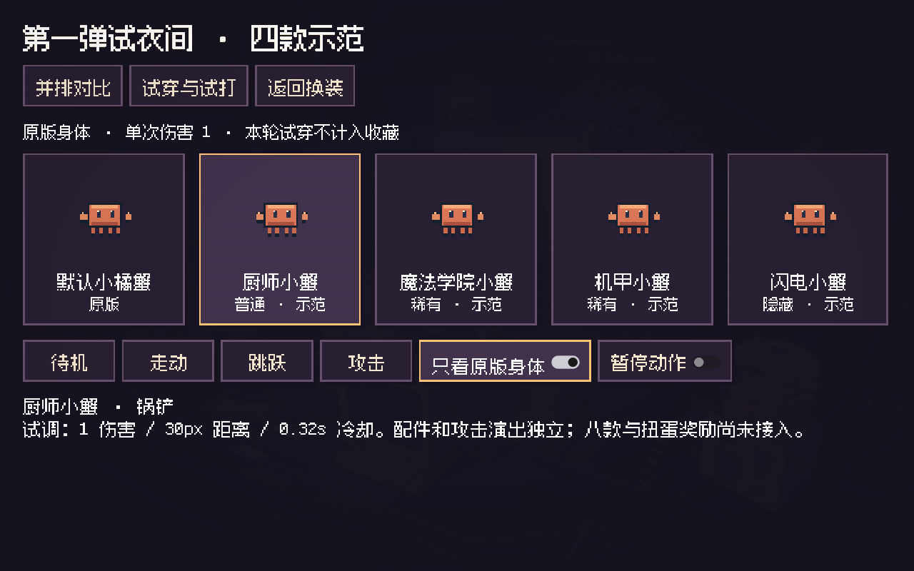
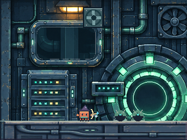
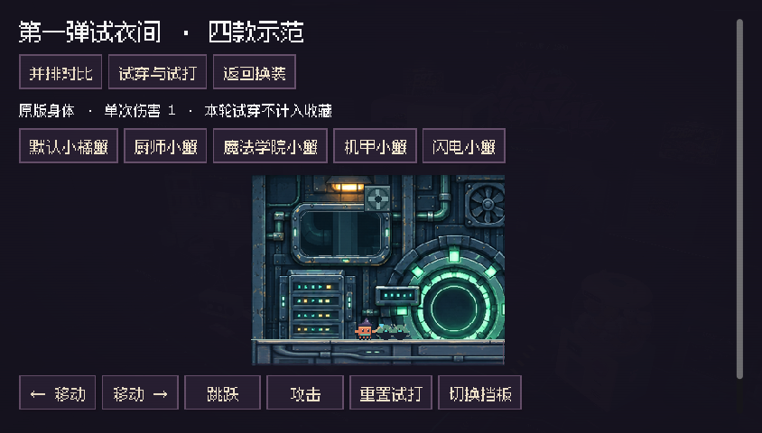

# 第一弹皮肤：四款可运行示范

> 本页为阶段一归档。当前已补齐八款示范，入口名称和功能范围见 [阶段二说明](SKIN_DRAFTS_STAGE2.md)。

本次交付原版与厨师、魔法学院、机甲、闪电的对比页，以及独立试打区。素材包只有 DOCX 与 JSON 草案，没有成品图片；本轮配件和武器是按现有小橘蟹绘图体系制作的像素示范。

入口：主菜单 → 更换服装 → **第一弹试衣间 · 四款示范**。




## 本轮范围

| 示范 | 配件与攻击演出 | 试打距离 | 试打冷却 |
| --- | --- | --- | --- |
| 厨师小蟹 | 白色厨师帽、短围裙、锅铲挥击 | 30px | 0.32s |
| 魔法学院小蟹 | 小巫师帽、学院围巾、小魔杖与短弹体 | 42px | 0.40s |
| 机甲小蟹 | 背部模块、轻肩甲、机械拳套 | 28px | 0.42s |
| 闪电小蟹 | 青色钳饰、背部小模块、短电弧 | 30px | 0.32s |

一次攻击最多伤害一个目标，伤害为 1。没有附加状态、移动增益、额外按键或解谜能力。试打区中的原版采用相同单目标规则，便于对比；正式冒险里的原版钳击没有修改。

八款原始提案完整保存在 `data/skin_drafts.json`，但运行时只开放上述四款和原版。海盗、音乐家、头号玩家、天界四款，以及八款正式解锁、装备、扭蛋分配和存档迁移，均未实施。先用本次实机示范评审方向，再扩展其余四款。

## 身体与分层方式

- 身体直接读取现有 `assets/pixel/skins/classic_orange.png`，不重新描画本体，也不覆盖原始资源。
- 原图 8 列、6 行，共 48 帧。身体、眼睛、钳子、四条腿逐像素保留，原色仍为 `#D97757`。
- 仅在运行时身体副本中分离攻击行原有的金色弧线墨色 `#F7E6AA`，让新武器演出不会叠上旧钳击弧线。该操作不修改磁盘图片；只看身体时可直观看到五张相同身体。
- 背部小模块在身体后方，帽子、围裙、肩甲和武器在身体前方；朝向跟随现有角色，武器动画使用现有攻击时长。
- 图形用整数坐标和最近邻绘制。轮廓由原来的橙色方身体主导，配件只说明职业，不替换角色。



## 试打区如何隔离

试打区是单独的 320×240 `SubViewport` 和 `World2D`，复用真实 `SideCrab`、`DataBug` 与 BOOT 环境。保留原来的 12×18 碰撞体、移动和跳跃控制；清空场景机关、梯子、箱子、传送和原关卡路牌，设置一块真实地面与两只静止靶虫。

试打区断开的是它自己角色的攻击信号，接到独立的单目标命中处理。学院短弹体用扫掠射线命中第一个敌人或真实挡板，耗尽距离即消失，不穿墙、不穿透、不触发机关。近战也检查挡板遮挡。

正式角色脚本、正式关卡命中处理、六关地图、皮肤目录、动物扭蛋和存档格式没有改动。试打只创建新的内存进度字典，不读写或装备到正式进度。切换皮肤或重置时清掉输入；Esc 先回对比，再回原换装页。

操作：A/D 移动、空格跳跃、J 攻击，也可用页面按钮。“切换挡板”用于检查遮挡，“重置试打”恢复靶虫。试打期间空格优先跳跃，避免误触仍有焦点的菜单按钮；Enter 继续用于菜单选择。

## 实机证据与检查

Windows Godot **4.7.2 stable / GL Compatibility** 实际运行并截图，未录制视频。`skin_drafts_evidence` 同时保存全页面和原生 320×240 画面，便于检查细节与整体 UI。

人工核对：原版加四款同屏、帽子不遮眼、橙色主体与四腿保留、武器跟随朝向、近战和弹体演出、真实地面接触、挡板遮挡，以及 844×480 横屏下控件与滚动可达性。图片均来自 Godot 渲染，没有后期绘制角色或拼接效果。

- 皮肤专项：headless 与实机各 **35 项通过**。覆盖原版像素、碰撞、左右朝向、伤害和单目标上限、弹体挡板与射程、真实移动跳跃、Space/J 键事件、按钮点击与释放、Esc 返回，以及进度/装备/动物收藏不变。
- 旧菜单与换装回归：**49 项通过**，包括购买、装备、旧档迁移、写盘失败与返回流程。
- 六关连续流程：**118 项通过**，包括六关修复、九个宝箱、最终交付、原子写盘与完整重载，详见 `campaign-headless.json`。
- 三份包内原文件逐字节比对一致，全部八款 JSON 提案保留；哈希见 `source-verification.json`。

未完成手机真机、多指同时操作与控制器验收。本次横屏截图是桌面窗口尺寸验证；正式皮肤解锁和扭蛋迁移也不在这轮测试范围内。




复跑命令（在 Godot 项目目录，`godot` 替换为本机引擎路径）：

```powershell
godot --headless --path . -- --qa --menu-qa --skins-qa
godot --path . -- --qa --menu-qa --skins-qa
godot --headless --path . -- --qa --menu-qa
godot --headless --path . -- --qa --chapter-qa
```

## 文件入口与后续接入

`scripts/skins/skin_drafts.gd` 管理启用清单、身体副本与配件绘制；`skin_portrait.gd` 用于并排预览；`skin_draft_rig.gd` 跟随真实角色；`skin_lab_shot.gd` 处理试打弹体；`skin_studio.gd` 管理页面、输入和隔离试打区。`front_end.gd` 只增加入口和返回逻辑，`main.gd` 只增加专项 QA 启动参数。

原始设计文件存于 `design/skins_v1/source/`。源文件作为设计资料保留，未执行其中外部指令，也未使用文档提到的外部项目代码或素材。

后续应先评审四款的配件比例和攻击节奏。确定后，补齐其余四款，再通过单独的奖励表和可回滚存档迁移接入正式换装；保留现有动物 ID、收藏、装备与晶体记录，避免把试衣阶段的草案直接当成已拥有物品。
