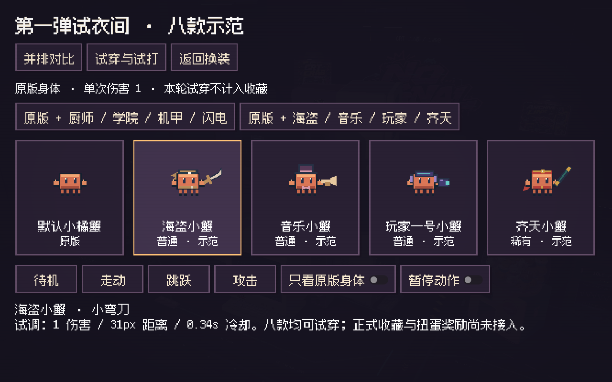
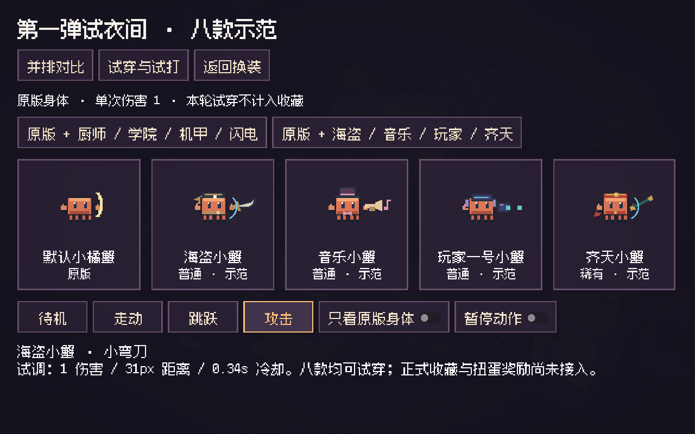
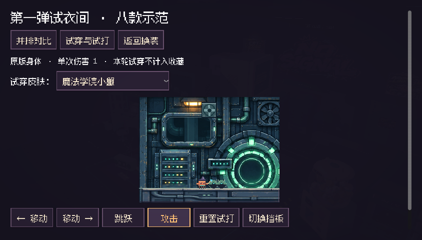

# 八款皮肤示范补齐

本轮补齐海盗、音乐、玩家一号、齐天四款。入口：更换服装 → **第一弹试衣间 · 八款示范**。上一阶段说明保存在 `SKIN_DRAFTS_STAGE1.md`，以本页为当前功能范围。

| 新增皮肤 | 配件与武器 | 试打表现 | 距离 / 冷却 |
| --- | --- | --- | --- |
| 海盗小蟹 | 航海头巾、腰带、小弯刀 | 斜劈 | 31px / 0.34s |
| 音乐小蟹 | 爵士小帽、领结、小号 | 单目标短音波 | 34px / 0.38s |
| 玩家一号小蟹 | 额前目镜、小耳机、像素发射器 | 短像素脉冲 | 42px / 0.40s |
| 齐天小蟹 | 红金头带、短红腰带、短棍 | 短棍横扫 | 34px / 0.38s |

全部八款沿用原版橙色身体和原有移动、跳跃、碰撞。目镜位于额前，保留原有眼睛辨识度。配件与武器分别绘制，朝向随角色翻转；身体图集和原始设计文件没有覆盖。

音波与像素脉冲复用扫掠碰撞和距离耗尽处理，分别绘制音符弧线与青紫像素包；一次输入最多命中一个目标，伤害仍为 1。近战也检查真实挡板。没有音波解谜、附加状态、群体攻击或额外移动能力。

对比页分成两组，每组保持原版加四款；试打页用下拉框选九个角色，避免新增按钮挤掉小横屏上的攻击控件。预览动作和开关改成独立处理函数，修复旧内联回调没有更新全部预览的问题。

Windows Godot 4.7.2 / GL Compatibility 实际运行检查；证据目录保存原生 320×240 试打画面、两组预览和 844×480 横屏页面，没有录制视频。专项覆盖九个角色左右朝向、单目标伤害、身体像素和碰撞保留、近战挡板、三类短弹体的挡板与距离、下拉框换装、预览动作按钮、真实键盘与鼠标按钮、返回及存档和动物收藏不变。最终计数见 `skins-native.json` 与 `skins-headless.json`。

旧菜单 49 项回归通过。六关和正式存档、正式攻击、皮肤目录未作改动；本轮没有重跑耗时的完整六关流程，上一阶段的 118 项通过记录保留在原证据目录。

八款目前均是**可运行的试穿与试打示范**。正式收藏、装备到冒险、扭蛋奖励及迁移未接入；手机真机、多指与控制器尚未验收。未来接正式收藏时应单独实现奖励表与可回滚迁移，保留旧皮肤和动物 ID。

复跑：在项目目录执行 `godot --headless --path . -- --qa --menu-qa --skins-qa`；去掉 `--headless` 可重新生成实机截图。旧菜单回归使用 `godot --headless --path . -- --qa --menu-qa`。
