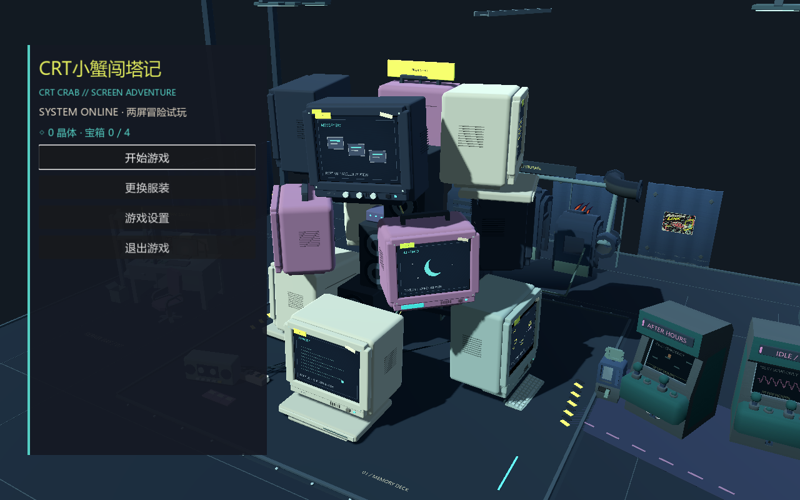

# 第二阶段交付与验证

## 1. Git 分支与提交

实现分支：`codex/stage-two`。功能提交：`9c30224c8c2ec9074cae584e56ee630694902026`。回退基线：`f9e6ae5f23c768d3927eca4e186c46650bb680e0`。本报告及证据由随后文档提交补齐，一并推送 main。Godot 4.7.2 stable，Windows，OpenGL Compatibility。

## 2. 变更文件

- `scripts/save_store.gd`：v3、格式校验、损坏/未来版本写入保护、旧版备份、同步购买与装备事务、新游戏备份与保留衣橱。
- `data/cosmetics.json`、`scripts/cosmetics.gd`、`assets/pixel/skins/`、`tools/build_pixel_assets.py`：四款配置、共享取帧、四套六行八帧动作及可复现作者工具。
- `scripts/front_end.gd`：主菜单、衣橱、购买确认、预览、设置、键鼠焦点与滚动。
- `scripts/main.gd`、`hud.gd`：菜单/关卡生命周期、输入状态、返回菜单、存档失败反馈、出生点检测、三段传送与回滚。
- `scripts/portal_fx_2d.gd`、`shell_director.gd`、`side_crab.gd`、`audio.gd`：真实角色像素采样、镜头进度回调、服装映射、短合成音效及持久设置。
- `tests/stage2_qa.gd`、`sideview_qa.gd`、`performance_probe.gd`：新增专项、原流程追加恢复检查、传送耗时采样。
- 内外两份 README、素材表、进度记录与本报告。未修改关卡布局、三层十二台 CRT 布局、原塔装饰和外围分区结构。

## 3. 已实现

| 范围 | 实际行为 |
|---|---|
| 主菜单 | 正式启动停在塔实景菜单；无档开始，有档继续/新游戏；换装、设置和退出有效。标题没有可操作 2D 世界，停留/关闭不隐式保存冒险。 |
| 返回流程 | 暂停先保存再返回主菜单，失败停留原关卡。只卸载 2D 世界，塔/音乐保留同一实例；继续后恢复关卡与安全位置。 |
| 衣橱 | 默认橘蟹、银壳眼镜、赛博耳机、故障款；同一取帧入口用于真实预览及实体。待机/走动/钳击和预览暂停；选卡、确认购买、装备分开。 |
| 晶体 | 银壳6、赛博8；同步写盘成功才发布余额和持有状态。重复购买不扣款，失败保持原余额/外观。回血仍1晶体1心；服装不改变物理。 |
| 隐藏款 | archive_hidden 首次领取解锁；已有该宝箱的 v2 旧档补解锁，未重复发晶体。 |
| 设置 | 音乐开关/音量、音效开关/音量、减少动态、环境微动态、原生全屏；写入独立 audio.cfg。继续复用用户指定 209 秒 NO SIGNAL 完整版。 |
| 三段传送 | EXIT 0.25s 原屏内按当前动作/皮肤像素分解；LINK 1.0s 真实插口间数据线及亮点/塔镜头；ENTER 0.30s 目标屏内重组及微弱涟漪。单个活跃 320×240 画布；原屏冻结无可玩的第二只蟹。 |
| 减少动态 | 0.1s 淡出 + 0.35s 稳定机位短切 + 0.1s 淡入，无碎片和跑线亮点。转场期间锁定角色、敌人、暂停/复位/多次传送。 |
| 失败恢复 | 无效路由拒绝，目标失效/出生点被堵时恢复原角色、旗标、画面和输入，显示 NO SIGNAL。写盘失败有独立提示。 |
| 灵感 | README 明确 Diamond Rush 机制灵感与本作跨 CRT 持续信号，保留独立角色/用户图片的来源说明。 |

## 4. 未实现或仅占位

没有将新关卡、Boss、付费提示、屏幕主题、唱片解锁、平台导出或手机触控写成完成。本次没有占位菜单按钮或概念图替代功能。没有添加可选机器人语音，使用代码合成电子短音。画面仍为当前试玩的像素/低模精度，尚非商业美术精修。

## 5. 存档迁移与备份

正式进度仍为原 `user://progress.json`，不更改已有用户目录。

- v2 读入后补 v3 衣橱/started，保留生命、晶体、宝箱、拾取、旗标、两屏世界状态与位置；先保留 `progress.json.v2-backup`。
- v1 保留 `progress.json.v1-backup` 和 legacy_progress，从新 2D BOOT 安全入口接续；旧 3D 坐标/奖励不映射成新谜题完成。
- 损坏 JSON、结构异常、未来版本或迁移备份失败时，停止自动覆盖。恢复/新游戏经用户确认，先备份原文件。
- 新游戏先保存 `progress.json.before-new-<时间戳>`，成功后清空冒险进度、晶体与宝箱，保留衣橱和设置；取消不变化。备份或写盘失败不提交新数据。
- 音乐、音效和画面设置独立保存 `user://audio.cfg`；不会因切换冒险存档丢失。

## 6. 测试命令与结果

原回归加环境检查：headless **86/86**、真实 Windows GPU **88/88**。第二阶段专项：headless **46/46**、真实 GPU **46/46**。导入通过，两类 GPU stderr 与性能 stderr 均为空。四款图集由仓库作者工具重新生成到隔离目录，与实际使用 PNG 逐字节一致。

```text
--headless --editor --path . --quit
--headless --path . --fixed-fps 60 --quit-after 15000 -- --qa --environment-qa
--path . --fixed-fps 60 --quit-after 15000 -- --qa --environment-qa
--headless --path . --fixed-fps 60 --quit-after 5000 -- --qa --menu-qa
--path . --fixed-fps 60 --quit-after 8000 -- --qa --menu-qa
--path . -- --perf --transfer-perf
```

原流程仍由正常走跳/推拉/梯子/攻击/开箱/端口输入走完 BOOT→ARCHIVE→BOOT→ARCHIVE，验证重石信号、唯一奖励、R、死亡和磁盘重载。

专项使用独立经济/迁移/外观与转场场景：0/5/6/8/14/17 晶体、重复购买、不可写路径、坏/未来存档原文不变、v2迁移备份及隐藏款、新游戏确认/取消、购买/装备分离、实际键盘 Enter 和鼠标输入、重载外观与余额、继续位置、保存失败不离开关卡、两种动态模式及堵塞目标的完整回滚。退出经过实际绑定的“退出游戏”按钮，日志标记 QA_EXIT_BUTTON，进程正常结束。

QA 初始化即禁用正式存档与正式设置读取；专项显式写入仅 `qa-stage2-<进程号>*`，音频用例仅 `qa-audio-<进程号>.cfg`，最后清理。经济/外观边界用独立夹具，不冒称真实游玩赚取；银壳实际验证了入关、动作、两方向切屏与重载，四款共用同一动画入口。

原始 JSON：[核心 headless](stage2_evidence/sideview-qa-headless.json)、[核心 GPU](stage2_evidence/sideview-qa-visual.json)、[专项 headless](stage2_evidence/stage2-qa-headless.json)、[专项 GPU](stage2_evidence/stage2-qa-visual.json)。

## 7. 实测画面

全部是 Godot 实际渲染；鼠标/键盘事件进入真实窗口 GUI，未用静态设计稿代替交互。横向 1280×800，竖窗口 720×900。-screen 图片为同一时刻的真实 320×240 画布。

- [主菜单](stage2_evidence/stage2-title.png) / [竖窗口](stage2_evidence/stage2-title-portrait.png)
- [购买确认](stage2_evidence/stage2-purchase-confirm.png) / [装备后衣橱](stage2_evidence/stage2-wardrobe.png) / [竖窗口衣橱](stage2_evidence/stage2-wardrobe-portrait.png)
- [设置](stage2_evidence/stage2-settings.png) / [暂停返回入口](stage2_evidence/m2-pause.png)
- [EXIT](stage2_evidence/stage2-transfer-exit.png) / [LINK](stage2_evidence/stage2-transfer-link.png) / [ENTER](stage2_evidence/stage2-transfer-enter.png) / [完成](stage2_evidence/stage2-transfer-complete.png)
- [传送关键帧 GIF](stage2_evidence/transfer.gif)：按真实运行顺序编码四个关键帧；是关键帧演示，非实时录像。
- [原 BOOT](stage2_evidence/m1-01-boot.png) / [原 ARCHIVE](stage2_evidence/m2-05-archive.png)



## 8. 性能变化

基线从 f9e6ae5 独立归档、重新导入并实际运行；不是复用更早环境阶段数据。同 RTX 5060 Ti、同分辨率与三视角；每方向2.5秒，真实墙钟强制 OpenGL 绘制 + GPU读回，无固定时间步。两次均关闭关卡物理及自动 BGM，保留同一320×240内屏。包含读回开销，**不是稳定交互 FPS、纯 GPU 帧时间或显存保证**。

[基线 JSON](stage2_evidence/stage2-baseline-performance.json) / [当前 JSON](stage2_evidence/stage2-final-performance.json)。

| 视角 | 前中位数/P95 ms | 后中位数/P95 ms | 中位数变化 | draw calls 前→后 | 引擎静态内存 MiB 前→后 |
|---|---:|---:|---:|---:|---:|
| active | 19.010/19.753 | 18.562/19.266 | -2.4% | 841→842 | 86.37→87.29 |
| front | 19.529/20.295 | 19.055/20.678 | -2.4% | 861→862 | 86.42→87.34 |
| back | 19.598/20.203 | 20.821/22.000 | +6.2% | 871→872 | 86.42→87.34 |

单次传送也实际采样绘制读回：

| 阶段 | 样本数 | 中位数/P95 ms |
|---|---:|---:|
| EXIT | 8 | 20.814/21.934 |
| LINK | 30 | 20.902/21.991 |
| ENTER | 9 | 20.912/21.452 |

静态样本中位数最差 +6.2%，没有降低内屏分辨率或更新频率；传送各阶段 P95 约 24ms，仍含读回。样本短、受窗口调度与时钟波动影响；不能据此承诺低端机帧率。

## 9. 已知边界与下一步

当前自动检查无失败；菜单减少动态开关还单独验证了镜头立即静止。未做低配置 GPU、手机、多小时手动试玩、真实断电/磁盘硬故障验收；磁盘失败覆盖了实际无效写入路径。全屏使用 Godot 原生窗口模式，QA 保持窗口，尚未手工验证多显示器切换。图集一致性与共享映射已验证，仍需要玩家手动试玩评估各套装小尺寸辨识度和传送节奏。

两关共17晶体；两套付费皮肤共14，回血超过三次可能本轮买不齐，但不阻塞主线。新游戏保留衣橱，明确允许玩家重玩，不引入账号/联网经济。之后应先收集试玩反馈，再扩第三关。
