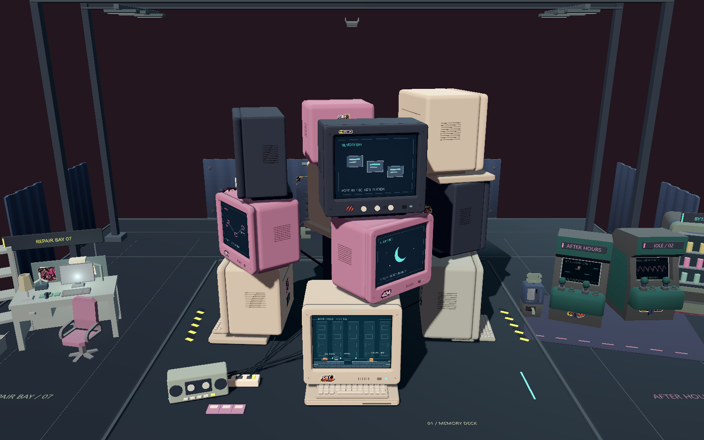
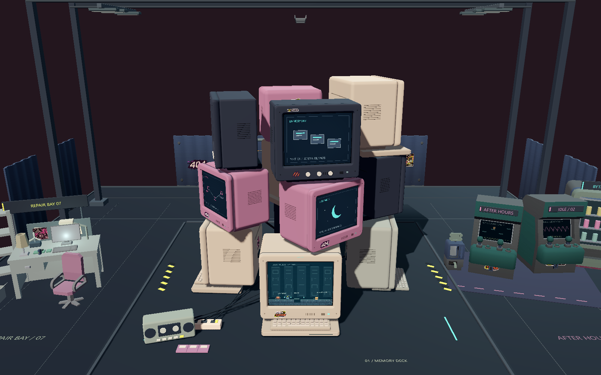
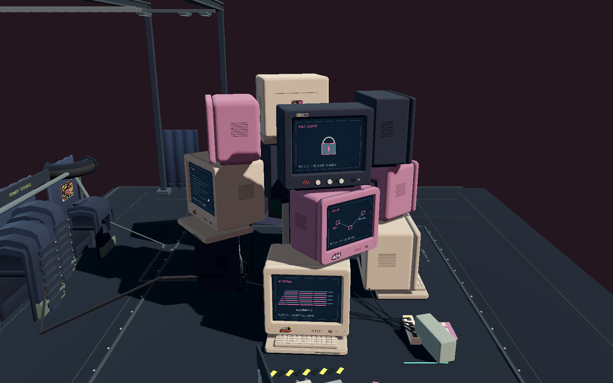
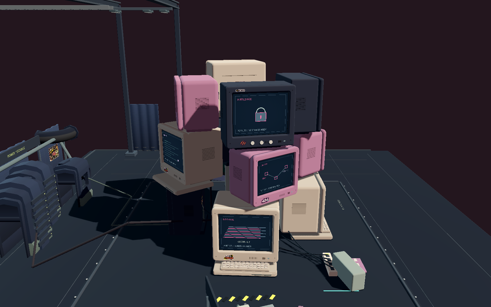
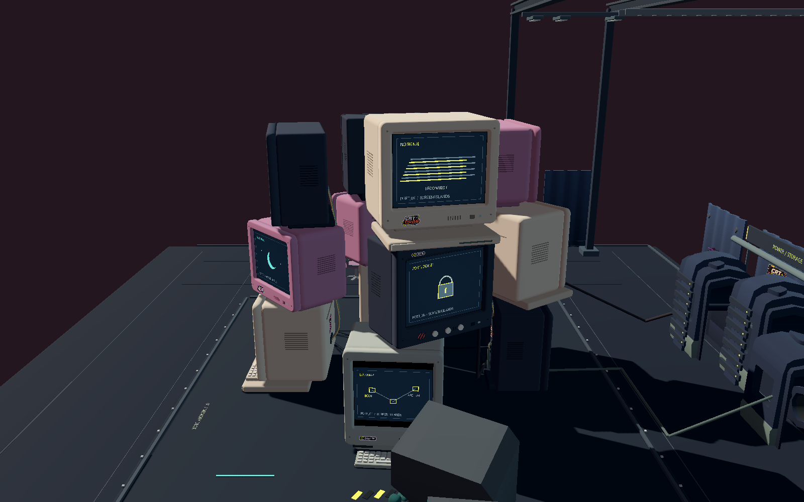
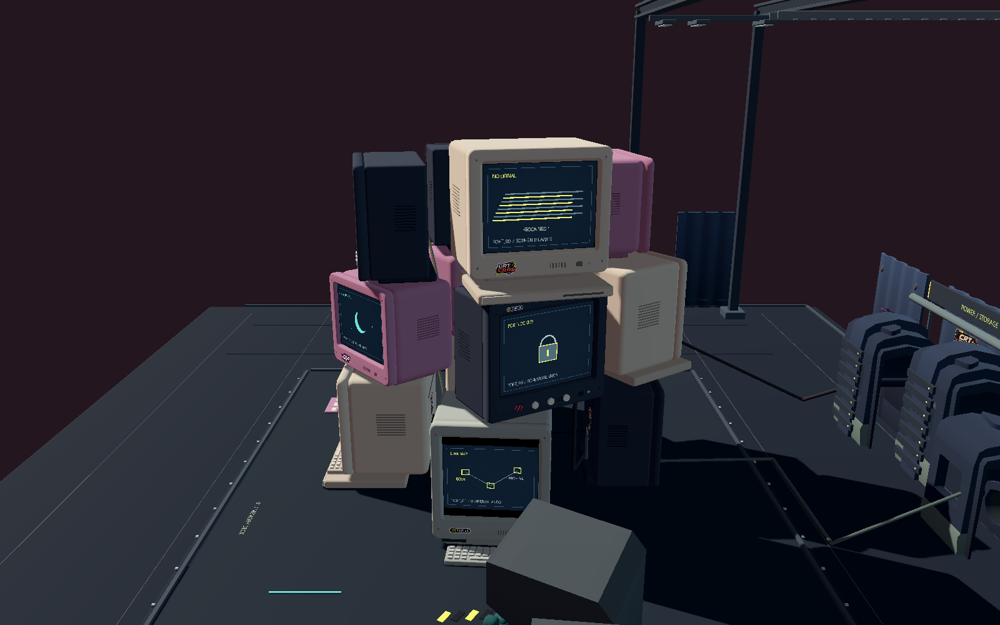

# CRT 电脑塔聚拢对比

2026-11-06。修改前基线：e7e9cce（上次外壳与承托修复完成版）。

## 结果与范围

仅更改 `data/monitor_layout.json` 十二台电脑的水平位置：保持原有高度、机型、朝向、键盘配置、三层承托对象及关卡 ID 不变，把 X/Z 向现有塔心收紧 16%。没有改动外壳、底脚、面框、既有音箱、布景、屏幕玩法或传送逻辑。

以 8%、12%、16%、20% 的小步候选做几何校验，选择 16% 的版本进行实机检查。左右纵向空洞缩小，同时保留层间错位与局部透空；没有再加填充物，避免遮挡与挤成实心方块。

十二台中心的左右跨度由 12.600 缩为 10.584 场景单位。单台水平移位约 0.81–1.03 单位，远小于约 5 单位的标准机壳宽度。此数值描述中心位置变化，不是机壳缩放。

## 同机位实机前后对比

1600×1000 原始 Godot 截图，未修图、未缩放电脑模型。前后相机完全相同：高度 17、水平距离 34、目标 (0, 6.4, 0)、FOV 43°。下表左为修改前，右为修改后；完整 PNG 可单独打开。

| 方向 | 修改前 | 修改后 |
| --- | --- | --- |
| 正面 +Z |  |  |
| 左侧 -X |  |  |
| 右侧 +X |  |  |

## 位置增量

单位为场景单位，Y 高度与 rotation 均未变化。

| 电脑 | X 增量 | Z 增量 | 原承托关系 |
| --- | ---: | ---: | --- |
| 00 / BOOT | +0.000 | -0.976 | 保留 |
| 01 / SLEEP_1 | -1.024 | -0.048 | 保留 |
| 02 / SLEEP_2 | -0.064 | +0.976 | 保留 |
| 03 / SLEEP_3 | +0.992 | -0.016 | 保留 |
| 04 / SLEEP_4 | -0.256 | -0.896 | 保留 |
| 05 / ARCHIVE | -0.912 | +0.176 | 保留 |
| 06 / SLEEP_6 | +0.016 | +0.960 | 保留 |
| 07 / SLEEP_7 | +0.912 | -0.272 | 保留 |
| 08 / SLEEP_8 | -0.144 | -0.800 | 保留 |
| 09 / SLEEP_9 | -0.880 | +0.192 | 保留 |
| 10 / SLEEP_10 | +0.160 | +0.816 | 保留 |
| 11 / SLEEP_11 | +0.816 | -0.144 | 保留 |

## 验证

- 十二台承托检查：12/12，通过；接触面间隙绝对值 < 0.0001。
- CRT 之间的组件包围盒穿插：0；与既有塔内大件装饰的穿插：0；意外装饰承托：0；低于地台的组件：0。
- 沿用原机壳均匀密度包围体估算并累计上层质量，最小载荷重心承托余量为 0.2918，调整前为 0.2204。此为几何稳定性估算，不是实物材料强度仿真。
- 网格、映射、状态文字、360° 相机及聚焦视线：49/49 通过。新增十二台聚焦视线检查，每台检查玻璃中心与四角、贴纸、按钮、指示灯；其他 CRT 的网格与批次包围盒均未遮挡这些目标。
- 显卡渲染的实际玩法与环境回归：89/89，通过。包括 BOOT/ARCHIVE 往返、传送失败回滚、关卡机关、存档、暂停及 720×900 竖屏。
- 两轮最终运行的标准错误日志均为空。

新增的验证在既有 `tests/crt_geometry_qa.gd` 中；运行：

```powershell
.\.tools\godot\Godot_v4.7.2-stable_win64_console.exe --path . --script res://tests/crt_geometry_qa.gd -- --qa
python tools/check_crt_stack.py
.\.tools\godot\Godot_v4.7.2-stable_win64_console.exe --path . -- --qa --environment-qa
```

原始截图与校验结果见 [tower_spacing_evidence](tower_spacing_evidence)。QA 不读取或改写正式玩家存档。
