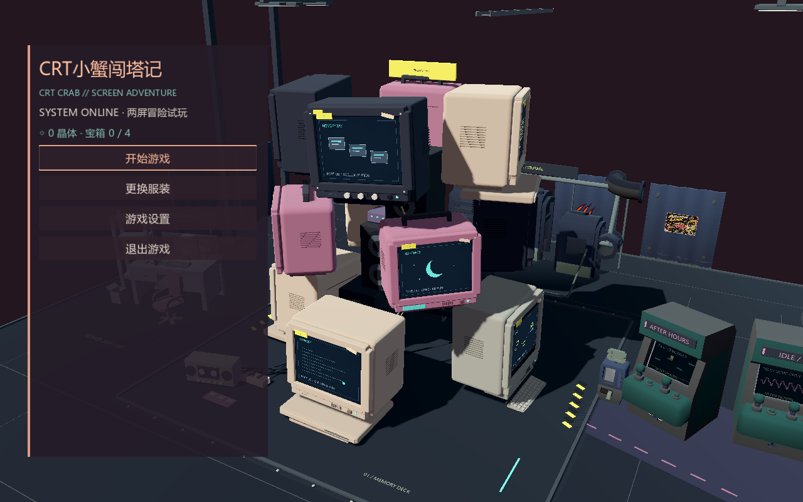

# 暖夜色调微调

基线 main 8b1d88b；本轮只修改 main.gd 的环境/灯色和 front_end.gd 的菜单配色。没有改布局、镜头、机壳材质底色、关卡、存档或换装/购买流程。

背景 #121a22 → #20171e，菜单 #151923ee → #241c28e0，底板略增透明。标题/焦点转为蜜桃橙，普通字保留奶白，少量青绿作冷色对比。按钮复制原样式，仅改颜色，保留原边距、边框宽度和焦点导航。

主光 #d4e5e4 → #f3deca，补光 #6b91bf → #6b94a9；环境光转为浅紫灰 #b4a1b1。主光、环境光、补光能量仍分别为 0.70/0.28/0.35，曝光和 Filmic 映射不变。内置五点 LUT 给中间调极弱橙粉偏移，保留纯黑/纯白端点，不添加 Bloom、模糊或全屏覆盖层。[Godot 环境颜色校正](https://docs.godotengine.org/en/stable/classes/class_environment.html#class-environment-property-adjustment-color-correction)。粉紫与奶白显示器原材质没有修改。

[同机位调整前](warm_night_evidence/before.png) / [调整后](warm_night_evidence/after.png) / [竖窗口](warm_night_evidence/portrait.png) / [衣橱](warm_night_evidence/wardrobe.png) / [BOOT 活动屏幕](warm_night_evidence/boot.png)。参考主体区域 x470..999、y100..699，原图加权亮度>45像素，平均8位 RGB加权亮度111.56→109.45（约 -1.9%）；用于确认亮度近似保持，不是逐材质测光。

菜单专项 headless 46/46、真实 GPU 46/46；原玩法 GPU 71/71，包括两屏往返、存档、购买以外的机关/战斗与新增失败恢复。两组 GPU stderr 为空。测试命令沿用 --qa --menu-qa 及 --qa；仅独立 QA 文件，不访问正式存档。没有为此次调色新增测试逻辑，也未重测性能。

