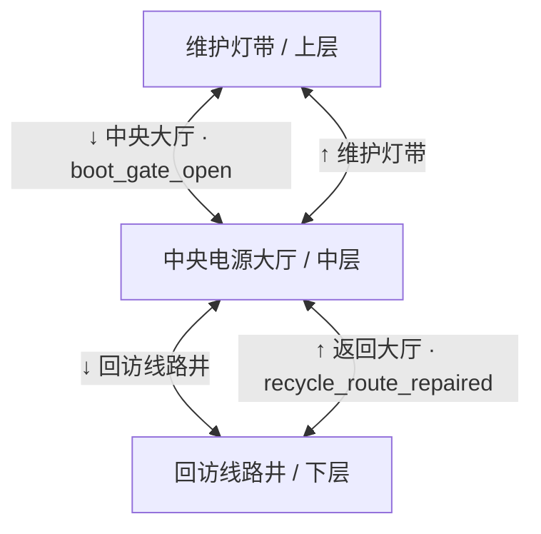
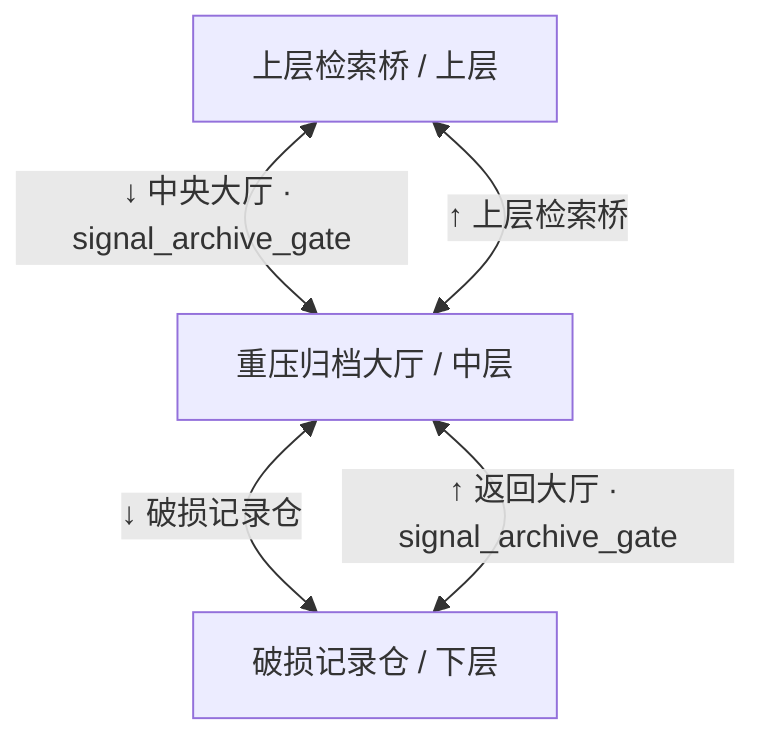
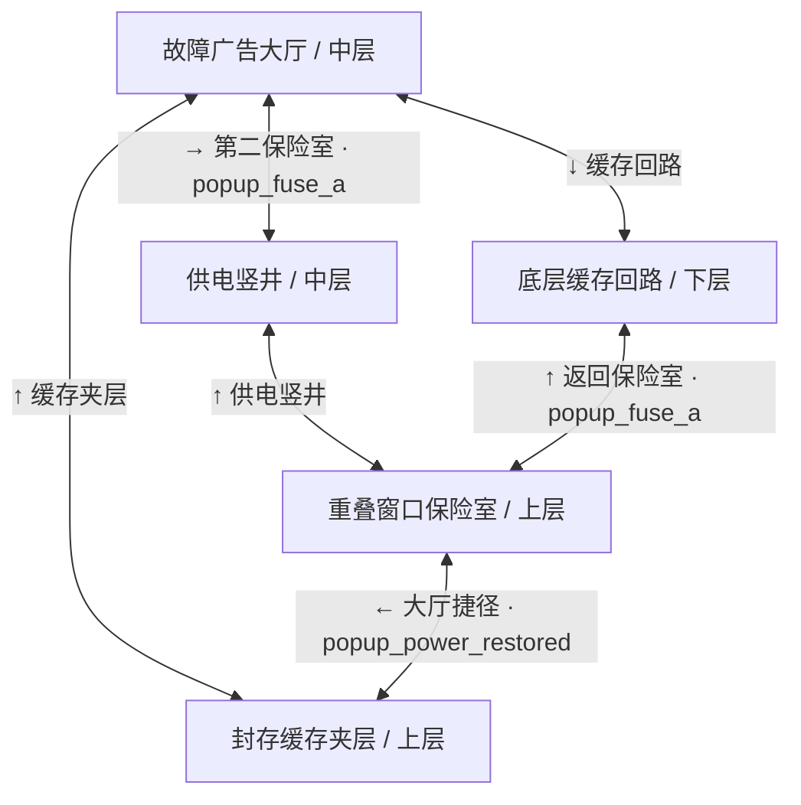
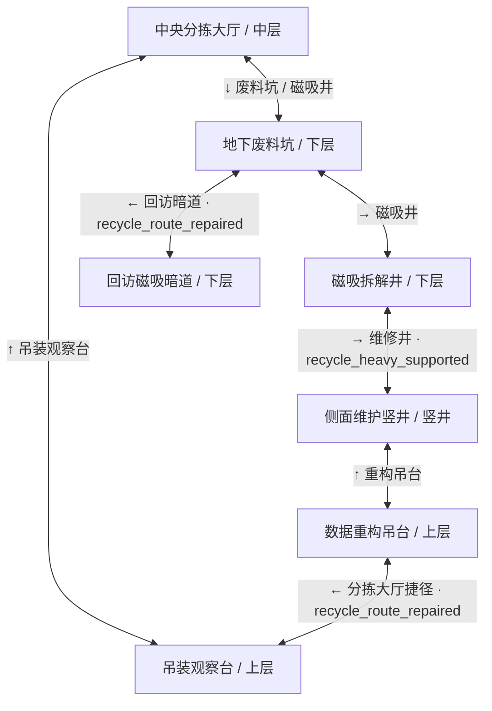
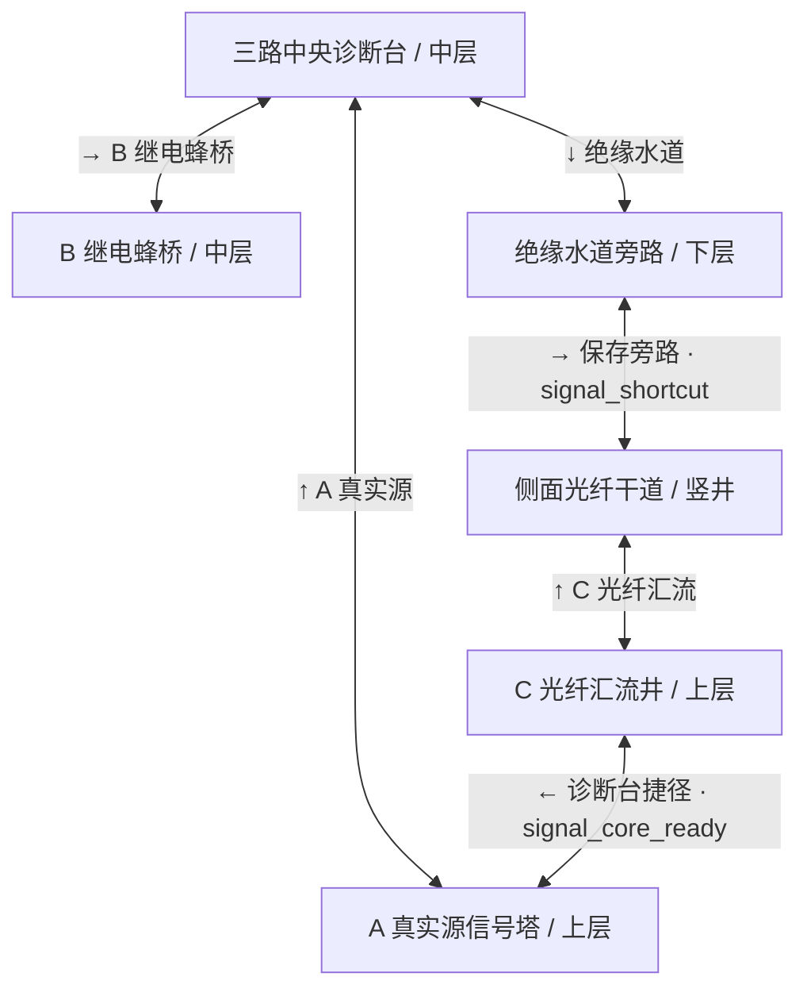
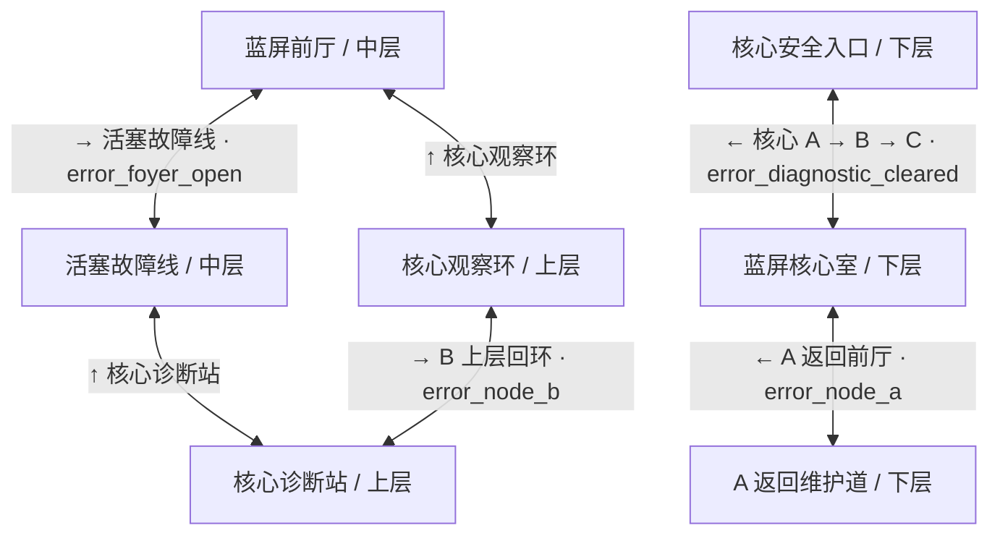

# 六关拓扑对照（布局 v2）

旧：BOOT/ARCHIVE 横向一层；后四关通过 E 端口逐间切换。
新：每关一个连续物理空间；下列每条边均为可步行或攀爬的双向连接。跨 CRT 端口另行保留。

## BOOT · 1024 × 640

## ARCHIVE · 1024 × 640

## POPUP · 1024 × 768

## RECYCLE · 1024 × 768

## SIGNAL · 1024 × 768

## ERROR · 1024 × 768

